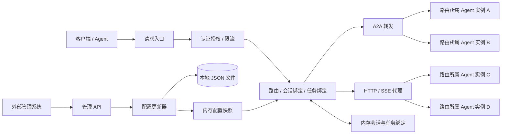

# AI Agent 网关实现方案

本文描述目标架构；当前实现、运行方式和差异见 [README.md](README.md)，开发约定见 [DEVELOPMENT.md](DEVELOPMENT.md)，验证记录见 [VALIDATION.md](VALIDATION.md)。

## 1. 目标与范围

使用 Go 构建独立网关，支持 A2A 协议转发和普通 Agent 的 HTTP / SSE 代理。通过 HTTP 管理 API 管理路由及其所属实例，请求从内存读取配置和绑定，每次管理配置更新同步写入本地文件并发布到内存，会话和任务路由绑定仅保存在内存。第一期采用单进程单节点部署，无数据库或 Redis 依赖。

一个逻辑智能体对应一个路由，路由直接包含多个提供相同能力的 Agent 实例。负载均衡和健康检查策略配置在路由上，每个实例只隶属于一个路由。根据会话 ID 将后续请求路由到此前绑定的实例，避免多轮会话在实例之间漂移。

第一期不包含 Agent 执行框架、不同能力 Agent 的任务编排、管理后台，以及普通 Agent 到 A2A 的通用适配器。

## 2. 架构



- 管理面：配置维护、版本管理、审计、运行状态查询。
- 数据面：认证授权、实例选择、协议转发、超时取消、指标和追踪。
- 配置、会话和任务绑定均从内存读取；本地文件仅用于管理配置的持久化和重启恢复。
- 会话绑定、context 别名和任务绑定不落盘，重启清空；会话粘性仅在进程运行期间且绑定有效时保证。
- 统一状态更新器串行执行所有持久化变更；只允许一个进程持有数据目录的独占锁。
- 一个网关可以代理多个上游实例，但独立网关副本之间不共享本地状态，第一期不支持多副本一致路由。

## 3. 资源模型

| 资源 | 职责 | 主要字段 |
| --- | --- | --- |
| Route | 逻辑智能体的访问入口 | ID、key、protocol、endpoints、balance_policy、health_policy、enabled、session_policy、timeout、version |
| Endpoint | 实际 Agent 服务 | ID、route_id、url、weight、state、credential_ref、version |
| SessionBinding | 会话与实例的绑定 | route_id、tenant_id、owner_id、session_id、endpoint_id、generation、last_seen_at、expires_at |
| TaskBinding | A2A 任务归属和路由 | route_id、tenant_id、owner_id、gateway_task_id、upstream_task_id、endpoint_id、session_id、status、expires_at |
| Credential | 上游认证凭据 | ID、type、加密后的凭据或外部密钥引用 |
| ConfigRevision | 配置版本 | revision、created_at |
| AuditLog | 管理变更记录 | actor、action、resource、脱敏变更内容、created_at |

同一路由的实例必须协议和能力兼容。不同能力的 Agent 使用不同路由。客户端身份来自认证结果，不能直接相信客户端传入的租户或用户头。

Endpoint ID 表示稳定的实例身份。如果服务重建后丢失了本地会话状态，即使 URL 相同也应注册为新实例。禁止通过修改 URL 将有绑定的实例悄悄替换成另一实例。

### 3.1 路由表中的多实例结构

一个 Route 表示一个逻辑 Agent，`endpoints` 直接保存其部署实例集合。每个 Endpoint 表示其中一个部署实例，拥有独立地址、权重和启停状态。例如：

| 路由 key（逻辑 Agent） | 协议 | 实例 ID | 上游地址 | 权重 | 管理状态 |
| --- | --- | --- | --- | --- | --- |
| research | a2a | research_01 | http://10.0.0.11:8000/a2a | 100 | active |
| research | a2a | research_02 | http://10.0.0.12:8000/a2a | 100 | active |
| research | a2a | research_03 | http://10.0.0.13:8000/a2a | 50 | draining |
| assistant | proxy | assistant_01 | http://10.0.0.21:8000 | 100 | active |
| assistant | proxy | assistant_02 | http://10.0.0.22:8000 | 100 | active |

表中 research 的三行是同一个路由的三个实例，不是三个独立路由。客户端只调用 `/a2a/research`，不需要知道实例地址。

内存路由表按 `routeKey` 索引，解析后的条目包含路由策略及关联实例列表。本地配置保存 `routes` 数组，每个路由内嵌 `endpoints` 数组；运行时构建按实例 ID 索引的 Map，实例的所属路由由父对象确定。增删实例后重建相关内存路由条目，既有会话绑定保持不变。

运行时的路由表与会话表关系如下；实例列表保留 draining / disabled 实例，由调度器按新会话或已有绑定分别检查是否可用：

```text
路由表（由持久化配置构建）
research
  route_id: route_123
  protocol: a2a
  balance_policy: weighted_round_robin
  endpoints:
    research_01 → http://10.0.0.11:8000/a2a  weight=100  active
    research_02 → http://10.0.0.12:8000/a2a  weight=100  active
    research_03 → http://10.0.0.13:8000/a2a  weight=50   draining

会话表（仅内存）
(tenant-A, user-A, route_123, session-A) → research_02
(tenant-A, user-A, route_123, session-B) → research_01
```

处理 `session-A` 时，先从会话表取得 `research_02`，再从该路由的实例索引解析地址及当前状态。绑定保存稳定的实例 ID，不保存实例数组下标，避免配置更新后实例顺序变化导致选错目标。若绑定指向的实例无法解析，则返回不可用，不回退到随机选择。

路由详情直接返回实例列表，无需展开参数。例如 `GET /admin/v1/routes/route_123` 返回：

```json
{
  "id": "route_123",
  "key": "research",
  "protocol": "a2a",
  "enabled": true,
  "balance_policy": "weighted_round_robin",
  "session_policy": {
    "enabled": true,
    "header": "X-Session-ID",
    "idle_ttl_seconds": 86400,
    "on_endpoint_unavailable": "fail",
    "on_expired": "reselect"
  },
  "endpoints": [
    {
      "id": "research_01",
      "url": "http://10.0.0.11:8000/a2a",
      "weight": 100,
      "state": "active"
    },
    {
      "id": "research_02",
      "url": "http://10.0.0.12:8000/a2a",
      "weight": 100,
      "state": "active"
    },
    {
      "id": "research_03",
      "url": "http://10.0.0.13:8000/a2a",
      "weight": 50,
      "state": "draining"
    }
  ]
}
```

路由详情与列表中的每个路由均包含 `endpoints`，从同一配置快照读取，保证路由策略和实例列表一致。创建路由支持内嵌实例；创建后的实例增删改使用路由下的实例 API。

### 3.2 多实例选择示例

1. `session-A` 首次调用 research：从健康且 active 的 research_01、research_02 中按权重选择，假设选中 research_02。
2. 内存保存 `(调用方, research, session-A) → research_02`，后续该会话直接访问 research_02，不再参与负载均衡。
3. `session-B` 首次调用时独立选择；权重仅影响尚未绑定的会话。
4. 新增 research_04 后，新会话可以命中它，session-A 仍访问 research_02。
5. research_02 进入 draining 后，session-A 继续访问它，新会话不再分配给它；实例故障时按既定策略返回不可用，不静默切换。

### 3.3 运行时索引

运行时结构示意如下，策略类型省略具体字段：

```go
type Snapshot struct {
    Revision uint64
    Routes   map[string]*Route // routeKey → 路由
}

type Route struct {
    ID            string
    Protocol      string
    Enabled       bool
    Session       SessionPolicy
    Timeout       TimeoutPolicy
    BalancePolicy string
    HealthPolicy  HealthPolicy
    Endpoints     map[string]*Endpoint // endpointID → 实例配置
    Ordered       []*Endpoint         // 新会话调度的稳定遍历顺序
}

type Endpoint struct {
    ID            string
    URL           *url.URL
    Weight        uint32
    State         EndpointState
    CredentialRef string
}

var current atomic.Pointer[Snapshot]
```

同一快照内 `Endpoints` 和 `Ordered` 指向相同的只读实例配置。绑定通过 `route.Endpoints[binding.EndpointID]` 定位目标；不保存快照指针，避免长寿命会话阻止旧快照回收。

健康状态和活跃请求数按 `(routeID, endpointID)` 单独维护，轮询状态按 `routeID` 维护。新快照发布时保留仍存在实例的运行状态；被删除实例的运行资源在在途请求释放后清理。创建新绑定须先取得生命周期读锁，再读取当前快照，防止等待锁期间配置已更新却仍按旧实例列表建立绑定。

## 4. 会话粘性路由

### 4.1 会话 ID 来源

每个路由显式配置会话 ID 提取方式，初版支持：

1. HTTP / SSE：默认读取 `X-Session-ID`，允许配置其他请求头。
2. A2A：支持从固定协议版本定义的 context 标识提取；也支持调用方通过 `X-Session-ID` 提前指定会话。
3. JSON body 字段提取作为后续扩展，避免透明代理默认解析所有请求体。

默认启用严格会话模式：普通代理缺少会话 ID 时返回 `400 SESSION_ID_REQUIRED`。无状态路由可显式关闭会话要求，此时每个新请求独立选择实例。

A2A 首次请求可能尚无 context ID，允许先选实例，在上游返回 context ID 后建立绑定，再将包含该标识的响应或流式事件交给客户端。调用方如需在首次响应前发送同一会话的并发请求，必须提供稳定的 `X-Session-ID`。

若同时存在请求头会话 ID 和 A2A context ID，维护两个标识到同一个内部会话的映射。若两者已绑定到不同会话或实例，返回冲突，不静默覆盖。A2A context 别名同样仅保存在内存，并按租户、调用方和路由隔离。

会话 ID 视为不透明字符串，限制长度，拒绝非法控制字符，不使用其内容推导租户身份。日志默认仅记录会话 ID 摘要。

### 4.2 绑定规则

绑定唯一键为 `(tenant_id, owner_id, route_id, session_id)`。共享会话场景后续增加显式授权，不默认允许同租户用户互相访问会话。

```text
收到请求
  → 认证、授权并定位路由
  → 提取会话 ID / A2A context ID / task ID
  → 若操作已有任务，读取任务绑定并校验会话一致性
  → 否则读取会话绑定
      → 已绑定：选择原实例
      → 未绑定：从健康且 active 的实例中选择，并原子创建绑定
  → 校验所选实例状态
  → 转发请求，刷新绑定活跃时间
```

核心保证：**有效绑定存在时，同一会话始终访问原实例；新增实例、调整权重或扩容不迁移已有会话。**

内存使用复合键索引及分片 Map，以分片锁保护绑定的查询和创建。同一复合键必须落入同一分片；持锁后重新检查绑定和实例状态，不存在才选实例并写入内存，然后放行请求，不访问文件。并发首次请求必须使用同一个最终绑定。配置删除、排空和绑定创建使用生命周期读写锁协调，锁顺序固定：配置写锁（仅管理更新需要）→ 生命周期锁 → 按分片编号升序获取绑定锁。创建绑定时持生命周期读锁，管理更新校验引用至发布配置期间持写锁，防止排空或删除与新绑定交错；锁不覆盖上游网络请求。涉及会话、context 别名和任务的多索引操作采用统一锁顺序并重新校验，避免分片后破坏绑定一致性。
一致性哈希不作为初版绑定方案：实例增减会改变部分映射，无法单独保证始终访问上次实例。

### 4.3 生命周期和过期

- 会话绑定仅在内存维护，创建、续期和清理均不写文件。
- `idle_ttl` 可按路由配置，例如 24 小时；普通请求及长连接活动刷新内存活跃时间。
- 禁止清理仍有活跃请求或未结束任务引用的绑定，并发续期和清理通过绑定锁协调。
- 空闲过期后删除绑定，不保留过期标记；下次请求按新会话重新选择实例。
- 网关重启后绑定为空，同一个会话 ID 也可能选择不同实例。网关不恢复聊天历史或上游会话状态，调用方需携带必要上下文，或由 Agent 共享会话存储。
- 绑定达到容量上限时拒绝创建新绑定，避免淘汰仍有效的会话导致无提示切换。
- A2A 已有任务操作不适用“绑定缺失则重新选择”规则，详见第 5 节。

### 4.4 故障与下线行为

| 实例状态 | 新会话 | 已绑定会话 |
| --- | --- | --- |
| active 且健康 | 参与调度 | 继续访问 |
| draining 且健康 | 不接收 | 继续访问，包括既有会话的新请求 |
| unhealthy | 不接收 | 返回 `503 SESSION_ENDPOINT_UNAVAILABLE`，保留绑定 |
| disabled | 不接收 | 返回不可用，保留绑定 |

默认不自动迁移有状态会话，也不因连接失败而重新提交请求到其他实例。已选定实例的首次调用失败后仍保留绑定，避免在上游是否执行未知的情况下改变目标。

只有路由下的实例明确共享会话和任务存储、且支持跨实例访问，才可后续为该路由启用故障转移；启用前需要验证取消、订阅和幂等语义。

排空过程：设为 draining → 等待会话和任务释放 → disabled → 删除。长寿命会话可能导致排空长期等待，管理接口展示剩余绑定和活跃请求数量。第一版不提供强制迁移；进程内有有效绑定时禁止硬删除实例。重启后内存计数归零不代表上游任务结束，删除实例前管理系统仍需确认上游已排空。

实例不能直接迁移到其他路由；需要在目标路由注册新实例，并让旧路由下的实例完成排空。有有效绑定时，禁止删除路由、修改其协议或替换被绑定实例的地址；扩容和调整权重不改变已有绑定。

## 5. A2A 协议处理

- 开工时固定协议版本及 SDK 版本，第一期只实现该版本的 JSON-RPC over HTTP 和流式交互，维护兼容性测试。
- 发布逻辑智能体的 Agent Card，接口地址指向网关，声明的能力必须被该路由的所有实例支持。
- 保留消息、任务、文件和结构化内容语义，不统一降级为聊天文本。
- 为上游任务分配网关任务 ID，在内存保存任务映射，避免不同实例的任务 ID 冲突。对支持的协议消息、流式事件、查询、取消和订阅一致转换任务标识。
- 在向客户端暴露任务或 context 标识前完成内存绑定；容量不足时返回明确错误，不自动重试任务创建。
- 任务映射同样不落盘。网关重启或映射过期后，对未知任务 ID 按所选协议版本返回任务不存在错误，不能随机选实例查询或取消。第一期不承诺跨网关重启恢复任务；如后续需要，再单独设计任务恢复机制。
- 未知 A2A context ID 不能默认按新会话发送到其他实例；默认返回明确的上下文不可恢复错误，调用方创建新 context。仅上游明确支持共享 context 时才允许重选实例。
- 对已有任务的操作以任务绑定确定实例，并验证调用方权限；若请求的会话绑定与任务绑定不一致，返回冲突。
- 网关启动后发现不支持的协议能力应明确拒绝，不静默透传可能破坏标识映射的操作。第一期不声明推送通知能力。
- A2A 错误按固定版本的协议错误结构返回；文档中的 HTTP 错误码主要用于普通代理和管理 API。

## 6. 请求转发与可靠性

- HTTP / SSE 使用 `httputil.ReverseProxy`，共享连接池，流式响应及时刷新，不聚合完整响应。
- 分别设置连接、响应头、流空闲和最大调用时长；对长流启用有界缓冲、写入超时及并发上限。
- 客户端断开时取消上游 HTTP 请求；持久化 A2A 任务取消属于单独的协议操作，不与断开连接等同。
- 默认不重试消息提交和任务创建；只对明确安全或有幂等保证的操作配置重试。
- 响应开始后无法修改 HTTP 状态码；按协议返回错误事件，或关闭连接并记录失败。
- 新会话默认加权轮询；后续可提供最少进行中请求策略，使用当前进程的活跃请求计数。
- 主动健康检查需要实例配置实际可用的健康接口，不假定所有 Agent 都提供 `/healthz`；结合被动失败统计判断健康状态。
- 管理员设置的 draining / disabled 状态与运行时健康状态分开保存。健康检查维护本进程的内存健康视图，但不得因此改写有效会话绑定。
- 优雅停机停止接收新请求，在限定时间内处理存量流，进程退出后丢弃内存绑定。

## 7. HTTP API

### 7.1 数据面

```text
:8080
POST /a2a/{routeKey}                        A2A 协议入口
ANY  /proxy/{routeKey}/{path...}             HTTP / SSE 代理
GET  /agents/{routeKey}/.well-known/agent-card.json
                                           网关自定义 Card 发布路径
GET  /healthz
GET  /readyz
```

如需标准域名根路径发现，使用独立域名到路由的映射。代理允许的方法可按路由限制。

### 7.2 管理面

```text
:9090
POST   /admin/v1/routes
GET    /admin/v1/routes
GET    /admin/v1/routes/{id}
PATCH  /admin/v1/routes/{id}
DELETE /admin/v1/routes/{id}

POST   /admin/v1/routes/{id}/endpoints
GET    /admin/v1/routes/{id}/endpoints
GET    /admin/v1/routes/{id}/endpoints/{endpointID}
PATCH  /admin/v1/routes/{id}/endpoints/{endpointID}
DELETE /admin/v1/routes/{id}/endpoints/{endpointID}

GET    /admin/v1/routes/{id}/sessions         分页查询绑定，支持状态和实例筛选
GET    /admin/v1/routes/{id}/tasks            分页查询任务绑定
GET    /admin/v1/config/status               文件与内存版本、持久化健康状态
GET    /admin/v1/audit-logs
GET    /metrics                             内部受控访问
```

所有管理接口需要独立认证和资源授权。支持分页、稳定错误码、OpenAPI 文档。创建接口支持 `Idempotency-Key`，幂等记录与资源创建在同一个文件快照中提交；更新使用 ETag / `If-Match`，版本不匹配返回 412。

删除有会话、任务或活跃请求引用的路由、实例返回 409，并提供引用数量。删除路由时连同其内嵌实例配置一起提交；仅在这些实例均无引用时允许删除。凭据管理接口只返回元信息，不回显密钥。

配置多实例 Agent 时，一次创建路由及其多个实例。路由 key 和实例配置全部校验通过后，在同一次文件提交及内存发布中生效；任一实例非法则整体拒绝。响应返回路由 ID、实例 ID 和版本，幂等重试返回同一组 ID。

```http
POST /admin/v1/routes
Content-Type: application/json
Idempotency-Key: create-research-route-001

{
  "key": "research",
  "protocol": "a2a",
  "enabled": true,
  "balance_policy": "weighted_round_robin",
  "session_policy": {
    "enabled": true,
    "header": "X-Session-ID",
    "idle_ttl_seconds": 86400,
    "on_endpoint_unavailable": "fail",
    "on_expired": "reselect",
    "accept_a2a_context": true
  },
  "endpoints": [
    {
      "url": "http://10.0.0.11:8000/a2a",
      "weight": 100,
      "state": "active",
      "name": "research_01"
    },
    {
      "url": "http://10.0.0.12:8000/a2a",
      "weight": 100,
      "state": "active",
      "name": "research_02"
    }
  ],
  "timeout": {
    "response_header_ms": 10000,
    "stream_idle_ms": 120000,
    "max_duration_ms": 1800000
  }
}
```

后续通过路由下的实例 API 扩容，例如下列 `route_123` 使用创建响应中的实际路由 ID：

```http
POST /admin/v1/routes/route_123/endpoints
Content-Type: application/json
Idempotency-Key: add-research-instance-003

{
  "name": "research_03",
  "url": "http://10.0.0.13:8000/a2a",
  "weight": 50,
  "state": "active"
}
```

`PATCH /admin/v1/routes/{id}` 修改路由策略，不接受整体替换 `endpoints`；实例权重、地址及排空状态通过实例 PATCH 修改，逐次检查绑定约束。所有实例变更都递增所属路由版本及全局配置版本；实例自身版本随修改递增。路由和实例 GET 返回各自 ETag，对应 PATCH/DELETE 必须携带 `If-Match`，防止并发覆盖。所有成功变更均先持久化再发布内存。

同一调用方连续发送 `X-Session-ID: session-001`，从内存绑定中取得相同实例；网关重启后首次请求重新选择实例，不保证命中重启前的实例。

## 8. 内存与本地文件持久化

### 8.1 存储边界

| 数据 | 内存 | 本地文件 | 重启行为 |
| --- | --- | --- | --- |
| 路由及其内嵌实例、凭据引用 | 是 | 是 | 从文件恢复 |
| 配置版本、管理幂等记录、有界审计 | 是 | 是 | 从文件恢复 |
| 会话绑定、context 别名 | 是 | 否 | 清空 |
| A2A 任务路由映射 | 是 | 否 | 清空，旧任务操作返回明确错误 |
| 活跃请求计数、健康状态、指标 | 是 | 否 | 重新建立 |

```text
data/
  gateway.lock       进程独占锁，使用操作系统文件锁
  config.json        已提交的管理配置
  .config-*.tmp      同目录临时文件，不作为已提交配置加载
```

`config.json` 包含 schema_version、config_revision、路由（内嵌实例）、凭据引用、管理 API 幂等记录和有界审计记录。配置修改全部通过 HTTP API，不直接编辑运行中的文件。

### 8.2 配置更新流程

1. 串行获取配置写锁，构造候选快照；获取生命周期写锁，校验版本、权限、引用以及内存绑定约束。
2. 将候选配置完整写入同目录临时文件，执行文件 `fsync` 并关闭，检查各步骤错误。
3. 使用同文件系统的原子 `rename` 替换 `config.json`，再同步父目录。
4. 原子发布内存配置快照，释放锁，返回成功和新版本。

顺序为 **先持久化配置文件，再发布内存配置，最后返回成功**。文件和内存无法同时提交，但每次已确认的配置更新两者一致。请求读取已发布的配置；已有流继续使用请求开始时的目标。

会话创建、续期、context 映射、任务映射和内存清理不走文件提交流程。生命周期锁只用于协调配置变化与绑定创建或引用检查，管理更新较少，初版接受刷盘期间短暂阻塞新绑定创建。

### 8.3 失败、恢复和启动

- 原子替换之前失败：保留旧配置文件和旧内存配置，返回 `503 PERSISTENCE_FAILED`；会话绑定保持不变，可继续按旧配置转发。
- 替换后父目录同步失败：配置提交结果不确定，暂停新请求和配置更新，将 ready 置为失败；重新同步并校验文件、发布匹配配置后恢复服务，不假装回滚成功。
- 文件替换后、内存发布前崩溃：重启恢复新配置；管理调用通过文件中保存的幂等记录安全重试。
- 启动先取得目录独占锁，校验配置格式、版本和资源引用，初始化空的会话及任务索引，再进入 ready。
- 首次初始化通过显式启动参数创建空配置；已有配置文件损坏时启动失败，不自动清空。
- 忽略未提交临时文件；不支持的 schema_version 报错，升级通过备份和显式迁移完成。
- 部署时复用持久化数据目录，只允许一个进程写入；独立网关副本之间不共享会话状态。

### 8.4 性能与容量

代理请求和会话续期无需磁盘 I/O。只有管理配置变更需要序列化配置快照和刷盘，适合路由规模有限、配置变更频率较低的网关。

内存会话和任务索引设置容量及 TTL，管理审计和幂等记录设置保留期限。验收时确认高并发请求不会造成配置文件写入，配置更新不会清空现有会话绑定。

## 9. 技术栈与目录

### 9.1 技术选择

优先保证高并发网络转发、低分配和可控资源占用。第一版采用 Go 标准库为核心的单服务，不引入数据库、Redis 或额外 HTTP 框架。

| 部分 | 选择 | 性能与工程考虑 |
| --- | --- | --- |
| 语言 / HTTP | Go、net/http、http.ServeMux | 支持流式响应、请求取消和连接管理；管理面和数据面独立监听 |
| HTTP / SSE 代理 | httputil.ReverseProxy | 流式转发，不聚合完整响应体 |
| 路由读取 | 不可变快照、atomic.Pointer | 配置读取无锁，一次请求使用同一份快照 |
| 配置更新 | sync.Mutex 串行提交、原子发布 | 在管理更新时构造索引，减少请求处理时的计算 |
| 会话和任务索引 | 分片 Map、分片锁、TTL 分批清理 | 降低不同会话的锁竞争，保证首次绑定原子性 |
| 负载均衡 | 加权轮询 | 新会话选实例，已有会话直接查询绑定 |
| 上游连接 | 复用 http.Transport 连接池 | 避免逐请求创建 TCP/TLS 连接 |
| 转发缓冲区 | ReverseProxy.BufferPool、sync.Pool | 复用固定大小缓冲区，降低分配和 GC 压力 |
| 本地持久化 | encoding/json、临时文件、fsync、原子 rename | 只有管理配置更新写盘 |
| 日志 | log/slog | 结构化元信息日志，控制频率和输出开销 |
| 指标与追踪 | Prometheus、采样的 OpenTelemetry | 观察延迟和资源占用，控制埋点成本 |
| 接口契约 | OpenAPI | 用于外部系统集成与 SDK 生成 |
| 性能验证 | Go benchmark、pprof、HTTP/SSE 压测 | 以实际延迟、分配、锁竞争和长连接容量决定优化 |

### 9.2 请求路径与并发设计

```text
认证 → 原子读取路由快照 → 分片查询会话绑定 → 复用连接转发上游
                              ↓ 未绑定
                      选择实例并原子建立绑定
```

- 配置快照发布后不可修改；路由及其所属实例索引一并构建并发布。健康状态、负载均衡计数和活跃请求数放在独立运行时结构中，不修改快照。
- 会话续期、活跃引用计数和清理在对应分片内协调；分批扫描过期项，避免全表清理期间持有全局锁。容量耗尽时拒绝新绑定，不淘汰仍有效的会话。
- 生命周期锁保留第 4 节的约束，分片不会取消配置变更与绑定创建之间的同步。配置读取无锁不代表整个请求无锁；管理刷盘仍可能短暂阻塞新绑定创建，需要单独压测。
- 加权轮询仅作用于健康且 active 的候选实例；调度状态按路由隔离，如需调度锁，在取得绑定锁后获取，禁止反向获取。已有会话不执行轮询。
- 普通 HTTP/SSE 不解析正文；A2A 按协议需要解析和转换消息、context 及任务标识，设置请求体和单事件大小上限，不能以性能优化为由跳过语义校验。

### 9.3 连接、流式转发与资源控制

- 复用按传输配置划分的 `http.Transport`，不逐请求创建；TLS、代理或客户端证书配置不同的上游使用不同连接池。按上游规模设置 `MaxIdleConns`、`MaxIdleConnsPerHost`、`MaxConnsPerHost` 和 `IdleConnTimeout`。
- 分别设置连接、TLS 握手、响应头、流空闲和最大调用时长，不用一个短的全局超时覆盖长时间 SSE。配置变更淘汰旧连接池时关闭空闲连接，让在途请求完成。
- SSE 到达后及时刷新，避免网关或部署链路的响应缓冲；不为全部普通响应强制逐次刷新。使用有界复制缓冲和写入超时，让慢客户端触发背压或断开。
- 使用 `ReverseProxy.BufferPool` 复用固定大小缓冲区；`sync.Pool` 仅用于减少分配，不作为容量限制或状态存储，不缓存无限增长的响应正文。
- 按全局、调用方和实例设置活跃请求限制，长连接占用名额直到结束；队列有界，过载时明确拒绝。HTTP/2 下连接数不等于并发请求数，需要独立限流。
- 日志不记录正文或凭据；高频成功访问日志支持采样。指标标签不使用会话 ID、任务 ID、请求 ID 等无界值，追踪按比例采样并限制导出队列。`pprof` 仅在受控的诊断入口启用。

### 9.4 性能验收

先测直连上游基线，再在相同机器、负载和响应内容下测经过网关的结果，记录 CPU/内存规格、Go 版本、TLS/HTTP 版本、上游延迟和连接配置。性能目标依据预期流量和部署资源确定，不预先承诺固定 QPS。

| 场景 | 重点观测 |
| --- | --- |
| 已绑定会话的普通请求 | 吞吐量、p50/p95/p99 延迟、网关额外延迟、每请求分配 |
| 大量新会话与同会话首次并发 | 绑定正确性、锁等待、调度开销、容量限制 |
| 大量 SSE 长连接 | 活跃流数量、首事件延迟、事件转发延迟、每连接内存 |
| 慢客户端、慢上游和断流 | 内存是否有界、超时与取消是否释放连接和并发名额 |
| 配置更新与 TTL 清理期间 | 尾延迟、绑定创建等待、已有会话是否保持目标 |
| 长时间稳定负载 | RSS、堆、GC、goroutine、文件描述符和连接数是否稳定 |

使用 Go benchmark 衡量路由查询、绑定查询/创建和分配，使用 `pprof` 定位 CPU、堆及锁竞争。真实 HTTP/SSE 压测验证网络行为；竞态检测用于独立正确性测试，不以其运行结果作为性能基线。验收同时确认数据面请求与会话续期不触发配置文件写入。

### 9.5 目录结构

```text
cmd/gateway/main.go
internal/
  bootstrap/       环境变量和启动配置
  admin/           管理 API
  server/          数据面 HTTP 路由
  auth/            认证和资源授权
  credential/      上游凭据
  registry/        内存配置索引和版本查询
  routing/         实例选择和健康状态
  session/         会话绑定、别名、续期和过期
  task/            A2A 任务映射
  a2a/             协议和 Agent Card
  proxy/           HTTP / SSE 转发
  store/           管理配置文件提交和启动恢复
  observability/   日志、指标和追踪
api/openapi.yaml
data/              运行数据目录，不提交版本库
```

路由配置不使用 YAML。数据目录、监听端口及密钥入口通过环境变量提供；OpenAPI YAML 仅是接口契约。

默认不记录提示词、文件正文和凭据。上游目标只能来自授权管理配置，不接受调用者指定任意代理地址；清理外部身份头后注入可信身份，客户端凭据与上游凭据分离。

## 10. 实施阶段与验收

### 第一阶段：管理和持久化

完成内存状态存储、原子文件提交、启动恢复、资源 CRUD、幂等、乐观锁、审计和配置即时生效。验收外部系统通过 API 一次创建路由及多个实例，再增删改所属实例，每次成功后文件和内存版本一致，重启后恢复配置。注入磁盘满、写入失败、原子替换前后崩溃和文件损坏，检查提交及恢复行为；验证第二个进程不能打开同一数据目录。

### 第二阶段：直接代理和会话路由

完成 HTTP / SSE、会话绑定、内存续期、健康检查和排空。重点验证：

- 同一会话连续请求和并发首次请求均只落到一个实例。
- 上游扩容、配置更新和权重调整不改变有效绑定。
- 网关重启恢复路由配置，但清空会话绑定；新请求重新选择实例。
- 不同租户或调用方使用相同会话 ID 不串会话。
- 原实例故障返回明确错误，不自动切换；恢复后仍访问原实例。
- 排空实例不接新会话，已有会话可继续访问。
- 长时间 SSE 不被过期清理误删，慢客户端和断开能正确释放资源。
- 空闲过期会话重新选择实例，活跃会话不被清理；会话操作不触发文件写入。

### 第三阶段：A2A 转发

固定协议版本，接入真实客户端和上游，验证 Agent Card、消息、任务查询、取消和流式交互。验证任务 ID 映射、context 绑定、跨实例 ID 冲突、权限隔离，以及会话和任务绑定冲突。验证网关重启后未知任务或 context 返回明确错误，不被随机转发。

### 第四阶段：集成和运行保障

完成 OpenAPI、部署说明、指标告警、限流和第 9.4 节的性能验收，保存可复现的压测配置和报告。重点覆盖文件与内存一致性、并发修改、实例退出、磁盘写入失败、快照容量和优雅停机。

后续按需求增加普通 Agent 的 A2A 适配器、共享状态实例间的故障转移、任务恢复机制及动态服务发现。
