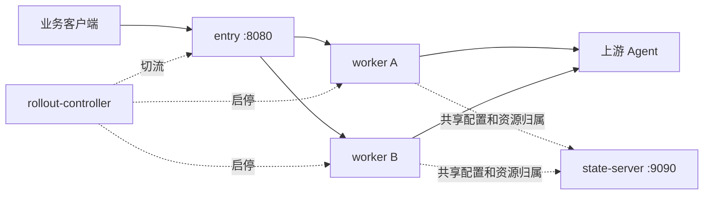
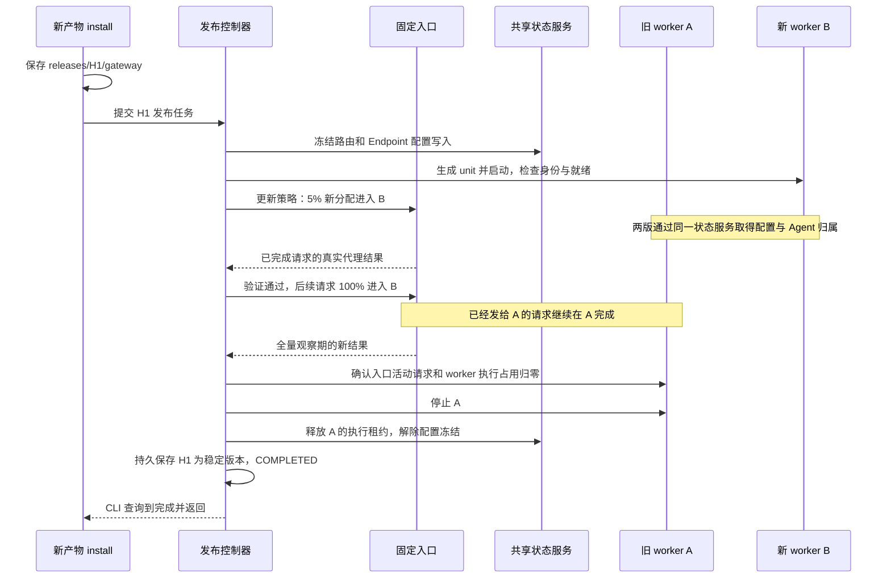

# 安装、运行文件与升级全流程

本文按 2026-10-13 的代码说明 Linux/systemd 部署，从首次安装一直讲到灰度切流、整套组件更新和恢复。平时运行三个基础进程加一个 worker；灰度期间增加一个候选 worker；正常完成后退出旧 worker。

这里有两种不同的“全量”：**全量切流**是把后续业务请求全部交给新 worker；**整套组件更新**还要升级入口、状态/管理服务、发布控制器和管理 CLI。当前 `install` 自动处理前者，后者需要维护窗口。

| 内容 | 阅读位置 |
| --- | --- |
| 有哪些进程，为什么 `top` 都显示 gateway | [运行模式与进程](#运行模式与进程) |
| 首次安装生成什么，按什么顺序启动 | [首次安装](#首次安装) |
| 二进制、配置、状态、Socket 分别在哪里 | [文件布局](#文件布局)、[配置如何生效](#配置如何生效) |
| 灰度期间如何替换文件和交接请求 | [一次灰度升级的文件变化](#一次灰度升级的文件变化)、[进程与请求如何交接](#进程与请求如何交接) |
| 何时全量切流，失败时怎么办 | [全量切流与验证规则](#全量切流与验证规则)、[回退重启与卸载](#回退重启与卸载) |
| 如何同时升级所有组件 | [整套组件更新](#整套组件更新) |
| 如何核对实际进程、版本、端口和日志 | [运行现场检查](#运行现场检查) |

构建、打包和上传命令见 [灰度操作说明](ROLLOUT_OPERATIONS.md#构建发版)，完整 YAML 字段见 [配置说明](CONFIGURATION.md)。以下安装和维护命令在目标 Linux 服务器执行；本机模拟验证与 Linux 实机验收的范围见 [验证记录](../VALIDATION.md)。

## 运行模式与进程

同一个二进制通过启动参数选择角色。默认 systemd 部署如下：

| 进程角色 | systemd unit | 默认监听 | 运行用户 | 日常灰度升级 |
| --- | --- | --- | --- | --- |
| `entry` | `aiagent-gateway-entry.service` | 数据 `:8080`；入口控制 Unix Socket | `aiagent-gateway` | 持续运行 |
| `state-server` | `aiagent-gateway-state.service` | 公共管理 `:9090`；共享状态 Unix Socket | `aiagent-gateway` | 持续运行 |
| `rollout-controller` | `aiagent-gateway-rollout.service` | 发布控制 Unix Socket | root | 持续运行，负责启动/停止 worker |
| `worker --slot=a` | `aiagent-gateway-worker-a.service` | 数据 `127.0.0.1:18080`；内部控制 `127.0.0.1:19090` | `aiagent-gateway` | 槽位 A |
| `worker --slot=b` | `aiagent-gateway-worker-b.service` | 数据 `127.0.0.1:18081`；内部控制 `127.0.0.1:19091` | `aiagent-gateway` | 槽位 B |

A/B 是两个固定槽位，轮流承接新版本。首次使用 A；下一次使用 B；再下一次使用 A。正常情况下只有一个 worker 运行，升级或等待恢复时可能两个都在。

```text
首次安装完成：entry + state-server + rollout-controller + A(H0)          = 4 个
灰度验证期间：entry + state-server + rollout-controller + A(H0) + B(H1)  = 5 个
升级完成以后：entry + state-server + rollout-controller + B(H1)          = 4 个
```

这里统计常驻网关进程，不包括上游 Agent、`install` 客户端和一次性初始化进程。`aiagent-gateway.service` 是 `Type=oneshot` 的服务组，执行 `/usr/bin/true` 后退出，显示 `active (exited)` 属正常情况；它不额外承接业务。`aiagent-gateway-init.service` 也在初始化后退出。



基础组件和 worker 的文件名都叫 `gateway`，因此 Linux `top` 的进程名通常相同；角色和槽位在完整命令行中。按 `c` 或使用后文的 `ps` 命令区分。

前台命令 `./aiagent-gateway --config ./config.yaml` 则在一个进程里提供数据和管理接口。它不经过上述四角色部署，单独重启也没有 worker 灰度交接机制。

## 首次安装

### 安装入口如何判断环境

目标系统需要运行 systemd，具备 `systemctl`、账户管理命令及 `LoadCredential` 支持；当前部署要求 systemd 247+。安装使用 root，运行服务使用上表中的账户。

假设已上传并校验了正确架构的二进制：

```sh
chmod +x ./aiagent-gateway-linux-amd64
sudo ./aiagent-gateway-linux-amd64 install
```

安装器首先检查已有部署和配置。主要分支如下：

| 服务器现状 | 处理方式 |
| --- | --- |
| 没有部署清单、配置和路由文件 | 首次安装 |
| 预先放置了有效 `config.yaml`，尚无路由文件和旧安装残留 | 保留预置配置，完成首次安装 |
| 没有部署清单，但已有配置和路由文件 | 要求显式 `install --migrate`，按维护迁移处理 |
| 已有当前格式的 `deployment.json` | 查询当前版本和发布状态；同版本稳定运行则校验后返回，同版本发布中则接续等待，其余新版本提交 worker 灰度任务；即使传 `--migrate`，也先进入这一分支 |
| 既有安装丢失了管理配置或路由文件 | 拒绝把它当成全新环境，要求先恢复文件 |
| 仍使用旧 `gateway.env` / `gateway.yaml` 基础组件 | 要求先完成 [配置迁移](CONFIGURATION.md#从环境变量版本迁移) |

### 第一次执行 install 的顺序

以新二进制内容的 SHA-256 为 `H0`，首次安装依次执行：

1. 对二进制计算 SHA-256，保存到 `/opt/aiagent-gateway/releases/H0/gateway`。目录名标识文件内容，显示用的版本标签不参与身份判断。
2. 创建或核对 `aiagent-gateway` 系统用户和组。
3. 若没有预置配置，生成 `/etc/aiagent-gateway/config.yaml`：包含随机管理 Token、端口和状态路径。管理 Token 来自 32 字节随机数的十六进制编码，不输出到终端。配置文件权限为 `0600`，新建配置目录为 `0700`。
4. 另外复制同一二进制到 `/opt/aiagent-gateway/infrastructure/H0/gateway` 和 `/usr/local/bin/aiagent-gateway`。前者运行基础组件，后者用于管理命令。
5. 写入服务组、初始化、入口、状态和发布控制器的 unit；写入 `deployment.json`，将基础组件路径和初始 worker 路径记录为 `H0`，使用默认发布策略。
6. 如果路由文件不存在，运行一次性 init unit，创建 `/var/lib/aiagent-gateway/config.json`。初始内容为空路由列表，已有文件不会被空配置覆盖。
7. 启用并启动服务组，拉起 `state-server`、`entry`、`rollout-controller`。控制器等待共享状态和入口 Socket 可连接；没有既有发布记录时，从 `deployment.json.initial_release` 开始首次发布。
8. 控制器生成 `worker-a.service`，启动 A，检查身份、就绪和协议，然后把 A 记为稳定版本。首次没有旧 worker，直接开放服务，不执行 5% 灰度和五分钟全量观察。CLI 等到 `COMPLETED` 后返回 0。

首次安装完成时，同一份 `H0` 内容存在于三个二进制路径。基础组件的三个进程共用 infrastructure 中的文件，但各自独立运行。

### 安装之后配置业务

```sh
sudo aiagent-gateway rollout status --json
sudo systemctl list-units --all 'aiagent-gateway*'
curl -fsS http://127.0.0.1:8080/readyz
sudoedit /etc/aiagent-gateway/config.yaml
```

自动生成配置的 `public_url` 为 `http://localhost:8080`，接入 A2A 前要改为客户端可达的公开地址。若修改启动配置，在正式接入流量前执行 `sudo aiagent-gateway restart`，然后重新核对各角色状态。初始化没有默认消费者；通过公共管理 API 登记路由、消费者和上游 Token 后，才能进行业务访问。

默认公共管理地址为 `http://<网关IP或域名>:9090/admin/v1/...`，请求携带管理 Token。`port` 和 `admin_port` 生成的公共监听都绑定所有网卡，systemd worker 的内部端口使用显式 loopback 地址。

## 文件布局

以下是已经运行过一次灰度升级的典型布局。`H0`、`H1` 在实际路径中是完整的 64 位 SHA-256；standby worker 的 unit 可能尚未生成，或保留上一次使用的路径。

```text
/usr/local/bin/aiagent-gateway              管理 CLI
/opt/aiagent-gateway/
  infrastructure/H0/gateway                三个基础组件使用的二进制
  releases/H0/gateway                      首次 worker 产物
  releases/H1/gateway                      新 worker 产物
/etc/aiagent-gateway/
  config.yaml                              启动配置和管理 Token
  deployment.json                          部署路径、初始版本、发布策略
/etc/systemd/system/
  aiagent-gateway.service                   服务组
  aiagent-gateway-init.service              一次性初始化
  aiagent-gateway-entry.service             入口启动定义
  aiagent-gateway-state.service             状态/管理服务启动定义
  aiagent-gateway-rollout.service           发布控制器启动定义
  aiagent-gateway-worker-a.service          槽位 A 的具体产物与参数
  aiagent-gateway-worker-b.service          槽位 B 的具体产物与参数
/var/lib/aiagent-gateway/
  config.json                              动态路由配置
  gateway.lock                             路由存储独占锁
  shared/state.log                         会话、资源、别名和幂等元数据
  shared/state.lock                        共享状态日志独占锁
  entry/state.log                          流量策略、灰度归属和请求结果
  entry/state.lock                         入口日志独占锁
/var/lib/aiagent-gateway-rollout/
  state.log                                发布报告、当前稳定版本、切流意图
  state.lock                               发布日志独占锁
/run/aiagent-gateway/
  state.sock                               worker/entry 与状态服务通信
  entry.sock                               控制器与入口通信
/run/aiagent-gateway-control/
  controller.sock                          管理 CLI 提交和查询发布
/run/lock/aiagent-gateway-install.lock       防止管理命令并发修改安装
```

### 持久文件由谁维护

| 文件 | 写入者 | 内容与使用方式 |
| --- | --- | --- |
| `config.yaml` | 安装器首次生成，之后由管理员维护 | 进程设置、管理 Token；各角色启动时读取 |
| `deployment.json` | 首次安装或维护重建时生成 | `version`、`infrastructure`、`initial_release`、`policy`；日常安装读取其中的策略 |
| `config.json` | `state-server`，前台模式则由单进程网关维护 | 路由、Endpoint、消费者 ID/Token 哈希、上游 Token、版本和管理幂等回执 |
| `shared/state.log` | `state-server` | 会话到 Agent 的绑定，Hermes/A2A 资源 ID 映射、父子关系、别名和数据幂等信息 |
| `entry/state.log` | `entry` | 稳定/候选目标、流量 revision、灰度会话归属、有界请求结果及未结束请求记录 |
| `aiagent-gateway-rollout/state.log` | `rollout-controller` | 当前发布阶段、稳定/候选版本、验证策略与结果、失败原因及未完成切流意图 |

`deployment.json.initial_release` 是没有发布历史时的启动种子。日常升级成功后，**当前稳定版本保存在发布控制器的状态日志中**，通过 `rollout status` 查询；安装器不会把 `initial_release` 每次都改成最新版本。运行路径由 unit 和入口策略指向，当前没有通过 `current` 符号链接切换版本的机制。

三个 `state.log` 都是带序号和校验的持久状态日志。提交同步落盘，累计提交后会压缩并原子替换日志；它们不是 `journalctl` 中的人类可读运行日志。复制或恢复时按完整状态目录处理，不手工编辑其中的记录。

安装产物权限为 `0755`，生成的 unit 为 `0644`；配置、状态日志和锁文件按 `0600` 创建。已有目录或自定义 unit 的实际权限应以部署现场为准。

### 临时文件和运行文件

- systemd 的 `LoadCredential` 为每个 unit 提供 `config.yaml` 私有副本，启动参数通过 `%d/config.yaml` 读取。管理员编辑源文件 `/etc/aiagent-gateway/config.yaml`。
- `/run` 下的 Socket、安装锁属于运行文件，服务/主机恢复时重新建立。Socket 不是配置或业务数据的备份。
- `gateway.lock` 和 `state.lock` 的文件可能在进程退出后仍存在；是否正在持锁由操作系统决定，不能仅凭文件存在判断服务运行。
- 安装写入可能短暂出现 `.gateway-install-*`；路由提交使用 `.config-*.tmp`；状态压缩使用 `.snapshot-*`。正常流程会清理临时文件。
- 从旧路由 schema 1 迁移时，可能生成 `config.schema-1.backup.json`；全新安装不会必然生成它。
- 进程日志通过 `journalctl -u <unit>` 查看。当前没有自动清理历史 release/infrastructure 产物的管理命令。

## 配置如何生效

以 systemd 安装为例，启动配置的主要字段如下；预置文件时应填写自己的管理 Token，安装器自动创建的文件已经含有随机 Token：

```yaml
port: 8080
admin_port: 9090
data_dir: /var/lib/aiagent-gateway
public_url: https://gateway.example.com
admin_token: replace-with-admin-secret
state_socket: /run/aiagent-gateway/state.sock
entry_socket: /run/aiagent-gateway/entry.sock
control_socket: /run/aiagent-gateway-control/controller.sock
deployment: /etc/aiagent-gateway/deployment.json
rollout_data: /var/lib/aiagent-gateway-rollout
```

安装器要求数据、Socket、部署清单和发布日志路径使用上述默认绝对路径，因为内置 unit 和 driver 依赖这些位置。容量字段可按 [配置说明](CONFIGURATION.md#字段与默认值) 设置。

| 要修改的内容 | 修改入口 | 生效时间 |
| --- | --- | --- |
| 公共端口、`public_url`、管理 Token、启动容量 | `config.yaml` | 相关进程重启后；修改管理 Token 应协调重启服务组，避免进程间认证不一致 |
| 路由、实例、消费者、上游 Token | `/admin/v1/...` 管理 API | 正常运行时动态生效；发布期间配置写入被冻结 |
| 灰度比例、验证时长和样本数 | `deployment.json.policy` | 下一次提交的发布；进行中的任务使用已保存的策略 |
| 正在运行的程序版本 | 新产物的 `install` 或整套组件维护流程 | 新进程启动并完成对应交接后 |

YAML 不读取环境变量，不展开 `$VAR`，也不接受 `callers` / `credentials` 字典。消费者和上游 Token 属于路由配置；上游 Token 需要原文转发，保存在权限受限的 `config.json` 中，消费者 Token 保存哈希。

修改源 YAML 不会使运行中的进程重新读取配置。新 worker 会在启动时获得当时的凭据副本，因此正常灰度期间应保持启动配置一致；需要修改公共配置时安排维护操作。

## 一次灰度升级的文件变化

假设基础组件使用 `H0`，稳定 worker A 也使用 `H0`，现在上传了内容哈希为 `H1` 的新二进制。

### 用新文件提交升级

```sh
sudo aiagent-gateway rollout status --json > rollout-before.json
sha256sum ./aiagent-gateway-linux-amd64
sudo ./aiagent-gateway-linux-amd64 install
```

`install` 提交的是**正在执行安装命令的那个文件**。应执行新上传产物的 `install`；`/usr/local/bin/aiagent-gateway` 平时保留为基础管理 CLI，执行它的 `install` 会提交它自身的旧内容。查询状态仍使用 `sudo aiagent-gateway rollout status --json`。

### 文件具体如何变化

| 文件或目录 | 本次灰度中的变化 |
| --- | --- |
| 上传目录中的新二进制 | 作为安装输入，读取其内容并计算 `H1` |
| `/opt/aiagent-gateway/releases/H1/gateway` | 新增；若相同路径已存在，核对内容哈希后复用 |
| `/opt/aiagent-gateway/releases/H0/gateway` | 保留，供旧 worker 继续运行及之后降级 |
| `/opt/aiagent-gateway/infrastructure/H0/gateway` | 继续供三个基础组件运行 |
| `/usr/local/bin/aiagent-gateway` | 保留现有管理 CLI |
| `aiagent-gateway-worker-b.service` | 由控制器生成或改写，`ExecStart` 指向 `releases/H1/gateway`，槽位设为 B |
| `aiagent-gateway-worker-a.service` | 本次仍指向 `H0`；完成后停止 A，unit 文件保留 |
| `config.yaml`、`config.json`、`deployment.json` | 安装器保留已有内容；读取发布策略和配置，不用上传包里的示例覆盖它们 |
| `shared/state.log` | 持续提交业务会话和资源状态 |
| `entry/state.log` | 保存候选、流量比例、归属和请求结果；完成时保存新的稳定目标 |
| `aiagent-gateway-rollout/state.log` | 保存本次任务、切流意图、验证结果及新的稳定版本 |

基础 unit 和 CLI 如有缺失，安装器会按已有 `deployment.json.infrastructure` 修复；这不将它们切换到上传的新二进制。上述流程以健康的服务组为起点；服务组未启动时，安装器会先恢复已记录的稳定部署。

安装器写新文件时采用“同目录临时文件 → 写入并同步 → rename → 同步目录”。运行中的旧 worker 始终引用自己的版本文件。每个 worker unit 使用具体版本的绝对路径，切换不依赖覆盖运行中的二进制或修改符号链接。

候选 B 的启动命令形如：

```text
/opt/aiagent-gateway/releases/H1/gateway worker \
  --slot=b --release=H1 \
  --listen=127.0.0.1:18081 --admin=127.0.0.1:19091 \
  --config=<systemd 凭据目录>/config.yaml
```

控制器调用 `systemctl daemon-reload` 和 `systemctl start aiagent-gateway-worker-b.service`，校验新进程的 release、槽位、进程代次、协议和就绪状态。worker unit 的模板来自**正在运行的发布控制器**；更新模板或 driver 的行为需要升级该基础组件。

完成后 B 运行 `H1`，三个基础组件和管理 CLI 仍使用 `H0`。下一次发布 `H2` 时，控制器改写空闲 A 的 unit，启动 `A(H2)`；原来的版本目录继续保留。

重复执行同一 SHA-256 二进制的 `install` 时，若该产物已是稳定版本，安装器确认 worker 的 release、槽位、进程代次、协议与就绪状态，并核对入口确实只指向该 worker，然后直接返回成功，不启动另一槽位或重做灰度。判断依据是当前报告中的 `stable`，不是首次安装的 `initial_release` 或基础组件版本。若同一版本正在发布，则等待原 rollout 完成，不重置验证窗口；需要恢复、其他版本发布中或健康检查失败时给出具体错误。服务停止时仍先恢复已有部署。

此检查在新上传二进制的安装客户端执行，因此也兼容旧常驻控制器。新控制器同时对相同产物重复 `Begin` 保留已有报告；更新该服务端保护仍需基础组件维护更新。日常安装请始终使用新上传的二进制执行 `install`。

## 进程与请求如何交接

### 交接顺序



灰度分配依据调用方、路由、接口及会话/资源/幂等身份形成的归属键；同一归属在灰度期间保持版本亲和。没有可用归属键的请求按次分配。因此 5% 表示新分配的比例，不能直接当成全部请求数或 CPU 使用量的 5%。

### 进行中的请求留在哪里

入口在每次请求开始时选定 worker。进入 100% 后，新的 HTTP 请求，包括已有 keep-alive 连接上的后续请求，使用新策略；已发给 A 的 HTTP/SSE 请求继续由 A 完成。这里通过固定入口改路由并等待旧请求结束，没有把 TCP 连接、SSE 响应或进程内存搬到 B。

旧进程退出需要同时满足入口记录的 `Active == 0` 和 worker 报告的 `Inflight == 0`。后者包含处理器请求和共享执行租约，覆盖网关本地仍占用执行的后台工作。driver 停止前再次核对进程代次和在途数，避免操作已经被替换的进程。

### 会话为什么能继续使用

两版 worker 访问同一个状态服务，由状态服务保存有效期内的归属：

```text
(调用方、路由、接口、会话 ID) → 原 Agent Endpoint
Hermes/A2A 公开资源 ID        → 原 Agent Endpoint、上游 ID、父子关系

切换前：session-123 → A(H0) → Agent X
切换后：session-123 → B(H1) → Agent X
```

worker 不各自改写 `config.json`，也不用在退出时向另一个 worker 复制整份状态文件。资源创建、归属和幂等提交由状态服务确认；旧 worker 退休时释放的是执行租约，会话和资源绑定按自身生命周期保留。

持久化保存的是定位和幂等元数据，不包含客户端连接或 Agent 内部的聊天历史。绑定仍有 TTL；原 Agent 故障也不会自动改投另一实例。仅在上游 Agent 内执行的异步任务，可由新 worker 根据映射继续查询或取消，通常不要求等整个 Agent 任务结束后才退出旧 worker。

### 控制器和终端的关系

`install` 只是提交任务并轮询报告。后台控制器持久保存阶段，一次只接受一个未结束的发布；终端断开不会取消任务。重新连接后先查询状态。

每次切流先保存意图，再带预期 revision 更新入口，最后保存确认结果。若入口已经切换而响应丢失，控制器核对入口实际 revision 和策略后继续。控制状态无法确认时进入恢复流程，不凭猜测继续切换。

## 全量切流与验证规则

当前发布流程自动从 5% 灰度进入 100% 后续流量；没有供用户跳过验证的 `promote` 命令，也没有自动逐档经过 10%、25%、50% 的阶段。

| 阶段 | 默认条件和动作 |
| --- | --- |
| 准备 | 检查旧版健康，冻结路由/Endpoint 等配置写入 |
| 候选启动 | 最多等待 30 秒；校验身份、控制/状态协议、就绪和两版配置 revision |
| 灰度验证 | 5% 新分配；至少 60 秒，每种必需类型至少 10 个成功样本；最多验证 300 秒 |
| 全量切流 | 后续请求 100% 进入候选，包含原会话的后续请求 |
| 全量观察 | 再观察 300 秒，每种必需类型取得至少 10 个本阶段的新成功样本 |
| 旧版排空 | 继续监测候选失败，等待旧版活动请求和执行占用归零；默认等待上限 600 秒 |
| 完成 | 停止旧 worker、提交新稳定目标、解除配置冻结、返回 `COMPLETED` |

默认有效失败容忍数为 0。HTTP 5xx/429、连接错误、协议错误、SSE 非正常结束等会触发回退。普通客户端错误和有证据的主动取消不计成功；健康检查、Agent Card 等本地响应不算真实代理成功。SSE 要观察可识别的完成语义，单纯收到 HTTP 200 或首帧不够。

必需类型按启用路由推导，包含 `http`、`sse`、`a2a`、`a2a_sse`。网关使用实际业务结果，没有自动模型请求或流量镜像来补样本。没有流量或样本不足时，等待超时后回退，不会自动全量。

这些默认值可通过 `deployment.json.policy` 为下一次发布调整，字段和完整示例见 [发布策略](ROLLOUT_OPERATIONS.md#发布策略)。灰度期间管理配置写入返回 `409 ROLLOUT_IN_PROGRESS`，业务请求和资源操作继续执行；正常完成或安全回退后解除冻结。

600 秒是排空阶段的等待上限。超时进入 `RECOVERY_REQUIRED`，保留两个进程和当前流量策略；它不是强制断开旧请求的时间。恢复操作见后文。

## 整套组件更新

### 哪些改动需要更新基础组件

| 变更范围 | 需要运行新代码的角色 |
| --- | --- |
| worker 内的代理和协议处理，且兼容现有共享服务 | worker，可走日常灰度 |
| 公共管理 API、配置写入、共享资源或状态行为 | `state-server`，以及使用相关协议的 worker |
| 固定入口的路由和结果统计 | `entry` |
| 灰度状态机、systemd driver、worker unit 模板 | `rollout-controller` |
| 安装、管理命令或基础 unit | 管理 CLI，以及对应基础组件 |
| 启动配置格式、共享协议或持久数据格式不兼容 | 整套维护迁移，先准备数据/配置转换方案 |

同一个 Go 包可能被多个角色使用，应按代码实际运行在哪些进程中判断。比如公共管理接口的实现更新必须让 `state-server` 运行新二进制；重新启动旧路径上的 state 服务仍是旧代码。

当前没有 `install --full`、`upgrade-all` 等命令。**`install --migrate` 也不是已有灰度部署的一键全组件升级开关**：只要原 `deployment.json` 还在，安装器就先尝试使用原基础组件提交 worker 任务。

### 当前格式部署的维护步骤

下面流程适用于已经使用 `config.yaml`、部署清单 `version: 2`、默认系统路径，且新版本兼容现有路由和共享业务状态的部署。它会停止整套服务、重新建立发布基线。配置或数据格式不兼容时，应先按版本迁移方案完成转换，不能仅靠替换二进制。

执行前，在业务入口暂停新流量，结束当前发布，并确认网关内的在途请求和本地后台执行已经结束。正常发布状态应为 `COMPLETED` 或 `ROLLED_BACK`；处于 `RECOVERY_REQUIRED` 时先解决原任务。手动停止服务使用 systemd 停机窗口，不具备灰度排空等待的全部保护。

以下各段在**同一个 root Bash 会话中逐段执行**，每段完成后按说明检查，再继续。新文件路径替换为实际上传位置：

```sh
sudo bash
```

**1. 建立独立备份目录，记录版本。**

```bash
set -euo pipefail
umask 077
gateway_new_binary=/tmp/aiagent-release/aiagent-gateway-linux-amd64
gateway_backup_dir="/var/backups/aiagent-gateway-$(date +%Y%m%d-%H%M%S)"
test -x "$gateway_new_binary"
test ! -e "$gateway_backup_dir"
install -d -m 0700 "$gateway_backup_dir"
aiagent-gateway rollout status --json | tee "$gateway_backup_dir/rollout-before.json"
sha256sum "$gateway_new_binary" | tee "$gateway_backup_dir/new-binary.sha256"
printf 'Backup directory: %s\n' "$gateway_backup_dir"
```

检查报告中的阶段和旧 `stable.release`，记录备份目录。保留新产物和完整旧产物，后续备份包含管理 Token 与业务状态，目录只供 root 访问。

**2. 停止服务组，核对所有子进程退出，再备份持久文件。**

```bash
systemctl stop aiagent-gateway.service
systemctl show 'aiagent-gateway-*.service' \
  -p Id -p ActiveState -p SubState -p MainPID
```

确认 entry、state、controller 和已有 worker 均停止、`MainPID=0`，再执行：

```bash
tar -C / -cpf "$gateway_backup_dir/files.tar" \
  etc/aiagent-gateway \
  var/lib/aiagent-gateway \
  var/lib/aiagent-gateway-rollout \
  opt/aiagent-gateway \
  usr/local/bin/aiagent-gateway
install -d -m 0700 "$gateway_backup_dir/units"
cp -a /etc/systemd/system/aiagent-gateway* "$gateway_backup_dir/units/"
```

这时取得的是停止写入后的配置和状态。标准 unit 及同名前缀的 drop-in 目录一起保存；如果另有自定义部署文件，也应纳入对应备份。`/run` 下的 Socket 不参与恢复。

**3. 归档旧部署和控制状态，保留业务状态。**

```bash
install -d -m 0700 "$gateway_backup_dir/previous-control"
mv /etc/aiagent-gateway/deployment.json \
  "$gateway_backup_dir/previous-control/deployment.json"
mv /var/lib/aiagent-gateway/entry \
  "$gateway_backup_dir/previous-control/entry"
mv /var/lib/aiagent-gateway-rollout \
  "$gateway_backup_dir/previous-control/rollout"
```

保留 `/etc/aiagent-gateway/config.yaml`、`/var/lib/aiagent-gateway/config.json`、`/var/lib/aiagent-gateway/shared` 以及版本产物原位。它们提供管理凭据、路由身份和有效资源归属。

归档上述三个控制位置，是为了让新入口和新控制器从新版本建立基线。只移走部署清单、却保留原控制器报告，会继续恢复报告中的旧稳定目标。仅移走控制日志也不能替代业务状态迁移。

此流程保留现有 `aiagent-gateway.service` 和基础 unit，由安装器重新写入；安装器在重建前还会调用一次 `systemctl stop aiagent-gateway.service`。不要在这一步先卸载服务组定义。

**4. 用新二进制重建整套部署。**

```bash
"$gateway_new_binary" install --migrate
```

此时原部署清单已经归档，配置和路由仍在，安装器进入显式维护迁移分支。它将执行：

- 保存 `releases/Hnew/gateway` 和 `infrastructure/Hnew/gateway`，将管理 CLI 更新为新内容。
- 把 entry、state 和 controller 的 unit 指向 `infrastructure/Hnew/gateway`，重写服务组和 init unit。
- 重新生成 `deployment.json`，初始 worker 指向 `Hnew`；保留既有 YAML 和路由文件。
- 新 state 服务读取原共享业务状态，新 entry/controller 创建自己的控制记录，启动 `A(Hnew)` 作为新基线。

因为这是已经暂停流量的基线重建，没有可参与本轮灰度的旧稳定目标，就绪后直接完成。B 槽位的旧 unit/产物可能仍在磁盘上，但不会因此自动运行；下一次灰度使用 B 时会重新生成它的 unit。

新清单的 `policy` 恢复为代码默认值。对照备份恢复需要的策略字段，保留本次生成的 `infrastructure` 和 `initial_release` 路径，不整份覆盖回旧清单。自定义 unit drop-in 仍可能影响新进程，应通过 `systemctl cat` 核对它们与新配置是否一致。

**5. 核对全部运行版本，再恢复业务流量。**

```bash
aiagent-gateway rollout status --json | tee "$gateway_backup_dir/rollout-after.json"
systemctl show 'aiagent-gateway-*.service' \
  -p Id -p ActiveState -p MainPID -p ExecStart
sha256sum "$gateway_new_binary" /usr/local/bin/aiagent-gateway
curl -fsS http://127.0.0.1:8080/readyz
```

使用自定义端口时替换就绪检查地址。验收要求：报告为 `COMPLETED`，稳定 release 等于新文件哈希；三个基础组件的实际执行路径为 `infrastructure/Hnew/gateway`，活跃 worker 为 `releases/Hnew/gateway`；新管理 API 和真实业务请求通过。再用维护前保留的有效会话/资源 ID 核对原 Agent 归属，恢复外部入口流量。

本流程保留兼容且仍有效的业务映射，但停止整套服务会中断连接，状态服务的内存缓存、运行代次和列表快照也会重建。首次从原单进程模式迁移时，旧内存会话映射无法通过此办法继承。

### 旧配置格式与失败恢复

旧 `gateway.env` / `gateway.yaml` 版本先按 [配置迁移说明](CONFIGURATION.md#从-gatewayyaml--credentials-版本迁移) 转换 YAML、路由 Token 和消费者；保存原 Token、路由 ID、Endpoint ID 及原始文件。在停机备份后，旧 state unit 若仍包含 `EnvironmentFile=` 或 `gateway.yaml`，将该 unit 归档移出 `/etc/systemd/system`，由新安装器重建。保留服务组主 unit 供迁移时停止服务。当前安装器会主动拒绝仍带这些旧 state unit 的安装。

整套维护失败没有自动恢复整套文件的事务。外部流量继续暂停，先停止各角色并保存失败现场，再从同一备份恢复配置、共享状态、入口/控制器记录、CLI、unit 和对应产物；执行 `systemctl daemon-reload` 后启动服务组，核对恢复的稳定版本。恢复集合要一致，不能只恢复旧二进制却混用不兼容的新状态。

若新版已经接收了业务写入，恢复维护前的状态会丢弃之后的变更，必须先处理这些数据。日常灰度回退保留当前共享状态；整套维护的备份恢复是另一种操作。

上述命令依据当前安装分支整理，尚未完成 Linux/systemd 实机全套维护演练。已有本机多进程和模拟 driver 验证的范围见 [验证记录](../VALIDATION.md)。

## 回退重启与卸载

| 操作或状态 | 当前行为 |
| --- | --- |
| 灰度/全量观察期间发生有效失败 | 后续流量切回旧版，再排空候选，安全收尾后 `ROLLED_BACK` |
| `rollout rollback` | 活动任务仍有候选和旧稳定目标时请求回退；已发给 Agent 的请求不自动重放 |
| `old_worker_drain_timeout` | 已全量切到新版，但旧版未排空；保留两版和冻结状态，等待处理后恢复 |
| `candidate_drain_timeout` | 后续流量已回到旧版，候选仍有存量执行；等待处理后恢复 |
| `rollout resume` | 仅恢复 `RECOVERY_REQUIRED` 记录的阶段，重新检查条件；不是强制通过验证 |
| `COMPLETED` 后降级 | 使用兼容当前状态的旧产物再发起一次灰度；当前没有历史版本选择式 rollback |
| `stop/start/restart` | 操作服务组；控制器恢复记录中的稳定 worker，不因上传了文件就改版本 |
| `uninstall` | 停止服务，删除 unit 和管理 CLI；保留配置、状态、部署清单及版本目录 |

```sh
sudo aiagent-gateway rollout status --json
# 活动发布需要主动回退时：
sudo aiagent-gateway rollout rollback
# RECOVERY_REQUIRED 的原因已处理完毕时：
sudo aiagent-gateway rollout resume
```

以上是不同场景的命令，按报告选择操作。排空超时后，即使在途请求稍后结束，状态机也等待显式 `resume`。候选与旧版都无法确认健康时保留现场，状态和原因通过报告及日志检查。

完成后需要降级，例如目标旧版本哈希为此前保存的值：

```sh
previous_release='填写目标旧版本的64位SHA256'
sudo "/opt/aiagent-gateway/releases/${previous_release}/gateway" install
```

此时仍要取得真实成功样本，并完成观察和排空。回退和降级不恢复旧 `config.json` / `shared/state.log`，灰度中新建的合法资源继续保留；已执行的上游操作也不会被撤销。

服务组重启会中断连接。状态服务重启后，旧 worker 的状态客户端会检测到代次变化，拒绝继续使用旧状态；systemd 依赖和控制器负责停止或恢复对应 worker。元数据恢复不能恢复原 TCP/SSE 连接。

卸载后的普通重装会根据保留的部署清单和发布记录恢复旧基础组件与稳定目标，再提交所执行二进制的 worker 发布。**卸载后直接 install 也不等于更新全部基础组件**。整套更新使用前面的维护流程，保留恢复所需产物；不要把删除状态目录作为日常升级步骤。

## 运行现场检查

### 进程和实际执行的文件

在 Linux `top` 中按 `c` 显示完整命令，或执行：

```sh
ps -eo pid,user,comm,args | grep '[g]ateway'
sudo systemctl list-units --all 'aiagent-gateway*'
sudo systemctl show 'aiagent-gateway-*.service' \
  -p Id -p ActiveState -p SubState -p MainPID -p ExecStart
sudo aiagent-gateway rollout status --json
```

常见命令行如下，实际路径使用完整哈希：

```text
.../infrastructure/H0/gateway entry --config=...
.../infrastructure/H0/gateway state-server --config=...
.../infrastructure/H0/gateway rollout-controller --config=...
.../releases/H1/gateway worker --slot=b --release=H1 --config=...
```

`systemctl show` 展示加载的 unit 配置。需要核对一个正在运行的进程实际执行哪个文件时，在 Linux 使用其 PID：

```sh
gateway_pid=$(systemctl show -p MainPID --value aiagent-gateway-state.service)
sudo readlink "/proc/$gateway_pid/exe"
sudo systemctl cat aiagent-gateway-state.service
```

先确认 PID 非 0。管理 CLI 文件的哈希不能代替 worker 版本；日常升级后它们本来就可能不同。以实际进程路径和发布报告的 `stable.release` / `candidate.release` 核对。

### 端口和日志

```sh
sudo ss -ltnp
sudo ss -lxnp
sudo journalctl -u aiagent-gateway-entry.service -n 100 --no-pager
sudo journalctl -u aiagent-gateway-state.service -n 100 --no-pager
sudo journalctl -u aiagent-gateway-rollout.service -n 100 --no-pager
sudo journalctl -u aiagent-gateway-worker-a.service \
  -u aiagent-gateway-worker-b.service -n 100 --no-pager
```

健康状态下，8080 属于 entry，9090 属于 state-server；活跃槽位占用 18080/19090 或 18081/19091，灰度期间可能两组都在。worker 的内部控制端口提供身份与在途数；使用实际管理 Token，仅作为 curl 客户端变量：

```sh
GATEWAY_ADMIN_TOKEN='填写现有管理Token'
curl -fsS http://127.0.0.1:19090/control/v1/identity \
  -H "Authorization: Bearer $GATEWAY_ADMIN_TOKEN"
```

查询 B 时换成 19091；只查询正在运行的槽位。身份响应包含 release、实例、进程代次、就绪及在途信息。`/readyz`、unit 显示 active、端口可连接分别只证明部分条件，升级完成还要核对发布报告和实际业务请求。

## 实现位置

| 内容 | 当前源码 |
| --- | --- |
| CLI 参数、前台单进程入口 | [cmd/gateway/main.go](../cmd/gateway/main.go) |
| 四种角色、监听、启动与退出 | [cmd/gateway/roles.go](../cmd/gateway/roles.go) |
| YAML 默认值、校验和路径解析 | [internal/appconfig/config.go](../internal/appconfig/config.go) |
| 系统账户、管理锁、原子文件写入、默认管理配置 | [internal/service/service.go](../internal/service/service.go) |
| 安装分支、版本文件、unit 生成、卸载与 systemd driver | [internal/service/rollout.go](../internal/service/rollout.go) |
| 实际内嵌 unit 模板 | [internal/service/units](../internal/service/units)；服务组模板在 `rollout.go` 的 `masterUnit` |
| 灰度状态机、切流意图、回退与恢复 | [internal/rollout/controller.go](../internal/rollout/controller.go) |
| 默认比例与各阶段门槛 | [internal/releaseprotocol/protocol.go](../internal/releaseprotocol/protocol.go) |
| 入口分流、归属、请求结果与持久策略 | [internal/entry/entry.go](../internal/entry/entry.go) |
| 共享业务状态与持久会话 | [runtime/shared.go](../internal/gateway/runtime/shared.go)、[runtime/sessions.go](../internal/gateway/runtime/sessions.go) |
| 路由原子存储、状态日志与压缩 | [config/store.go](../internal/gateway/runtime/config/store.go)、[state/journal.go](../internal/state/journal.go) |

发布状态机和安装器已有自动测试，本机模拟多进程检查覆盖切流、会话归属和失败请求不重放；Linux systemd 首装、整套维护及真实 Agent 升级验收仍以 [VALIDATION.md](../VALIDATION.md) 中实际记录为准。
