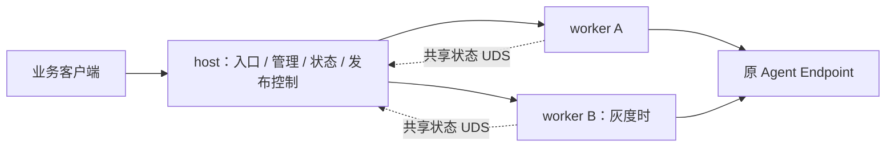

# 安装、运行文件与升级全流程

按 2026-10-19 的实现说明。新安装使用 **稳定宿主 host + 业务 worker**：稳定期 2 个常驻进程，灰度期 3 个，正常结束后恢复 2 个。所有安装统一采用这一拓扑。

日常 `install` 只发布业务 worker，入口、管理、状态和发布控制所在的 host 保持运行。host 自身升级需要维护窗口。设计依据见 [减进程方案](PROCESS_REDUCTION_RECOMMENDATION.md)。

## 运行模式与进程

| 角色 | systemd 管理方式 | 监听 | 用户 |
| --- | --- | --- | --- |
| host（入口、状态、管理、发布控制） | `aiagent-gateway.service` 的 MainPID | 公共数据 `:8080`、管理 `:9090`，三个控制 UDS | aiagent-gateway |
| worker A 或 B | host 直接启动并 Wait 回收的子进程 | 两个动态分配的 `127.0.0.1` 端口 | aiagent-gateway |
| 候选 worker | 仅发布期间启动的第二个子进程 | 独立动态 loopback 端口 | aiagent-gateway |

```text
稳定：host + A(H0)          = 2 个
灰度：host + A(H0) + B(H1)  = 3 个
完成：host + B(H1)          = 2 个
下一次：host + B(H1) + A(H2)
```

数量不含短命 install/status CLI、一次性 init、systemd 和上游 Agent。正常 systemd 状态为 `active (running)`。发布排空超时时保留两个 worker 等待恢复，不强杀旧请求或启动第三个 worker。



无子命令的前台模式仍是单进程网关，不提供 host-worker 自动灰度。对外安装只维护 host-worker 模式。

## 首次安装

构建和上传步骤见 [操作说明](ROLLOUT_OPERATIONS.md#构建发版)。在 Linux/systemd 247+ 上执行：

```sh
sudo ./aiagent-gateway-linux-amd64 install
sudo aiagent-gateway rollout status --json
sudo systemctl status aiagent-gateway.service
curl -fsS http://127.0.0.1:8080/readyz
```

安装器以 root 暂存自身二进制的 SHA-256 版本，创建非 root 账户、启动 YAML、部署清单和两个 unit（host 与一次性 init）。已有凭据不重建。init 只初始化缺失的路由存储，host 打开配置及三个持久日志，随后启动初始 worker。首次没有旧版，身份、就绪及协议校验通过后直接完成，不等待灰度业务样本。

启动配置通过 systemd `LoadCredential` 提供给 host，worker 继承同一份 YAML 路径。默认没有业务路由；通过管理 API 注册路由、消费者和上游凭据。A2A 接入前将 `public_url` 配置为客户端可访问的地址。

## 文件布局

`H0`、`H1` 代表完整的 64 位 SHA-256。

```text
/usr/local/bin/aiagent-gateway              管理 CLI，日常 worker 发布不替换
/opt/aiagent-gateway/
  infrastructure/H0/gateway                稳定 host 二进制
  releases/H0/gateway                      初始 worker
  releases/H1/gateway                      后续业务版本
/etc/aiagent-gateway/
  config.yaml                              启动配置、管理 Token
  deployment.json                          基础产物、启动种子、发布策略
/etc/systemd/system/
  aiagent-gateway.service                   单个 host service
  aiagent-gateway-init.service              一次性初始化
/var/lib/aiagent-gateway/
  config.json                              存储格式、schema、配置版本
  routes.json                              路由、Endpoint、消费者及上游凭据
  route-logs.json                          管理幂等回执和审计记录
  .config.pending.json                     存在时用于完成配置提交
  gateway.lock                             配置独占锁
  shared/state.log                         资源、会话、别名、业务幂等
  entry/state.log                          切流策略、会话版本分配、请求结果
  release/state.log                        发布报告、稳定版本和未完成切流意图
/run/aiagent-gateway/
  state.sock                               worker 共享状态
  entry.sock                               本机入口诊断/控制
/run/aiagent-gateway-control/controller.sock 发布提交与查询
/run/lock/aiagent-gateway-install.lock       安装与管理命令互斥
```

三个日志目录各有 `state.lock`。host 是路由和持久状态的唯一写入者；两个 worker 都通过状态 UDS 使用同一个 epoch、配额、资源目录及幂等数据。部署清单仅包含 `infrastructure`、`initial_release` 和 `policy`。`initial_release` 只在没有发布历史时使用，当前稳定版以 `release/state.log` 和 `rollout status` 为准，不选择最新上传文件。

安装二进制及 releases 目录由 root 持有，运行用户只读；产物和目录不能由其他用户写入，符号链接和内容哈希不符会拒绝启动。host 以专用非 root 用户运行，通过 Unix peer credentials 与管理 Token 双重校验发布控制请求。生产控制入口只接受 root 安装身份，公共管理 API 不提供执行二进制的接口。

配置与状态按 0600 创建；运行和状态目录限制为 0700。备份应复制完整目录和恢复事务，不能只复制 `config.json`。

## 配置如何生效

| 修改内容 | 操作 | 生效范围 |
| --- | --- | --- |
| 路由、权重、消费者、上游 Token | 管理 API | 动态生效，灰度期间管理写入冻结 |
| YAML 监听、管理 Token、容量 | 修改 config.yaml，维护重启 | host 与 worker 一起重启；不是灰度发布 |
| 发布策略 | root 编辑 deployment.json.policy | 下次 install 提交的任务 |
| 业务实现 | 执行新产物 install | 经过灰度和全量观察后生效 |
| host/基础组件 | install --update-host | 停机维护后整体更新 |

host 存续期间启动的 worker 使用同一份 systemd 凭据副本。编辑源 YAML 不影响正在运行的 host 或下一次业务发布，须维护重启。发布日志固定使用 `data_dir/release`。

## 一次灰度升级的文件变化

```sh
sudo aiagent-gateway rollout status --json > rollout-before.json
sudo ./aiagent-gateway-linux-amd64 install
```

执行新上传文件的 `install`，不要误用旧管理 CLI 提交旧产物。安装器新增 `/opt/aiagent-gateway/releases/H1/gateway`，通过本机控制 Socket 提交并等待任务；不改 host unit、CLI、基础组件路径、公共监听或 MainPID。worker 不生成 systemd unit，版本/端口/随机 incarnation 写入发布及入口日志。

重复提交同一正在发布的版本沿用原任务；已健康运行的同版本直接返回成功。其他活动任务或 `RECOVERY_REQUIRED` 阻止叠加发布。关闭 install 终端不取消后台任务，可重新查询或接续等待。

## 进程与请求如何交接

host 保持公共连接与共享状态，启动候选后核对实际子 PID、随机 incarnation、产物、槽位、协议和配置版本，确认就绪才参与流量。A/B 只表示两个槽位，端口动态分配；host 不根据持久化 PID 收养或终止不属于自己的进程。

5% 阶段按新逻辑会话分配 worker。全量后，已有会话的后续请求也可进入新 worker，但会话及 Hermes/A2A 公开资源 ID 继续指向原 Agent。已有 SSE 留在原请求链，不迁移连接。上游已收到的模型或工具请求不重放。

## 全量切流与验证规则

默认 5% 新会话、至少验证 60 秒、每类至少 10 个真实成功样本，最长验证 300 秒；全量观察 300 秒并取得新样本。HTTP、SSE、A2A、A2A SSE 独立计数，readiness 不能代替业务成功。

候选失败或样本不足自动回退。提交前同时检查入口活跃请求、worker 执行和状态租约，归零才停止并回收旧进程；排空默认最长 600 秒，超时进入 `RECOVERY_REQUIRED`，保留现场，排空后使用 `rollout resume`。完整策略和错误分类见 [操作说明](ROLLOUT_OPERATIONS.md#默认发布规则)。

## 回退重启与卸载

- 候选失败：切回旧版，待候选排空后退出，返回 2 个进程。回退不撤销上游已执行的操作。
- 稳定 worker 崩溃：host 回收子进程并按已提交产物重启，重新分配 incarnation，公共 host 和状态 epoch 不变。在途连接无法恢复。
- host 崩溃：父进程生命管道关闭，worker 退出；systemd 清理同 cgroup 后重启。新 host 先核对发布日志和入口切流意图，未提交发布回到旧稳定版，已进入 COMMITTING 的恢复新稳定版。日志冲突拒绝启动。既有连接会中断，业务元数据从最新持久状态恢复。
- 人工 stop/restart：host 最多用 20 秒排空公共请求，再关闭内部服务和子进程；unit 使用 [KillMode=mixed](https://www.freedesktop.org/software/systemd/man/latest/systemd.kill.html)，先通知主进程，宿主退出或 35 秒停止超时后由 systemd 清理剩余 cgroup 成员。此操作不等同于正常业务灰度。
- uninstall：移除 unit 和 CLI，保留清单、凭据、状态和不可变产物；重装恢复 host-worker 服务。

已完成发布后的降级要用兼容 host 子进程协议和当前状态的历史 worker 重新执行 install，重新经过灰度。

## 整套组件更新

host 自身升级需要维护窗口。无需手动删除部署清单或发布日志。

1. 先结束或恢复活动发布，确认报告为 COMPLETED、ROLLED_BACK 或 FAILED。
2. 暂停外部新流量，等待当前请求和本地后台执行结束，再停止现有服务。维护停机不能保留原 TCP/SSE。
3. 确认 host 和子 worker 已停止后执行更新。

```sh
sudo aiagent-gateway stop
sudo systemctl list-units --all 'aiagent-gateway*'
sudo ./aiagent-gateway-linux-amd64 install --update-host
sudo aiagent-gateway rollout status --json
sudo systemctl status aiagent-gateway.service
```

安装器拒绝活动/正在停止的服务、无法确认 systemd 状态、缺失配置和未结束发布。通过检查后，先把启动配置、部署清单、整个业务数据目录、CLI、unit 和 drop-in 备份至 `/var/lib/aiagent-gateway-backups/<UTC时间>/`。

保留路由三文件、恢复事务、shared 业务日志和自定义 unit drop-in 原位，归档 entry/release 进程身份，更新 host unit、基础产物和部署清单。

更新以本次执行的产物建立初始稳定版本，启动后验证存量公开 ID、原 Agent 归属和管理写入，再恢复业务。旧不可变产物仍保留。启动失败会报告备份位置；当前不自动回滚已经写入的新状态，恢复前要判断新进程是否已接受业务，不能用更新前快照覆盖合法新数据。

## 运行现场检查

```sh
sudo aiagent-gateway status
sudo aiagent-gateway rollout status --json
sudo systemctl show aiagent-gateway.service -p MainPID -p ControlGroup
sudo systemd-cgls /system.slice/aiagent-gateway.service
ps -eo pid,ppid,stat,args | grep '[g]ateway'
sudo ss -ltnp
sudo journalctl -u aiagent-gateway.service -f
```

在进程树中核对 host 和一至两个直接 worker 子进程。worker 身份接口包含 PID，完整命令行包含槽位、release 和 incarnation；实际端口以发布报告为准。控制参数是内部实现，不应手工修改运行中子进程。

本机真实进程验证、竞态检查及 Linux 构建结果见 [验证记录](../VALIDATION.md)。当前尚未完成真实 Linux/systemd 安装与 cgroup 故障验收，也未测量生产负载下的 RSS/PSS、延迟和吞吐。
