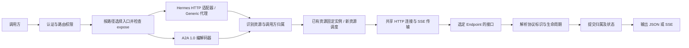

# Hermes 适配与 A2A 1.0 开发方案

日期：2026-09-30；状态更新：2026-10-05。**本期 Hermes HTTP、A2A 1.0、能力发现和后台核查已实现，双实例原生资源与官方 SDK 验收通过。** A2A 0.3.0 已直接替换为 1.0，不保留兼容编解码器；规范固定 v1.0.1，官方 Python SDK 固定 1.2.0。当前实现契约见 [HTTP API](HERMES_HTTP_API.md)，实际测试范围见 [验证记录](../VALIDATION.md)。下文保留设计目标和验收矩阵，不能将其全部视为真实环境已测项目：审批和异常帧等由自动回归覆盖，生产容量及 Linux 实机部署未验证；P6 资源持久化仍是后续里程碑。

固定 Hermes v2026.9.24 的 Runs events 是一次性消费队列，完成后再次订阅返回 404，不支持调研快照中的序号回放。网关保留上游重连参数，仅在上游明确声明时报告 `run_events_replay`；当前实例为 false。A2A 订阅首 Task 和 returnImmediately 的发布版差异已在 Hermes 专用适配层处理，并用官方 SDK 验证。

前置调研见 [Hermes Agent 会话接口调研](HERMES_SESSION_API_RESEARCH.md)。原有架构与实现记录见 [DESIGN.md](../DESIGN.md)、[DEVELOPMENT.md](../DEVELOPMENT.md)。本文对下一阶段明确调整的部分，以本方案为准。

## 1. 开发目标与交付范围

一个 Route 继续代表一个逻辑 Agent，一个 Endpoint 代表它的一个部署实例。**同一路由同时开放代理聊天和 A2A，首先实现 Hermes 适配。**

确定以下设计：

1. 新配置删除 Route 上互斥的 `protocol`，增加 `agent_type` 和 `expose`。
2. Endpoint 增加 `interfaces`，分别配置代理服务和 A2A 服务的地址、凭据、协议版本及探活地址。
3. `agent_type` 首期支持 `generic`、`hermes`；旧配置迁移为 `generic`，保留原行为。
4. Hermes 同时接入原生 API Server 和 A2A 插件；两者默认端口分别为 8642、9900。
5. 实现 A2A 1.0 的 JSON-RPC/HTTP + SSE 处理器，移除原有 0.3.0 处理器；只允许接口版本 1.0。
6. 公共层负责认证、资源归属、调度、生命周期；适配器负责识别上游请求及响应语义。
7. 对外统一使用 `/agents/{appId}`，只暴露应用标识和接口语义；`appId` 对应内部 Route 的 `key`。

本期交付范围：

| 能力 | 交付要求 |
| --- | --- |
| 同一路由两种入口 | `/agents/{appId}/api/...`、`/agents/{appId}/v1/...` 与 `/agents/{appId}/a2a` 同时可用，共用实例集合 |
| Hermes 会话 | 创建、详情、列表、历史、修改、删除、fork、同步聊天和 SSE 聊天 |
| Hermes Runs | 提交、状态、事件订阅、停止、steer、审批 |
| 兼容聊天接口 | Chat Completions 显式会话续接；Responses 响应链及命名会话 |
| A2A 1.0 | Agent Card、SendMessage、SendStreamingMessage、GetTask、ListTasks、CancelTask、SubscribeToTask |
| 兼容与运维 | 旧配置迁移、旧协议拒绝回归、能力探测、按接口健康检查、资源引用和排空 |

本期保留单进程单节点、Go 标准库运行时和管理配置文件持久化。资源归属仍在内存；**跨重启恢复归属单列后续里程碑**。HTTP/REST 形式的 A2A 绑定、gRPC、推送通知、跨版本报文转换、Desktop/终端 WebSocket，以及跨协议续接同一底层会话，不作为本期验收项；Agent Card 必须如实声明能力。

## 2. 规范与验证基线

| 对象 | 固定基线 | 用途 |
| --- | --- | --- |
| A2A 规范 | 官方发布标签 `v1.0.1` | 1.0 协议结构、版本协商、状态机、错误与 JSON-RPC 绑定 |
| A2A Python SDK | 官方发布标签 `v1.2.0` | 外部客户端互操作测试；开发时锁定安装包与依赖 |
| Hermes 发布版 | `v2026.9.24`，提交 `f97608f178d1ffeca59860195ab7da295f7c8e5f` | 真实联调基线 |
| Hermes 调研快照 | `f42f579cf8bac4918ac9599bece71618afadd846` | 补充接口行为对照；与发布版差异必须单独记录 |
| 本框架现状 | `f3227b54edf03b86919173d5ee79f6f79442cc0f` | 回归基线 |

规范发布版本、SDK 包版本、线上协议版本是三个概念。A2A 规范以 `Major.Minor` 协商，因此新接口的 `protocol_version` 和 `A2A-Version` 使用 **`1.0`**，不使用 SDK 版本 `1.2.0`，也不使用规范补丁号 `1.0.1`。[A1] [A2]

规范优先于某个上游的宽松行为。例如 Hermes 接受部分旧方法别名，不能据此把 1.0 报文视为 0.3.0。开发阶段先从官方规范/schema 整理请求、响应、错误和事件样例，再验证 Hermes 实际输出。

## 3. 配置模型

### 3.1 Route

| 字段 | 规则 |
| --- | --- |
| `agent_type` | `generic` 或 `hermes`；省略时为 `generic` |
| `expose` | 非空且不重复的数组，值为 `proxy`、`a2a`；新形态请求显式指定 |
| `endpoints` | 同一逻辑 Agent 的实例，保留嵌套创建和现有 CRUD |
| `session_policy` | 保留普通粘性配置；对已知 Hermes/A2A 资源，归属目录优先于请求头提示 |
| `agent_card` | 保留管理员提供的描述性字段；最终接口地址、版本、认证和能力由网关生成 |
| 其他字段 | `key`、`enabled`、`balance_policy`、`timeout`、`allowed_methods`、`version` 延续现有职责 |

`expose` 表示配置允许开放的入口，能力探测表示上游实际支持什么；探测结果不能自动扩大 `expose`。`allowed_methods` 继续作用于 proxy；A2A 通过自己的方法表校验。

### 3.2 Endpoint 与接口

Endpoint 保留稳定的 `id`、名称、权重、管理状态和配置版本。接口对象支持：

| 字段 | 含义 |
| --- | --- |
| `url` | proxy 为基础地址，a2a 为准确的 JSON-RPC URL；不根据另一个接口的端口推导 |
| `token` | 当前接口的上游 Bearer Token（管理响应不回显） |
| `health_url` | 可选探活 URL；探活策略由接口/适配器处理 |
| `protocol_version` | A2A 仅使用 `1.0`；proxy 不填写 |

首期要求每个配置的 Endpoint 都具备 `expose` 中的接口；同一路由各 Endpoint 的 A2A 协议版本必须一致。实例能力差异保留为探测信息，不阻止健康接口代理。API Server 和 A2A 接口必须属于同一个 Hermes 部署/profile；同主机名或相邻端口本身不能证明这一点。

新建路由请求示例，ID 和版本由服务端生成：

```json
{
  "key": "assistant",
  "agent_type": "hermes",
  "expose": ["proxy", "a2a"],
  "enabled": true,
  "session_policy": {
    "enabled": true,
    "header": "X-Session-ID",
    "idle_ttl_seconds": 86400
  },
  "timeout": {
    "response_header_ms": 120000,
    "stream_idle_ms": 120000,
    "max_duration_ms": 3600000
  },
  "endpoints": [
    {
      "name": "hermes-1",
      "weight": 100,
      "state": "active",
      "interfaces": {
        "proxy": {
          "url": "http://hermes-1:8642",
          "token": "replace-with-hermes-http-secret",
          "health_url": "http://hermes-1:8642/health"
        },
        "a2a": {
          "url": "http://hermes-1:9900/",
          "token": "replace-with-hermes-a2a-secret",
          "protocol_version": "1.0",
          "health_url": "http://hermes-1:9900/.well-known/agent-card.json"
        }
      }
    }
  ]
}
```

上面的超时是建议起点，实际按任务时长调整。Endpoint 地址、`agent_type`、A2A 版本以及入口移除涉及现有引用时返回 409；首期采用保守的 Endpoint 级引用保护，避免更换地址后仍使用旧绑定。关闭整个 Route 仍可立即拒绝新数据请求，并保留绑定供排查。

### 3.3 健康、能力与负载

按 `(endpoint_id, interface)` 维护健康和能力缓存：proxy 接口失败不自动宣告 a2a 接口失败。新请求只选择目标接口健康且为 active 的实例；能力不足、探测失败或缓存过期不影响调度。已有资源固定回原实例，该接口不健康时返回不可用。

Endpoint 级并发上限统计两个入口的 HTTP 请求总数，另提供各接口计数。后台 Run/Task 数独立统计。draining 实例不接新会话，允许已绑定会话的新轮次及查询、停止、审批；fork 属于新建会话，在 draining 时拒绝。disabled 实例或被 `expose` 关闭的入口不再服务请求，但保留归属记录。

### 3.4 对外地址契约

统一 Agent 基础地址为 `https://api.example.com/agents/{appId}`。`appId` 是公开应用标识，取现有 Route 的 `key`，不是 Route 的内部 ID 或 Endpoint ID；管理配置无需因此重命名 `key`。

| 用途 | HTTP 方法 | 对外路径 |
| --- | --- | --- |
| A2A Agent Card | GET | `/agents/{appId}/.well-known/agent-card.json` |
| A2A JSON-RPC（含 SSE） | POST | `/agents/{appId}/a2a` |
| 创建/列出会话 | POST / GET | `/agents/{appId}/api/sessions` |
| 会话详情/修改/删除 | GET / PATCH / DELETE | `/agents/{appId}/api/sessions/{id}` |
| 会话历史 | GET | `/agents/{appId}/api/sessions/{id}/messages` |
| 分支会话 | POST | `/agents/{appId}/api/sessions/{id}/fork` |
| 同步聊天 | POST | `/agents/{appId}/api/sessions/{id}/chat` |
| 流式聊天 | POST | `/agents/{appId}/api/sessions/{id}/chat/stream` |
| Chat Completions | POST | `/agents/{appId}/v1/chat/completions` |
| Responses | POST | `/agents/{appId}/v1/responses` |
| 提交 Run | POST | `/agents/{appId}/v1/runs` |
| Run 状态、事件和控制 | 沿用原接口方法 | `/agents/{appId}/v1/runs/{run_id}` 及其原生后缀 |

兼容 OpenAI 格式的客户端设置 `base_url = "https://api.example.com/agents/{appId}/v1"`。会话和 Runs 保留原生路径后缀及报文格式，支持范围以第 6 节为准。

新公开地址不包含 `proxy`、`gateway`、`hermes` 或实例信息；内部 `expose: ["proxy", "a2a"]` 和 `interfaces.proxy` 继续表示实现职责，不作为公开 URL 的组成部分。路径分发和旧路径别名已在 P1 实现；表中的 A2A 1.0 行为已本地实现，Hermes 资源语义仍待 P3。旧路径的兼容安排见第 9.4 节。

## 4. 请求架构与代码边界



分层职责：

- **入口层**：认证、公开 `appId` 到 Route `key` 的解析、`expose` 校验、HTTP 方法和路径权限。
- **Agent 适配器**：按 `agent_type` 识别 proxy API、准备请求、提取响应中的会话/run/response 标识、识别终态；Hermes 能力探测也在此实现。
- **A2A 编解码器**：按版本处理 Card、JSON-RPC 请求/响应、标准错误和 SSE oneof；可服务任意兼容的 Agent 类型。
- **公共资源层**：原子预留、归属查找、别名、调用方隔离、容量、引用计数和状态更新。
- **传输层**：连接池、上游凭据、超时、流式复制、客户端断开传播；不选择替代实例或自动重发写请求。

内部接口围绕 `PrepareRequest`、`ObserveResponse`、`ObserveEvent`、`DiscoverCapabilities` 等实际调用点收敛。网络请求与响应写入都不得持有配置/资源锁。首期保持在 `internal/gateway` 包内实现，避免为只有两个类型预先建设动态插件框架。

Hermes A2A 请求直接调用所配置的 A2A 插件接口；不把 `SendMessage` 隐式翻译成 `/v1/runs`。A2A 的任务语义由 A2A 服务实现，网关负责协议校验和正确转发。

在 `/agents/{appId}` 下，先识别保留的 `/a2a` 与 `/.well-known/agent-card.json`，两者均要求 `expose` 包含 `a2a`；其他路径再检查 `expose` 是否包含 `proxy` 并进入 HTTP 适配器。保留路径的方法错误、入口关闭或未知子路径不能落入通用代理。转发原生 HTTP 请求时，仅移除 `/agents/{appId}` 前缀，并按配置拼接上游基础路径；A2A 则使用 `interfaces.a2a.url` 的准确地址。

## 5. 公共资源归属与安全边界

### 5.1 资源目录

将现有 session/task/context 的共性收敛为资源目录，至少覆盖 `hermes_session`、`hermes_run`、`hermes_response`、`a2a_context`、`a2a_task`。

```text
正向键：(caller_id, route_id, resource_kind, public_id)
值：endpoint_id, interface, upstream_id, parent_id,
    binding_generation, lifecycle_state, last_seen_at, active_refs

反向键：(caller_id, route_id, resource_kind, endpoint_id, upstream_id)
值：public_id

别名键：(caller_id, route_id, namespace, client_alias)
值：canonical public_id
```

`resource_kind` 防止两种协议下相同文本 ID 意外合并；网关配置的 caller ID 为身份来源，不信任请求正文中的 `user_id` 或任意身份头。上游 A2A `tenant` 是接口路由参数，不能作为网关用户身份。

资源 ID 可由网关生成，或在显式创建时接受客户端别名。Hermes 上游 ID 使用独立随机命名空间，避免不同调用方自行指定相同 ID 后操作同一上游会话。调用方只看到公开 ID；适配器在已知协议字段、路径和请求头中转换 ID，不对正文文本、工具输出或任意 metadata 递归替换。

### 5.2 路由规则

1. 只有明确的新建操作可以调度实例；对已有资源的请求先查归属与权限。
2. 已知资源无需调用方额外知道实例地址；`X-Session-ID` 只是可选关联提示，不能覆盖已确定的归属。
3. 路径、请求头、正文引用了不同会话时拒绝冲突；绝不以“某个字段优先”静默访问另一会话。
4. 未知/其他调用方的 Hermes 资源统一返回 404；A2A 返回对应标准不可访问/不存在错误，避免泄露归属。
5. 上游返回新 ID 时，先建立映射再发送 JSON/首个包含 ID 的事件。容量不足不能把未登记的 ID 交给客户端。
6. 创建请求发送前原子预留绑定；并发首次请求落到同一实例。发送后结果不明时保留预留，不自动换实例或创建第二份资源。

压缩后的 ID 建立别名，原入口仍可找到相同会话谱系和实例。fork 创建一个新的公开会话，但固定在父会话所在实例。别名不自动赋予其他调用方访问权。

### 5.3 列表与隔离

Hermes `/api/sessions` 和 A2A `ListTasks` 只返回该调用方通过此网关建立的资源。先依据本地归属目录确定可见集合，再按需要有限并发查询原实例，完成过滤和分页；不直接转发上游全量列表。

分页游标由网关生成并绑定 caller、route、筛选条件与列表快照，不复用某一个实例的游标代表全路由结果。跨实例查询失败时显式报错，不能把残缺列表当完整成功。上游直接创建、或网关重启后丢失归属的资源，本期不自动导入。

API 级资源隔离不等于工具执行环境隔离：多个调用方共享一个 Hermes profile 时，工具、文件和长期记忆可能共享。需要这些层面的隔离时，应配置独立 profile/实例及独立路由权限。

## 6. Hermes HTTP 适配

入口使用 `/agents/{appId}/...`，具体会话和聊天地址见第 3.4 节。`generic` 延续原有透传；`hermes` 使用显式支持的路径表，未实现的资源操作返回清晰的不支持错误，不能退回未经归属校验的通用代理。

| 接口组 | 适配行为 |
| --- | --- |
| 创建会话 | 接受 `id`/`session_id` 别名或生成 ID，预留实例，注入隔离后的上游 ID，建立双向映射 |
| 会话详情/历史/PATCH/DELETE | 路径查归属；转换固定字段；活跃会话删除遵从 Hermes 409，不将 DELETE 当停止 |
| 会话列表 | 使用调用方可见资源目录；返回 Hermes 兼容的列表形状和分页信息 |
| fork | 依据父会话选实例，登记子会话和 lineage，处理父会话的 `branched` 状态 |
| chat / chat/stream | 从资源归属确定实例，处理有效会话 ID、run ID、审批事件、终态及断开 |
| Runs | 本期要求 `session_id` 引用已创建会话，绑定响应 `run_id`；后续状态、events、stop、steer、approval 全部固定原实例 |
| Chat Completions | 支持显式 `X-Hermes-Session-Id`；解析公共别名并注入真实上游 ID；首期要求先创建会话，避免用开场白指纹决定身份 |
| Responses | 识别 `previous_response_id`、`conversation`；新链可调度，已有链必须找到原实例；保存新 response 和会话归属 |
| models / capabilities | 可从健康实例/能力缓存获取；对外报告经过网关限制后的能力，不直接宣传上游全部接口 |

`session_policy.enabled=false` 不能关闭 Hermes 资源归属校验；该字段只影响 generic 粘性。原生 chat stream 回传的 run 支持状态/停止/审批，不因此承诺存在 Runs 的可重放 events 缓存。

支持集之外的 Hermes jobs、文件/浏览器控制、Dashboard、系统管理等接口不随聊天路由自动开放。`X-Hermes-Session-Key` 会影响长期记忆范围，需按调用方加命名空间后再传给上游；HTTP 中的会话头不作为认证凭据。

## 7. A2A 1.0 实现

### 7.1 版本选择与兼容

请求入口为 `POST /agents/{appId}/a2a`。新 1.0 路由使用 `A2A-Version: 1.0`；JSON-RPC 绑定按规范通过 HTTP Header 传递服务参数。缺失/空版本按规范解释为 0.3，不能自动升级成 1.0；若路由不支持请求版本，返回 `VersionNotSupportedError`。[A1]

只支持 `1.0`，不进行协议翻译。schema 2 明确声明 `protocol_version: "0.3.0"` 时拒绝配置，需升级上游后将配置改为 `1.0`。schema 1/旧管理形态中未声明版本的接口迁移为 1.0，要求上游同时升级。

处理器同步校验 JSON-RPC envelope、请求 ID、方法、必填参数、版本及能力，按规范映射错误；不要沿用“所有失败都返回内部错误”的粗粒度处理。网络/认证失败与已形成 JSON-RPC 的业务错误分别处理。

### 7.2 方法矩阵

本期选择 JSON-RPC + SSE 绑定，因此 A2A 只需两个 HTTP 入口：第 7.4 节的 Card GET 和统一的 RPC POST。下列六项是 JSON-RPC `method` 值，全部发送到 `/agents/{appId}/a2a`，无需各自增加 HTTP 路径。`SendStreamingMessage`、`SubscribeToTask` 在同一 POST 请求上返回 `Content-Type: text/event-stream`，不另设 `/a2a/stream` 或 GET 订阅入口。

| 1.0 方法 | 处理规则 |
| --- | --- |
| `SendMessage` | 无旧引用时创建；有 context/task 时验证归属；支持规范中的阻塞/立即返回行为；解析 `result.task` 或 `result.message` |
| `SendStreamingMessage` | 绑定首个 Task/Message 后输出；后续处理状态和 artifact 事件 |
| `GetTask` | 将公开 task ID 转换为原实例 ID，更新状态与历史中的已知资源引用 |
| `ListTasks` | caller 可见资源集合的状态同步、过滤和分页；不泄露共享上游中的其他任务 |
| `CancelTask` | 固定原实例，遵从上游取消能力；请求发出不等于任务已进入取消终态 |
| `SubscribeToTask` | 固定原实例；非终态任务重订阅，首事件必须是当前 Task；终态订阅返回规范错误 |

查询任务示例，`task-123` 为当前调用方已获得的公开任务 ID：

```http
POST /agents/my-app/a2a
Authorization: Bearer <token>
A2A-Version: 1.0
Content-Type: application/json

{
  "jsonrpc": "2.0",
  "id": "request-1",
  "method": "GetTask",
  "params": {"id": "task-123"}
}
```

推送通知配置、认证后的扩展 Card 等可选能力不在本期范围；后续采用 JSON-RPC 绑定实现时也通过相应 RPC 方法提供。推送接收 URL 属于调用方提供的回调地址，不是本期必须新增的 Agent HTTP 入口。

### 7.3 报文与状态机

独立实现 1.0 codec，覆盖以下变化：

- `supportedInterfaces` 中的 `protocolBinding: "JSONRPC"` 与 `protocolVersion: "1.0"`。
- `ROLE_USER`、`ROLE_AGENT`，以及按成员区分的 Part；保留合法多模态内容。
- `SendMessageResponse` 的 task/message oneof。
- `StreamResponse` 的 task、message、statusUpdate、artifactUpdate oneof；每个 SSE data 仍带完整 JSON-RPC envelope。
- 终态 `TASK_STATE_COMPLETED`、`TASK_STATE_FAILED`、`TASK_STATE_CANCELED`、`TASK_STATE_REJECTED`。
- `TASK_STATE_INPUT_REQUIRED`、`TASK_STATE_AUTH_REQUIRED` 等保留任务引用；不因等待外部输入而释放归属。

禁止依赖旧的 `kind`、小写角色/状态或 `final` 字段。未知的未来状态不能被当成成功终态。仅转换标准协议拥有的标识位置，parts 中的业务 JSON 和 metadata 保留语义；对协议允许的扩展字段采用兼容读取策略。

流校验遵从规范：Message-only 流发送一个 Message 后关闭；Task 流从 Task 开始，再发送状态/artifact 更新，观察到终态后正常关闭。提前 EOF、格式错误或超时不能伪造 `COMPLETED`；已有任务转入待核查状态，可通过 GetTask 恢复观察。[A1]

### 7.4 Agent Card

使用 `GET /agents/{appId}/.well-known/agent-card.json` 作为应用专属 Card，调用方通过明确 Card URL 或服务目录发现；多 Agent 网关不让根路径的单一 Card 冒充所有路由。Card 和 RPC 都沿用调用方 Bearer 认证及路由权限校验。

`supportedInterfaces` 只列网关实际提供的 A2A 接口，地址由 `GATEWAY_PUBLIC_URL` 和 `/agents/{appId}/a2a` 构造。`/a2a` 是本项目选定的路径，不是 A2A 规范强制的命名；客户端以 Card 宣告的 URL 为准。Hermes 原生聊天 URL 不属于 A2A binding，不能填入该数组。所有上游地址、签名和上游认证声明在生成外部 Card 时重新处理。

当 `GATEWAY_PUBLIC_URL=https://api.example.com` 且 `appId=my-app` 时，Card 的接口字段如下（仅展示片段）：

```json
{
  "supportedInterfaces": [
    {
      "url": "https://api.example.com/agents/my-app/a2a",
      "protocolBinding": "JSONRPC",
      "protocolVersion": "1.0"
    }
  ]
}
```

描述和 skills 来自配置；对外 Card 声明网关已实现且路由配置允许的能力。上游能力差异保留为探测信息，不通过整体 ready 拒绝代理，具体方法是否支持由上游实际响应确定。若上游 Card 需要 `tenant`，保存为接口级配置/探测数据并在转发时使用正确值；不让客户端切换到未经授权的上游 tenant。

## 8. 幂等、流与后台生命周期

### 8.1 数据面幂等

移除 Hermes 已支持接口上的无条件幂等头删除。Hermes Runs 的 `Idempotency-Key` 转换为包含 caller、route、接口/操作范围的稳定命名空间，符合上游长度限制；不与管理 API 的创建幂等表混用。

网关维护 `(caller, route, operation, key) → 原实例、请求指纹、处理状态` 的预留索引，首次发送前落到同一实例；同键不同指纹返回 409，同键结果未知的重试仍访问原实例。指纹包含影响会话/执行的请求体及相关头，不能只比较 prompt。

上游支持去重时由上游执行最终去重，网关不承诺未实现接口具备 exactly-once。A2A 的 JSON-RPC request ID、message ID 也不能擅自当作写操作幂等保证。连接失败、502/504、客户端超时均不自动跨实例重发。

本期索引仅在内存：同进程内重试可以稳定选实例；网关重启后不能仅因 Hermes 自身有持久幂等，就宣称网关仍能恢复原 run。已丢失资源归属的恢复请求必须失败，不能重新当作创建。

### 8.2 SSE

共享 SSE 帧解析器处理多行 data、CRLF、注释、空行、`event`、`id`、`retry` 和单事件上限，及时刷新，不聚合完整流。Hermes 心跳注释原样保留；Runs `Last-Event-ID`/事件序号保持原值，公开 run ID 则按协议字段映射。

| 场景 | 网关行为 |
| --- | --- |
| 原生 chat stream 断开 | 传播 HTTP 取消；继续保留已登记 run 引用，观察上游最终状态，不把断开当完成 |
| Runs events 断开 | 关闭订阅连接，保留执行资源；不隐式调用 stop |
| Runs events 重连 | 原实例、原 run，转发 `Last-Event-ID`；仅支持回放的上游可恢复事件。固定发布版完成订阅后返回 404 |
| A2A 流断开 | 保留 Task/context，显式取消用 CancelTask，重订阅用 SubscribeToTask；不假定上游必然继续执行 |
| 流中途失败 | 按对应协议报告或断开，保留已完成的映射，不输出另一个协议的错误帧 |

### 8.3 后台任务、容量与排空

HTTP lease 与 Run/Task 的生命周期引用分开。返回 202、SSE 断开或请求超时后，后台任务仍可能运行；通过已知状态事件及有界后台查询更新终态。暂时查询失败记为未知，不能视为结束。

已有资源引用阻止实例删除/地址替换。非终态、审批等待和状态未知资源不按普通空闲 TTL 淘汰；其余映射可按保留期清理，清理后返回不可恢复错误。绑定容量耗尽时拒绝新增，避免淘汰仍有效资源导致漂移。

默认保留期沿用现有 24 小时：无活跃/子资源引用的会话与别名按空闲时间清理，终态 task/run/response 映射按终态后的最近访问时间清理；有引用时一并延长父资源存活期。上游可能更早淘汰响应或事件缓存，此时如实返回不可用，不能用网关映射仍存在掩盖上游数据已丢失。

排空顺序为停止新建 → 继续服务已有会话及控制请求 → 确认后台任务结束/显式关闭会话 → disabled → 删除。空闲但仍需恢复的会话也属于引用；仅靠 HTTP 并发归零不能完成排空。

## 9. 配置迁移、管理 API 与恢复边界

### 9.1 schema_version 1 → 2

| 旧配置 | 迁移结果 |
| --- | --- |
| `protocol: "proxy"` | `agent_type: "generic"`、`expose: ["proxy"]` |
| `protocol: "a2a"` | `agent_type: "generic"`、`expose: ["a2a"]`、接口版本 `1.0`（上游必须同步升级） |
| Endpoint `url/token/health_url` | 移入原协议对应的 `interfaces` 项 |
| ID、配置版本、权重、管理状态、会话策略 | 保持不变，不重新生成资源身份 |

加载时先识别文件 schema，再使用对应 DTO 解码和迁移；迁移后统一校验。启动读取旧文件时只在内存正规化，首次成功管理写入再原子提交 schema 2，写入前保留可恢复的旧版备份。未知 schema 和混杂冲突字段明确拒绝。

管理 API 在兼容期接受纯旧形态请求并正规化，GET 返回新形态；同一请求同时带 `protocol` 与 `expose/interfaces` 返回冲突。旧幂等回执保留原请求指纹、原响应和资源 ID，不因迁移再次创建；新回执使用新响应形态。补充旧回执重放的专门兼容测试。

schema 2 文件不能直接交给旧二进制。回滚必须同时恢复旧二进制及对应配置备份；若升级后已有新配置变更，应先导出保留，不能默默丢弃。迁移不修改运行中的用户凭据。

### 9.2 管理接口更新

同步更新 OpenAPI 的 Route、RoutePatch、Endpoint、EndpointPatch、接口配置和兼容字段说明。Endpoint PATCH 合并 `interfaces`，仍受 ETag 与引用保护约束。

详情增加各接口健康/能力、HTTP 并发、非终态 Run/Task、未知状态与资源引用数量。沿用 `/sessions`、`/tasks` 查询，并增加 Hermes `/runs` 查询及接口/资源类型筛选；这些都是管理端视图，不代替调用方的原生会话接口。

### 9.3 绑定持久化单独交付

本期验收明确：重启恢复配置，清空运行时目录；旧 Hermes/A2A 资源不能随机转发。`generic` 原有无状态/请求头粘性语义保持兼容。

后续持久化里程碑需同时保存资源双向映射、别名、创建预留、幂等定位和 Endpoint 身份代次；先保证元数据提交成功，再向客户端暴露新标识。重启后按原实例核查状态，而不是恢复旧 HTTP 连接或工具进程。

持久化方案另行选择并压测；在选定前不引入数据库/Redis 依赖，也不以每个 token 或 SSE 事件重写管理配置文件。具备崩溃窗口、写失败、恢复及容量回收测试后，才能声明支持跨重启会话恢复。

### 9.4 旧公开路径兼容

兼容期保留 `/proxy/{key}/{path...}` → `/agents/{appId}/{path...}`、`/a2a/{key}` → `/agents/{appId}/a2a` 的旧路径别名，其中 `appId = key`。已有 Card 路径结构保持不变。新 Card、客户端配置和使用示例统一使用第 3.4 节的规范地址，旧路径仅用于存量客户端迁移。

别名直接复用相同处理器、认证、`expose`、资源归属和限流逻辑，不进行 HTTP 重定向，以免影响 POST 请求和 SSE。别名不绕过版本协商，也不提供跨 A2A 版本转换。后续移除旧路径另行公告，不与本次配置迁移同时强制切断旧客户端。

## 10. 文件改造清单

以下路径已按 2026-10-13 的目录整理更新。包边界与依赖关系见 [Gateway 代码结构](../internal/gateway/README.md)。

| 文件 | 主要改动 |
| --- | --- |
| `internal/gateway/protocol/model.go`、`runtime/config/route.go` | Route/Endpoint 字段、接口版本、默认值及组合校验 |
| `internal/gateway/runtime/config/migration.go`、`config/store.go` | schema 1 DTO、新旧管理输入正规化、备份和迁移 |
| `internal/gateway/runtime/gateway.go` | 迁移接入、资源目录初始化、运行状态恢复边界 |
| `internal/gateway/runtime/config/admin.go`、`config/views.go`、`runtime/admin.go` | CRUD、ETag/引用保护、接口健康和 Runs 管理查询，运行时负责配置事务 |
| `internal/gateway/runtime/scheduler.go`、`runtime/resource/directory.go` | 按接口调度、原子归属/别名、引用与生命周期 |
| `internal/gateway/runtime/proxy.go`、`runtime/protocols.go` | `/agents/{appId}` 分发、保留路径优先匹配、旧路径别名、expose 校验、适配器组装、连接与凭据处理 |
| `internal/gateway/hermes/`、`runtime/health.go` | Hermes 路径表、ID 转换、能力发现、幂等和事件 |
| `internal/gateway/a2a/` | A2A 1.0 转发、Card、错误、资源映射和任务分页 |
| `internal/gateway/protocol/http.go`、`a2a/stream.go`、`hermes/stream.go` | 共享 SSE 解析、边界限制及逐事件观察 |
| `api/openapi.yaml`、`cmd/gateway/main.go` | 管理契约及必要的资源容量/后台查询选项 |
| `internal/gateway/runtime/*_test.go`、`runtime/resource/*_test.go`、`tests/integration/`、`tests/integration/testdata/`、`deploy/hermes-local/` | 包内状态回归、公开接口集成、协议 fixtures、模拟上游、官方 SDK 与真实 Hermes 联调脚本；旧配置 fixture 保留在 `runtime/testdata/` |
| `README.md`、`DEVELOPMENT.md`、`VALIDATION.md` | 实际能力、迁移/回滚方式、验证版本及结果 |

## 11. 实施顺序与完成标准

| 阶段 | 工作 | 阶段完成标准 |
| --- | --- | --- |
| P0：契约固定 | 锁定规范/schema、SDK/Hermes 版本、公开路径及 Card URL，整理请求/响应/错误/SSE fixtures | 覆盖 1.0 所选全部方法；标记 Hermes 版本差异，不能用自编 fixtures 替代规范 |
| P1：模型与入口 | schema 2、迁移、interfaces、expose、接口健康、统一公开入口和旧路径别名 | 同一 appId 下两种入口可达、保留路径不误转发；旧配置迁移和旧协议拒绝回归通过 |
| P2：资源目录 | 公共资源/别名/幂等预留、冲突和权限、容量与后台引用 | 并发首次创建一致；跨 caller 不泄露；未知归属不重选；管理删除有引用被拒绝 |
| P3：Hermes HTTP | Sessions/Runs/兼容聊天接口、已知字段转换、能力发现 | 双模拟实例完成创建→续聊→历史→run事件→停止/审批；fork/压缩/重试不漂移 |
| P4：A2A 1.0 | codec、Card、全部所选方法、版本与错误、SSE状态机 | 官方 SDK 对网关所有目标操作通过；旧版请求明确拒绝 |
| P5：集成与交付 | 两个真实 Hermes 实例，同一路由同时开放两种入口；限流、故障、排空和迁移验证 | 生成版本固定的互操作报告；README 只声明已验证能力；保留已知限制 |
| P6：后续恢复能力 | 资源归属持久化与重启核查 | 完成存储设计及崩溃一致性验收后单独发布，不纳入 P1–P5 的跨重启承诺 |

P2 是 P3/P4 的共同前置；P3/P4 完成后再进行 P5。开发阶段可按模块提交，但本期发布以 **P1–P5 全部完成** 为门槛，不能只增加 `agent_type` 字段就宣称完成 Hermes 适配。

## 12. 测试与验收矩阵

| 类别 | 必须覆盖 |
| --- | --- |
| 配置 | schema 1/2、混用拒绝、缺失接口、接口版本不一致、ETag、迁移写失败、备份/回滚、旧幂等回执 |
| 两种入口 | 同一 key 两种入口同时成功；独立端口/凭据；关闭一个入口、单接口故障与能力不匹配 |
| 公开路径 | appId 正确映射 key；Card 仅宣告规范 RPC URL；六种 RPC 共用 POST，流返回 SSE；保留路径不落入 proxy；旧别名认证/归属一致且无重定向 |
| 会话 | 同 ID 不同 caller、头/路径/正文冲突、首次并发、fork、压缩别名、未知 ID、过期、重启 |
| 幂等 | 相同 key 重放、不同正文冲突、不同 caller 同 key、首次响应丢失、接口超时、不跨实例重发 |
| Runs | 202 后保持引用、等待审批、stop 后尚未退出、事件重连、缓存不足、未知状态与后台查询失败 |
| A2A 1.0 | task/message 两种响应、所有目标方法、版本错误、tenant、标准错误、终态继续发送/订阅拒绝 |
| 流 | 正确首事件、多行 data、注释/心跳、CRLF、慢客户端、断开、帧超限、提前 EOF、未知字段和状态 |
| 隔离 | 会话/任务列表分页不泄露；同名上游 ID 跨实例隔离；业务 parts/metadata 不被错误替换 |
| 运维 | 限流计数释放、后台任务容量、draining、接口 URL 替换保护、停机时在途任务可观察 |

本地实施时执行项目既有 `go test ./...`、`go test -race ./...`、`go vet ./...` 和构建检查。受限环境可使用 `GATEWAY_TEST_IN_MEMORY=true` 跑现有 net.Pipe 路径；真实 TCP、SSE 断开和官方 SDK 互操作另行执行并记录，不能相互替代。

真实验收链路至少包含：**官方 A2A SDK → 本网关 → 两个 Hermes A2A 实例**，以及 **HTTP/SSE 客户端 → 同一网关路由 → 对应 Hermes API Server 实例**。验证共用实例集合，不要求 A2A context 与 HTTP session 自动变为同一段对话。

最终交付物包括迁移工具/兼容逻辑、更新后的管理 OpenAPI、数据面使用示例、自动测试、固定版本联调脚本与报告，以及明确列出的重启恢复边界。

## 13. 参考资料

- [A2A 规范 v1.0.1][A1]：重点为版本协商、JSON-RPC 绑定、流生命周期、Agent Card 与错误定义。
- [A2A Python SDK v1.2.0][A2]：用于测试客户端；其版本号不是协议版本号。
- [Hermes 会话调研](HERMES_SESSION_API_RESEARCH.md)：固定提交的 API Server、Runs、A2A 源码与接口依据。
- [当前代理实现](../internal/gateway/runtime/proxy.go)、[当前 A2A 实现](../internal/gateway/a2a/handler.go)、[配置存储](../internal/gateway/runtime/config/store.go)、[路由模型](../internal/gateway/protocol/model.go)。

[A1]: https://github.com/a2aproject/A2A/blob/v1.0.1/docs/specification.md
[A2]: https://github.com/a2aproject/a2a-python/releases/tag/v1.2.0

### 本轮 A2A 实现边界

协议来源固定为 v1.0.1，wire version 为 1.0。ListTasks 使用当前调用方已登记任务的原实例 GetTask 构建快照，不调用上游全局列表；快照 2 分钟有效，绑定调用方/路由版本/筛选条件，默认 pageSize 50、historyLength 0、无 artifacts。当前限制为 4 个并发列表构建、1000 个候选任务/8 MiB 单快照、2 MiB 单页、64 快照/32 MiB 全局缓存；超限拒绝并提示缩小查询。主动后台核查已实现：每 10 秒轮转检查至多 16 个资源，单次探测上限 3 秒；失败保留未知状态和原实例归属。公开 Card 不宣告 tenant，上游 tenant 由 interfaces.a2a.tenant 固定注入。

官方 SDK 已完成 Card 与六个 RPC 的双实例互操作；执行结果和验证边界以 VALIDATION.md 为准。
