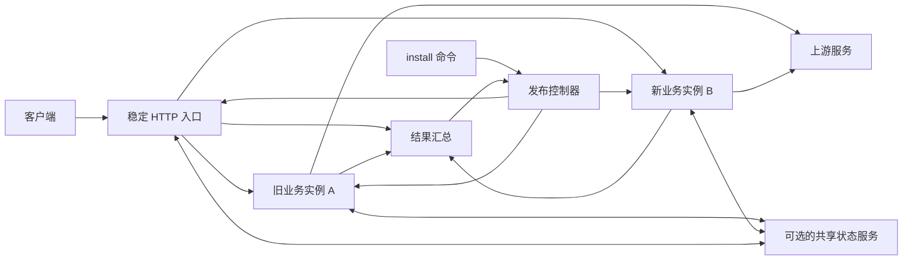

# HTTP 网关同机自动灰度升级设计

日期：2026-10-05。状态：实现前设计，文中命令、接口和目录均为拟议契约，尚未实现。

本文定义可用于不同 HTTP 网关的发布机制。本项目接入步骤见 [Agent 网关实施方案](AGENT_GATEWAY_ROLLOUT_IMPLEMENTATION_PLAN.md)。

## 1. 目标与边界

管理员执行一次新二进制的 `install` 后，系统在同一机器启动独立端口的新实例，使用少量真实请求验证代理能力；验证通过后自动切换新流量，观察通过且旧实例排空后完成发布。验证失败或超时则自动恢复旧版本承接新流量。

必须满足：

- 客户端地址不变，业务版本升级不重启公共入口，不预先停止旧版。
- readiness 通过仅代表可以试运行；真实代理结果决定能否转正。
- HTTP、SSE、协议封装错误分别判定，统计不足不得自动放行。
- 切流不迁移正在传输的连接，不自动重放已发送的业务请求。
- 安装终端断开后发布仍继续，控制进程重启后可根据持久化进度恢复。
- 同时最多一个发布任务、两个业务实例；失败原因、流量指向和残留任务可查询。
- 发布机制不依赖具体网关的路由、身份或 Agent 协议实现。

第一版范围为 Linux/systemd、单机、两个业务实例及固定入口。多机容灾、跨机器状态复制、入口自身无损升级、业务数据逆向迁移和请求执行的 exactly-once 不在承诺范围。宿主机、入口或状态服务故障可能影响两个版本，同机灰度不提供机器级高可用。

## 2. 可复用架构



| 组件 | 职责 | 复用方式 |
| --- | --- | --- |
| Installer | 暂存候选产物、提交幂等发布任务、等待结果 | 适配产物形式与产品目录 |
| Release Controller | 状态机、持久化、健康检查、验证门槛、切流与回退 | 通用核心 |
| Traffic Entry | 固定监听、请求分配、流式转发、记录传输结果 | 通用核心，提供请求分类和亲和性扩展 |
| Process Driver | 启动、停止、检查目标实例 | 首版 systemd 实现，可替换 |
| Gateway Adapter | 请求分类、协议结果判定、亲和性、排空和状态交接 | 每个网关实现 |
| State Provider | 配置版本、会话/资源归属、共享幂等及执行租约 | 无状态网关可省略，有状态网关必须提供 |

发布核心只认识 release、instance、request、profile 和 verdict，不认识 Hermes、A2A task 或具体业务路径。适配器可嵌入网关，也可提供受保护的本机控制接口；其他语言网关通过同一版本化协议接入。

首版在本仓库实现模块边界和契约，不提前发布独立公共 SDK。另一个网关接入验证后，再将通用模块提取为独立包或服务。

### 2.1 进程与权限

推荐入口、发布控制器、业务实例分属独立 systemd unit，有状态网关另设状态服务。可以由同一个二进制的不同子命令提供这些角色，但各角色必须使用独立、固定的产物路径。

发布控制器只暴露 root 可访问的 Unix Socket，管理受产品前缀约束的 unit 和发布目录；数据入口、状态服务、业务实例使用专用低权限用户运行。远程管理 Token 不直接赋予安装任意本机产物的能力。

普通 `install` 只更新业务实例。入口、控制器、状态服务采用独立基础组件版本；业务候选要求新基础协议时拒绝本次灰度，走单独的基础组件迁移流程，不能顺便重启稳定入口。

### 2.2 端口和产物布局

示例端口：公共数据面 `:8080`，业务 A/B 数据面 `127.0.0.1:18080/18081`，业务管理面 `127.0.0.1:19090/19091`。端口可配置，安装前和启动后均校验，不能仅凭端口返回 200 判断候选身份。

以产品名 `http-gateway` 为例：

```text
/opt/http-gateway/
  infrastructure/<infra-id>/gateway      # 稳定组件，普通发布不替换
  releases/<release-id>/gateway          # 不可变业务产物
  releases/<release-id>/manifest.json
/etc/http-gateway/
  gateway.env                           # 既有凭据，升级不重建
  rollout.json                          # 发布策略
/var/lib/http-gateway/
  rollout/current.json                  # 发布状态快照
  rollout/journal.log                   # 发布动作及恢复记录
  rollout/reports/<rollout-id>.json      # 验证和回退报告
  slots/a/                              # 实例独立可写目录
  slots/b/
  shared/                               # 可选，仅状态服务写入
/run/http-gateway/
  controller.sock
  entry.sock
  state.sock                            # 可选
```

业务 unit 的 `ExecStart` 指向确切 release 路径，不能通过可变的 `current` 链接启动，否则旧版异常重启时可能误启动新版。CLI 链接仅供用户调用，不作为运行中实例的版本依据。产物校验哈希、拒绝非预期符号链接，凭据、状态和控制 Socket 使用受限权限，日志不记录 Token 或业务正文。

## 3. 自动发布状态机

| 状态 | 动作及退出条件 | 失败处理 |
| --- | --- | --- |
| `PREPARING` | 检查旧版健康、空闲槽位、端口、容量、产物和兼容性；暂存候选 | 旧版不变，记录 `FAILED` |
| `STARTING` | 启动候选，核对 release、进程 incarnation、配置和协议版本 | 停止未接流量的候选，`FAILED` |
| `VERIFYING` | 候选接收灰度新流量；按 profile 收集完整结果 | 有效失败或截止仍不满足门槛，进入 `ROLLING_BACK` |
| `PROMOTING` | 持久化切流意图，入口 CAS 更新并确认应用版本 | 无法确认则进入恢复核对，不能直接报告成功 |
| `OBSERVING` | 新流量 100% 到候选，旧版保留；完成观察窗口及验证门槛 | 候选失败，进入 `ROLLING_BACK` |
| `DRAINING` | 旧版不接新归属，交接可迁移归属，等待活跃工作归零；继续监控新版 | 新版失败且旧版可用则回退；排空超时保留两版并标记待处理 |
| `COMPLETED` | 持久化新版为稳定版，停止旧版并确认；保留旧产物 | 后续故障走正常运行告警；自动回退保护期已经结束 |
| `ROLLING_BACK` | 新归属切回健康旧版，新版禁止新归属；交接状态并排空 | 旧版不健康或状态不可交接，进入 `RECOVERY_REQUIRED` |
| `ROLLED_BACK` | 旧版承接新流量；候选已排空并停止 | 发布结果为失败，CLI 非零退出 |
| `FAILED` | 灰度前失败，或首次安装失败 | 无旧版时明确无可回退版本 |
| `RECOVERY_REQUIRED` | 自动操作无法安全完成，保存已完成动作和阻塞原因 | 不伪称已回退/已完成，不自动强杀活跃工作 |

`100%` 只描述新归属分配比例。旧版可能仍有存量会话或活跃请求，状态中同时展示分配比例、实际请求比例和剩余工作。

排空截止后即使新流量已经全在新版，也不得报告 `COMPLETED`。保留旧实例，CLI 返回未完成状态；后续可执行 `rollout resume`。两槽位被占用时拒绝新发布。

### 3.1 切流事务和控制器恢复

每次发布分配唯一 `rollout_id`，每次流量配置带递增 `routing_revision`。控制流程为：

1. 将包含预期旧 revision、目标实例及目标权重的意图写日志并同步落盘。
2. 向入口发出幂等 CAS 更新；入口原子替换内存路由快照，不重启 listener。
3. 入口确认已应用 revision，控制器记录提交结果后进入下一状态。

控制器重启后核对日志、入口已应用 revision、systemd 实际进程身份与共享状态，而不是盲目执行上次命令。相同 action ID 可重复调用，不重复启动、重置观察窗口或重复发送业务请求。

入口仅接受经过校验的实例身份。入口自己重启时先恢复已提交路由并与控制器核对；未确认的切流意图不能成为默认新流量目标。控制器短暂不可用时入口保留最后确认策略；候选失联时停止新增归属，只有适配器确认可以安全落到旧版时才本机降级。

服务重启不自动重置观察截止时间。离线期间缺失的成功证据不能补成成功；恢复后到期仍证据不足则回退。候选 incarnation 变化视为候选重启，验证失败，不能继承前一个进程的样本自动转正。

## 4. 流量分配与亲和性

对于明确无状态的请求，使用加权分配；对于有会话、资源或幂等约束的请求，只对首次归属进行灰度选择，之后保持绑定。

适配器生成经过认证的 `AffinityKey`，例如 `(caller, route, interface, logical-session)`；禁止直接以未认证头或原始 Token 作为可信归属。存在多个资源 ID 时，先解析标准资源引用并检查归属冲突，再选择处理实例。资源未知不能作为新会话随意分配。

归属服务原子执行 `LookupOrAssign`，保证并发首请求只建立一份绑定。绑定至少记录业务实例、incarnation、归属 generation 和状态。单纯对 session ID 做一致性哈希不足以替代持久归属，改变候选集合或比例时不能重新映射已有会话。

入口扩展点必须覆盖请求分类与归属解析：普通 HTTP 可从受支持路径和头提取，JSON 协议使用有大小限制的解析器并保留原始正文。不能对任意上传或流式正文无界缓冲；无法安全提取归属的有状态路径应保留旧版并报告未覆盖，不得假定为无状态。

请求带内部 admission 标识到业务实例，业务实例在任何上游副作用前验证归属 generation 和配置版本。客户端提交的同名内部头在入口清除，内部控制身份另行认证；对外调用方鉴权仍由可信身份逻辑完成。

归属交接使用 fencing：先阻止源 generation 新执行，等待活跃租约清零，再更新目标并递增 generation。交接间隙的新请求可有界等待；超时在访问上游前返回可重试错误。旧 generation 的迟到请求不得执行上游调用。

候选必须按请求使用已确认配置快照。发布第一版可在 `VERIFYING` 至最终状态期间冻结路由、凭据和策略写入，以固定验证基线；返回明确的 `ROLLOUT_IN_PROGRESS`，读接口、任务查询和取消继续可用。另一个网关若已有可靠的多实例配置发布机制，可实现快照屏障后取消这项限制。

## 5. 如何判定真实代理成功

### 5.1 标准结果

每次请求最终产生一个逻辑结果，状态为：

- `success`：传输及协议条件均满足，计入成功样本。
- `failure`：确认有代理、协议或策略定义的有效失败，触发失败门槛。
- `excluded`：有效的客户端错误、已确认的主动取消等，不计成功，也不计失败。
- `unknown`：尚未完成、结果丢失或无法分类；不得当作成功。

最小结果字段：

| 字段 | 含义 |
| --- | --- |
| `rollout_id / request_id` | 发布和请求关联；重传按此去重 |
| `release_id / instance_id / incarnation` | 防止混入旧版或重启前样本 |
| `routing_revision / config_revision` | 关联当次实际分配和配置 |
| `profile / operation_class` | 如 http、sse、a2a，以及创建/查询/流式操作 |
| `route_key` | 有界路由标识，用于覆盖报告 |
| `started_at / completed_at / duration_ms` | 窗口及延迟统计 |
| `upstream_status / client_status` | 不能单独作为完整成功依据 |
| `transport_outcome / protocol_outcome` | 传输和语义分别记录 |
| `verdict / reason` | 统一判定和有界原因码 |

报告不保存 Token、请求正文、提示词或响应内容。session/task 等高基数标识不作为 Prometheus label。

### 5.2 协议判据

| 场景 | 成功要求 | 典型失败 |
| --- | --- | --- |
| 普通 HTTP | 满足路由预期状态，完整读取上游响应且向客户端写入完成 | 拨号/TLS 失败、超时、正文截断、写出异常、上游 5xx |
| SSE | 流事件正确转发，并达到协议规定的结束条件；无异常读写错误 | 首帧后中断、错误事件、缺失必要终态、解析失败 |
| JSON-RPC 等封装 | HTTP 成功且封装内为成功结果，必要标识可解析/归属已提交 | HTTP 200 内含协议 error、结果格式错误、归属登记失败 |
| 异步创建 | 创建确认、幂等记录及归属提交成功 | 返回成功但无法后续定位资源 |
| 明确业务拒绝 | 按路由契约区分客户端错误和代理故障 | 不能仅凭所有 4xx 一律排除 |

默认 HTTP 成功码为 2xx，其他预期状态由路由显式声明。上游 429/5xx、网关过载和协议内部错误默认计有效失败；明确由合法客户端配额或输入导致的错误可由适配器排除。有效旧资源突然 404、版本切换后认证异常等不能伪装成普通客户端错误。

SSE 结束条件必须按协议配置：`[DONE]`、终态事件、标准订阅正常关闭等不能混用。没有结束定义的无限 SSE 不可能在有限观察期内证明“完整请求成功”；首版要求提供可正常结束的验证操作，否则该 profile 为未验证并阻止自动转正。首事件成功仅作为诊断信息。

客户端主动取消只有入口具有明确取消证据且没有更早代理故障时才排除。大量取消会导致样本不足，不能帮助新版转正。

服务端完成写入只能证明服务端观察到的代理完成，不能证明客户端应用已消费所有字节。异步创建成功也不等于上游任务最终业务成功；如需验证任务完成，应额外配置创建→查询/订阅的验证操作。

### 5.3 结果采集的可信度

入口负责最终传输观察，业务适配器负责协议及资源提交观察，通过受保护的本机通道关联 `request_id`。仅有业务实例自报成功不足以转正，入口观察到下游写失败时不能保留成功结果。

结果汇总器等待必要信号齐全后只生成一次最终结果；任意确认失败可以立即触发回退。仅凭 HTTP 响应头、累计计数差值或日志关键词不足以替代结果协议。

结果事件带序列和确认，可重传、去重。队列溢出、上报缺口或控制器重启丢失证据时，相关请求标记 unknown，并禁止借此达到转正门槛。只持久化发布需要的有界结果与汇总，不无限保存所有请求。

转正前建立观察屏障：核对当期已接纳请求的结果及健康水位。未完成请求仍保持 unknown，在限定时间内继续等待；明确失败不能因跨阶段晚到而被忽略。后续阶段仍处理当前发布的迟到失败。

### 5.4 默认策略

以下是初始配置建议，不构成生产性能保证；字段均待实现：

```json
{
  "policy_version": 1,
  "canary_percent": 5,
  "readiness_timeout_seconds": 30,
  "verify_min_seconds": 60,
  "verify_timeout_seconds": 300,
  "min_success_per_profile": 10,
  "max_effective_failures": 0,
  "required_profiles": ["http"],
  "observe_seconds": 300,
  "observe_min_success_per_profile": 10,
  "drain_timeout_seconds": 600,
  "sample_shortage_action": "rollback"
}
```

`required_profiles` 按产品实际开放的能力确定，Agent 项目需覆盖使用中的 HTTP、SSE 和 A2A。可为关键 route/profile 配置额外最小样本，报告始终列出未覆盖路由；不能把少量样本描述为全接口验证。

候选试运行通过条件为：最短观察时间已到、每个必需 profile 达到成功样本、有效失败未超门槛、候选和共享依赖健康、结果证据完整。截止时间仍未满足则回退。请求仍遵守原路由超时；发布截止不能擅自截断已发出的长请求。

全量观察需完整经过 `observe_seconds` 并取得新的最小成功样本，不能复用试运行样本；持续处理失败信号。首版有效失败阈值为 0，因此上游本身不稳定也会导致保守回退，报告分别展示原因与旧版同期情况，但不据此自动豁免。按基线差异、失败率或 p95 回归转正的策略作为后续扩展，需单独定义最小样本。

低流量场景默认回退。只有配置了明确授权的、安全验证操作时，才能补充主动探测；探测走同一入口和结果协议、仅允许可信控制身份指定候选，结果独立标记。不得复制真实 POST 同时发给两版，不能把健康探测计作真实代理成功，也不能由发布器自行构造会产生业务副作用的任务。

## 6. 回退、排空与状态要求

### 6.1 回退动作

1. 锁定本次失败结果，禁止继续转正或接纳新的候选归属。
2. 核对旧版可接流量且状态协议兼容，将新归属分配 CAS 切回旧版并确认。
3. 有状态适配器交接可安全交接的归属；保留正在执行的候选连接/后台工作直到完成或按原协议失败。
4. 候选租约和不可迁移工作归零后停止候选，记录 `ROLLED_BACK`。

新流量恢复旧版与候选完全退出是两件事，状态分别报告。候选失败导致的当前请求不保证能被挽救；发布机制不能撤销已经执行的上游副作用。

默认不做应用层自动重放，尤其是 POST、任务创建及已写出响应的请求。即使业务实例连接失败，也只有明确证明尚未执行且路由声明可重试时，适配器才能启用独立重试策略；灰度模块不自行推断幂等性。

若旧版也故障，不切向明确不可用目标，不宣称回退成功；停止进一步放量，保留可用服务能力并报告 `RECOVERY_REQUIRED`。故障候选不能处理的有状态请求，须由 State Provider 安全接管或明确失败，不能随机换实例。

### 6.2 排空条件

实例状态区分 `accepting`、`draining`、`stopped`；draining 停止新增归属，仍允许有效旧归属查询、取消及必要续接。排空接口独立于 readiness，不能靠 readiness=false 让所有旧会话一起失效。

停止前至少确认：

- 活跃 HTTP/SSE 请求归零。
- 本地后台执行和未完成的元数据提交归零。
- 不可迁移资源归属归零；其他归属已完成带 generation 的交接。
- 所有状态已可由保留版本读取，且接管不会重发创建操作。

空闲 keep-alive TCP 连接不是业务工作，切流后同一客户端连接上的新请求仍重新经过入口路由。长连接、任务及闲置会话的状态必须分别计数；持有长期会话不必永久保留旧进程，但必须先提供可验证的归属交接能力。

### 6.3 共享状态的最低契约

无状态网关可使用空实现。有状态网关必须保证两版看到同一份可信配置、资源归属及幂等记录，或提供效果等价的单所有者转发/交接机制。两个独立内存表、复制一次配置文件、两个进程直接写同一个 JSON 文件均不满足要求。

新旧版本同时支持的 state/control/config 协议范围写入 manifest，在候选接流量之前完成兼容检查。发布期间候选只能使用旧版可理解的状态表示；不能产生旧版不认识的新资源后仍宣称可完整回退。破坏兼容性的迁移单独执行。

元数据交接不恢复 TCP 连接，不重启或复制上游工具执行。租约过期只代表 worker 失联，不代表上游任务已经结束；不确定操作保持 unknown，通过原资源定位核查。

## 7. 模块与本机协议

通用代码建议拆分为：

```text
rollout/          # 状态机、策略、日志、恢复、报告
entry/            # HTTP 转发、路由快照、传输结果
releaseprotocol/  # manifest、控制请求、结果事件、错误码
driver/systemd/   # 固定 unit 模板和进程管理
adapter/          # 产品提供的业务接口实现
```

各产品不复制状态机逻辑，只提供以下契约。协议使用版本化 JSON/HTTP over Unix Socket，具体 Go 接口作为该协议的封装：

| 能力 | 最低契约 |
| --- | --- |
| `Describe` | release、build、control/state/config 范围、支持的 profiles |
| `Ready` | 实例身份、配置 revision、共享状态连通和接纳能力 |
| `ClassifyAndResolve` | 验证身份、判定 profile、解析已有归属或创建新归属 |
| `Observe` | 上游和协议结果、资源提交状态、最终原因码 |
| `BeginDrain / DrainStatus` | 关闭新归属，列出 HTTP、后台、待交接数量 |
| `Handoff` | 带 generation 的幂等归属交接，不重放业务请求 |
| `ApplyTraffic / ReadTraffic` | 入口 CAS 应用策略与读取实际 revision |

首版本机资源建议为：`/control/v1/identity`、`/control/v1/ready`、`/control/v1/drain`、`/control/v1/drain/status`、`/control/v1/traffic`、`/control/v1/results`。每个角色只实现自己的资源；这不是面向客户端的 API。

所有变更请求携带 action ID、目标实例 incarnation 和预期 revision；旧实例或旧控制请求不能操作被复用槽位中的新进程。超时意味着结果待核查，不能直接认为没有生效。操作错误码区分冲突、状态不兼容、样本不足、排空未完成和底层执行失败。

### 7.1 CLI 行为

拟议命令：

```sh
sudo ./new-gateway install
sudo gateway rollout status --json
sudo gateway rollout resume
sudo gateway rollout rollback
```

首次安装没有旧版，不存在灰度回退：完成初始化及就绪检查后开放服务，并明确报告首次安装结果。已有双实例架构则默认执行完整自动发布。旧架构迁移由产品定义独立维护流程。

CLI 向后台提交发布任务后仅等待进度，不持有长时操作的唯一生命周期。退出码建议：0 完成；1 失败或已经回退；2 参数错误；3 任务仍需恢复/排空未完成。终端断开不等于取消；用户通过 status 确认后台结果。`resume` 不重置样本门槛或已失败的候选。

## 8. 验收矩阵

| 验证 | 必须观察的结果 |
| --- | --- |
| 候选端口冲突、配置错误、版本身份不符 | 候选不接流量，旧版持续可用 |
| 候选 ready 但代理全部 502 | 自动回退，不能凭 readiness 转正 |
| HTTP 200 携带 RPC error | 计协议失败并回退 |
| SSE 首帧成功后中断/缺终态 | 不计成功，按协议失败回退 |
| 低流量、全部取消、缺少必需 profile | 到期回退，报告证据不足 |
| 真实请求全部通过 | 5% 试运行→100% 新流量→观察→排空→完成 |
| 全量观察期发生故障 | 新流量恢复旧版，候选存量状态可追踪 |
| keep-alive 与长 SSE | 新请求使用更新策略，已有 SSE 不因切流中断 |
| 已发送 POST 后候选异常 | 不自动重放，上游副作用不重复 |
| 重复结果、结果乱序、上报缺口、候选重启 | 去重/拒绝过期结果，证据不足不转正 |
| 并发 install 和旧控制请求迟到 | 只允许一个发布任务，generation 隔离生效 |
| 控制器在切流各阶段被 kill | 根据意图和实际 revision 恢复，无未知目标切换 |
| 终端断开、控制服务重启、机器重启 | 不虚报完成；机器重启不承诺连接存活，恢复版本和状态正确 |
| 排空超时、长寿命会话、两槽位占用 | 保留实例并报告未完成，拒绝覆盖式新发布 |
| 旧版同时故障、状态格式不兼容 | 不伪称回退成功，不盲目路由 |

性能验收分别测单实例直连、固定入口转发及双实例灰度的吞吐、p95/p99、首事件延迟、内存和连接容量。性能门槛由目标机器基线确定，不以单元测试或少量真实请求作为容量证明。

## 9. 另一个 HTTP 网关的接入清单

1. 确认部署形态、公共端口、可并行运行两个版本及全局容量余量。
2. 明确是否真正无状态：鉴权缓存、限流计数、幂等、会话、异步任务及分页游标均需要检查。
3. 实现产品 manifest、就绪/排空接口和代理结果适配；列出成功状态与业务错误语义。
4. 无状态产品先启用普通 HTTP profile；存在 SSE、WebSocket 或其他长连接时单独定义生命周期验证。WebSocket 不自动继承 SSE 判据，首版未实现适配时不得声称已覆盖。
5. 有状态产品接入 State Provider，完成灰度分配、旧归属交接及兼容回退测试。
6. 配置必需 profile、关键路由样本和超时，再运行第 8 节通用验收。
7. 首次迁入稳定入口时安排端口交接；之后复用相同 `install` 自动发布体验。

复用交付物为发布核心、入口、systemd driver、版本化契约和故障注入验收场景；产品差异保留在适配器和策略文件中。
