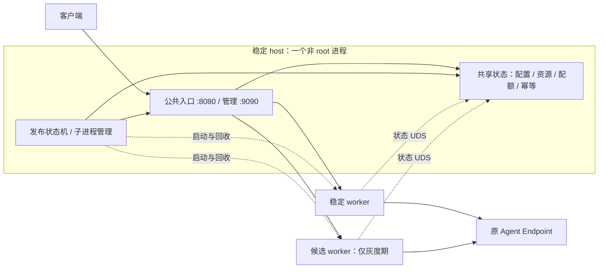

# 减少灰度升级进程：主流设计对照与推荐方案

方案日期：2026-10-18。实现更新：2026-10-19。host-worker 已实现并通过本机真实进程验证；所有安装统一采用 2 → 3 → 2，不维护部署拓扑版本和历史安装模式。Linux/systemd 实机与生产容量验收仍待完成。当前操作见 [部署全流程](DEPLOYMENT_LIFECYCLE.md)。

## 1. 推荐结论

以“减少进程，同时保留现有业务灰度保障”为优先，推荐先采用 **一个稳定宿主 host + 一个业务 worker**，发布时临时增加候选 worker，形成 **2 → 3 → 2**。

host 合并现有 entry、state-server、rollout-controller，承载公共端口、状态单写者、灰度分配与发布控制；worker 保持独立进程。普通业务发布不替换 host，因此不需要转移公共监听 socket、状态写入权或 systemd MainPID。这里保留的是计划业务升级的灰度语义；合并后的故障隔离变化见第 5 节。

后续目标见 [整个网关灰度发布实施方案](SINGLE_PROCESS_ROLLOUT_PLAN.md)：常驻 1 个、发布时 2 个完整网关，连同宿主功能一起换版。Linux/systemd 交接原型和单进程基础运行时已验证，完整状态与自动灰度交接仍在实现；具体边界见 [实现进度](SINGLE_PROCESS_IMPLEMENTATION_STATUS.md)，默认安装暂未切换。

| 方案 | 稳定期 | 灰度期 | 每次业务发布需要状态交接 | 评价 |
| --- | ---: | ---: | --- | --- |
| 旧四角色 | 4 | 5 | 否 | 作为迁移前基线 |
| 仅合并 entry/controller | 3 | 4 | 否 | 能少一个进程，但仍保留两个常驻基础进程 |
| **合并为 host，保留独立 worker** | **2** | **3** | **否** | **本次首选：分别少 50% / 40% 的常驻服务进程** |
| 完整网关交接 | 1 | 2 | 是 | 后续目标，须完成租约、回执、写入权和进程身份交接 |

数量只计算本项目承载服务的进程，不计系统已有 systemd、上游 Agent 和短命 install/status CLI。发布超时允许保留 host 与两个 worker，等待恢复；不为达到稳定期数量强杀长请求，也不再启动第三个 worker。

## 2. GitHub 主流项目采用了什么

以下依据本次直接读取的项目官方文档及 GitHub 源文件；比较机制，不以实时 Star 排名代替架构适配判断。最后一列是针对本项目的设计判断。

| 项目与原始资料 | 官方机制 | 本项目可以借鉴的部分 |
| --- | --- | --- |
| [NGINX 控制与在线升级](https://nginx.org/en/docs/control.html) | HUP 校验配置后启用新 worker、排空旧 worker；USR2 支持新旧可执行文件并存，旧 master 保留监听 socket 以便恢复 | 新版本先就绪，旧版本后退出；进程分工不必照搬 worker 数量 |
| [HAProxy 管理文档](https://github.com/haproxy/haproxy/blob/master/doc/management.txt) | 多线程处理连接；master-worker 模式监控 worker，reload 可交接监听 FD，旧 worker 完成存量连接 | 保留一个稳定管理角色和独立业务进程，业务并发交给线程或 goroutine。本文 host 还承担入口和业务状态，不等同于 HAProxy master |
| [Envoy hot restart](https://www.envoyproxy.io/docs/envoy/latest/intro/arch_overview/operations/hot_restart) | 新进程初始化后经 UDS 获取监听 socket，旧进程排空；已有连接不迁移，最终退出时剩余连接会被关闭 | 支持完整二进制替换，但不能把 FD 交接解释为活跃 SSE 或应用状态自动迁移；文档也提供额外 restarter 示例，不能将数据进程数等同于全部部署进程数 |
| [Apache APISIX README](https://github.com/apache/apisix/blob/master/README.md) | 动态路由、上游及插件热更新；README 介绍基于 NGINX/etcd 的架构，也列出 standalone 配置方式 | 配置变化不必触发二进制发布；上游灰度与网关自身升级是不同层次。本项目无需为此新增 etcd |
| [Traefik providers](https://doc.traefik.io/traefik/reference/install-configuration/providers/overview/) | 发现 provider 中的变化后动态更新路由 | 路由配置在已有进程内更新，无需重建网关进程 |
| [Caddy 配置 API](https://caddyserver.com/docs/api#post-load) | 配置加载失败时恢复旧配置，文档声明配置更新不中断服务 | 配置先验证再发布；该能力不能直接推导为完整二进制的灰度升级 |
| [Cloudflare tableflip](https://github.com/cloudflare/tableflip) | Go 服务平滑换进程，允许新进程初始化失败，同一时间只进行一次升级 | 可作为后续监听继承和进程生命周期的实现参考；不提供本项目的灰度样本判定、资源归属及状态交接 |

这些机制支持两条独立的更新路径：配置在运行中发布，代码通过新旧进程并行验证后替换。热重启解决监听与连接生命周期；5% 会话分配、真实成功样本和自动回退仍需本项目的发布状态机实现。

本项目已经通过配置快照和管理 API 动态更新路由、Endpoint 权重和消费者，不应为这些修改额外启动候选进程。监听端口等启动 YAML 设置仍按现有重启/维护规则处理；不能把路由热更新扩展表述为所有 YAML 字段均可热加载。

## 3. 目标进程与请求路径



普通运行路径仍为 `客户端 → host → worker → Agent`。灰度只改变 host 本次选择的 worker；两个 worker 的会话、公开资源 ID、幂等和并发额度始终由同一个 host 管理。

host 内部的入口、状态与控制器使用同一套实现的本地调用适配器；worker 保留现有状态 UDS 协议。第一阶段可保留现有 worker 本机 TCP 端口及认证，不把数据通道改为 UDS 作为减进程的前置条件。

同进程不等于全程持有同一把锁。配置、资源、发布控制仍保持模块边界及现有锁顺序；调用 worker 或 Agent 期间不持有共享状态锁。入口解析和 freeze 等本地路径必须保留与远程路径一致的校验与语义。

配置存储、shared、entry 和发布日志仍分别管理其恢复事务；合并 PID 不要求把它们合成一种存储格式。状态服务只初始化一次、后台核查只启动一份，所有 worker 共用同一 epoch。

## 4. 灰度流程保持哪些保障

```text
host + worker A
  → 校验产物、协议和状态兼容范围
  → 启动 worker B，等待身份与 readiness
  → 5% 新逻辑会话交给 B，收集真实代理结果
  → 100% 后续请求交给 B，持续观察
  → 排空 A 的请求、内部转发及仍依赖 A 的后台执行
  → 停止并回收 A，保留 host + worker B

验证失败：后续请求切回 A → 排空并回收 B → 保留 host + worker A
```

沿用 [DefaultPolicy](../internal/releaseprotocol/protocol.go)：5% 新逻辑会话、最少验证 60 秒、每个必需 profile 至少 10 个成功样本、验证最长 300 秒；全量观察 300 秒并取得新的成功样本；有效失败阈值为 0；排空最长 600 秒。不借减进程调整这些门槛。

- **版本归属与 Agent 归属分开。** 5% 阶段保留已分配会话的版本亲和；100% 后允许后续请求换到新版 worker，但仍访问原 Agent Endpoint。已有请求留在原处理链，不迁移正在进行的 TCP/SSE。
- **按逻辑请求分配。** 公共端口始终由 host 接入，keep-alive 不改变版本分配语义。5% 不表示必须占 5% 的连接、字节量或模型执行时长。
- **按实际业务结果验收。** HTTP/SSE/A2A/A2A SSE 分别取证；readiness、Agent Card、SSE 首帧以及包含 RPC error 的 HTTP 200 不能替代成功结果。保留 success/failure/excluded/unknown 的区分。
- **共享状态只由 host 写入。** 延续发布期管理配置冻结，业务资源登记与状态更新继续。两版 worker 不分别打开数据写锁，不复制额度或创建独立幂等目录。
- **副作用不重放。** 不镜像真实模型/工具调用验证新版；请求已经发往 Agent 后失败，不自动换 worker 再执行。回退不撤销已发生的上游操作，也不恢复旧业务状态快照。
- **退出以排空为依据。** 联合核对 entry 活跃请求、worker 执行及状态租约；进程仍持有代理流或本地后台执行时不退出。远端 Agent 的异步任务只要后续可依靠持久归属继续访问，不必等其整个业务生命周期终结。
- **发布互斥。** CLI 退出后 host 继续推进；同一产物重复提交查询原任务；排空超时进入 RECOVERY_REQUIRED，保留现场，禁止叠加第三个 worker。

## 5. systemd、权限和故障恢复

### 5.1 一个 service，宿主 MainPID 始终不变

systemd 管理一个 host service，host 用 `os/exec` 启动及回收 worker。两个业务版本作为 host 的子进程留在同一 cgroup，host 的 MainPID 在业务升级中保持不变；不调用整服务 restart，也不需要 `MAINPID=` 交接。

实现采用 [KillMode=mixed](https://www.freedesktop.org/software/systemd/man/latest/systemd.kill.html)：先向 host 发送 SIGTERM，由 host 排空入口并回收子进程；宿主退出或停止超时后清理整个 cgroup，并保留失败重启语义。人工 stop/restart 应结束整个服务组；业务灰度排空由控制器先完成，不能把人工 stop 等同于灰度升级。候选生命周期绑定 host，而非 install HTTP 请求或 CLI 的 context；断开终端不得取消服务子进程。

新增 `ChildProcessDriver` 实现当前 `rollout.Driver` 的 Start/Identity/Stop/Freeze。Start 需要幂等识别槽位、校验不可变产物和握手身份；Stop 要在排空条件满足后终止目标并 `Wait` 回收，确认死亡后 retire 对应 incarnation。不能仅凭持久化 PID 杀进程，PID 复用时必须结合实际子进程句柄、身份和存活状态。

host 使用子进程驱动直接启动及回收 worker，不写 worker unit 或调用 systemctl；systemd 安装和服务管理由短命 root CLI 完成。

### 5.2 短命 root 安装器，长期非 root 服务

root install CLI 校验并将候选文件放入 `/opt/aiagent-gateway/releases/<sha256>/gateway`，通过受限本机控制通道提交产物身份。host 与 worker 使用专用非 root 账户；可执行文件及其父目录由 root 持有，服务账户不可修改。

提交二进制发布的 UDS 应校验 Unix peer credentials，只接受获准的本机安装身份。公共管理 Token 继续用于业务管理，不提供远程执行任意文件的入口。worker 参数只由部署配置及受校验的产物信息生成，不执行 shell。

发布日志从现有 root 管理的控制目录迁入 host 可写、权限受限的位置。迁移明确区分 root 暂存产物与服务写入运行记录，不直接放宽整棵发布目录的权限。

### 5.3 恢复边界

| 场景 | 目标行为 |
| --- | --- |
| 候选初始化失败或崩溃 | host 保留稳定 worker，停止候选分流；已发送请求不重放，未知资源保留归属 |
| 旧 worker 未排空 | 保留三个服务进程，待恢复；不宣布发布完成 |
| 稳定 worker 异常退出 | host 按已提交版本及持久发布阶段恢复；原在途连接不能恢复 |
| host 崩溃 | systemd 清理同 cgroup 残留后重启；按发布记录和 entry 切流意图恢复稳定目标，不选择“最新上传文件” |
| host 重启导致状态 epoch 改变 | 旧 worker 必须退出，不复用其状态客户端；新 worker 从新 epoch 加载状态 |
| 磁盘提交失败或恢复记录不一致 | readiness 失败、停止自动推进；不能猜测状态并继续发布 |
| CLI 被关闭 | 发布仍由 host 执行，CLI 可重新查询同一任务 |

合并减少了隔离：原来独立 entry/controller 的故障可能只重启对应角色，新架构中 host 致命故障同时影响入口、状态和发布控制。这是明确的取舍，须通过模块错误处理、故障注入及进程恢复验收评估；进程减少不代表单节点具有高可用。

**host 自身升级仍是基础组件更新。** 第一阶段的 install 灰度替换业务 worker，host 的入口、管理与状态实现变更仍需维护升级或在多节点部署中逐节点替换。当前四角色部署本来也不通过日常 worker install 更新基础组件。新 worker 必须兼容在运行的 host 协议与状态语义，不兼容版本在接入流量前拒绝。

稳定期少两个 Go 运行时和相应常驻任务，并不意味着内存一定减少 50%。验收应记录整组进程 RSS/PSS、CPU、FD、吞吐、延迟和长流开销。Linux PSS 有助于避免共享页重复计算；结果以目标机器实测为准。

## 6. 为什么 1 → 2 → 1 需要单独实施

完整一体化方案仍有价值：平时无需本机代理跳转，并且入口、管理、状态和业务可随整个网关一起换版。困难在于本项目保存了 Agent 资源状态，已有代码尚不具备在线交接能力。

| 当前代码证据 | 直接合并后的问题 | 一体化必须补齐 |
| --- | --- | --- |
| [shared/server.go](../internal/gateway/runtime/shared/server.go) 的 lease 保存 `release func()` | 闭包无法迁移到新进程 | 可序列化租约及精确一次释放，迁移配额、资源引用和持有者身份 |
| [shared/client.go](../internal/gateway/runtime/shared/client.go) 在 epoch 改变后永久失败 | 新状态 owner 接管后，活跃新版请求无法继续使用旧客户端 | 带交接凭据的代次切换、回执去重及迟到操作防护 |
| [runtime/gateway.go](../internal/gateway/runtime/gateway.go) 的 BeginShutdown 将 healthy 置为 false | 旧版停止业务接纳时可能同时破坏新版依赖的状态服务 | 拆分监听接纳、执行接纳、状态接纳与存储健康 |
| [rollout/worker.go](../internal/gateway/runtime/rollout/worker.go) 要求 Remote 非空 | 单进程本地执行无法直接复用现有 worker 入口 | 统一本地/远程状态接口，保持认证、结果统计及容量限制 |
| [state/journal.go](../internal/state/journal.go) 使用独占锁且压缩重置 sequence | 不能让两版一起写，也不能直接把物理 sequence 当复制位置 | 单调逻辑 revision、一致快照/增量、写锁与持久提交决定交接 |

监听 FD 继承只解决新版本取得监听 socket。它不迁移上述状态，也不把既有连接搬到新进程。保持新版本活跃 SSE 时交接状态，还需要短暂、有界的状态操作屏障；不能等待所有新版本长连接归零，也不能让等待队列无限增长。

若继续推进一体化，沿用原草案的应用层会话分配、单写者交接和旧进程排空。必须验证：新旧入口对同一会话并发首次访问、keep-alive、SSE 中断、状态提交后回执丢失、各交接断点崩溃，以及 systemd 主进程连续 A → B → C 切换。`tableflip` 或 `SO_REUSEPORT` 都不能替代这些验收。

## 7. 实施与迁移顺序

| 阶段 | 改动范围 | 通过条件 |
| --- | --- | --- |
| P0 基线 | 固定当前策略、API 与状态协议，记录四/五进程部署的行为和资源开销 | 成功灰度、失败回退、长流、幂等、Agent 归属与恢复可重复验证 |
| P1 host 组装 | `cmd/gateway` 增加 host；复用 entry/shared/controller；新增本地适配器 | 一份状态服务和后台核查；现有 HTTP/Hermes/A2A 管理与转发行为一致 |
| P2 子进程驱动 | ChildProcessDriver 作为唯一 worker 驱动 | Start/Stop 幂等、身份校验、异常退出回收、CLI 断开后继续发布、无孤儿或僵尸 |
| P3 安装与宿主更新 | 单 service、root 产物暂存、控制 UDS、发布日志权限 | Linux 首装、宿主更新、start/stop/restart、开机恢复和卸载/重装 |
| P4 完整验收 | `tests/integration` 与 `deploy/rollout-local` 增加真实进程检查 | 正常 2 → 3 → 2、失败回退 2 → 3 → 2、连续 A → B → C；资源/幂等/配额一致 |
| P5 可选一体化 | 先做监听/进程身份和在线状态交接原型 | 满足原 [单进程方案](SINGLE_PROCESS_ROLLOUT_PLAN.md) P0–P5 后才改变默认运行模式 |

程序尚未正式上线，安装统一采用 host-worker，不提供旧拓扑识别或迁移分支。`deployment.json` 仅保存基础产物、初始业务版本和发布策略，不维护拓扑版本字段。

宿主自身更新使用 `install --update-host`：结束活动发布、暂停流量并排空服务后，完整备份 YAML、部署清单、路由三文件及恢复事务、shared/entry/release 日志与 unit；业务状态和自定义 drop-in 原位保留，归档旧进程身份，以新产物建立发布基线。具体步骤见 [部署全流程](DEPLOYMENT_LIFECYCLE.md#整套组件更新)。

宿主停机不能保留原 TCP/SSE。已经接收新业务写入后，恢复应使用最新有效状态，不能用更新前备份覆盖合法新数据。

代码落地时执行仓库要求的 `go test ./...`、`go test -race ./...`、`go vet ./...`，并在真实 Linux/systemd 上检查进程树、cgroup 清理及故障恢复。本机自动验证结果见 [VALIDATION](../VALIDATION.md)，仍不能代替 Linux/systemd 实机验收。

最终验收重点是公共端口和 host PID 在业务灰度中不变、状态 epoch 不变、失败调用不重复执行、旧流可排空、公开 ID 仍指向原 Agent；然后才是进程数量和资源开销。
