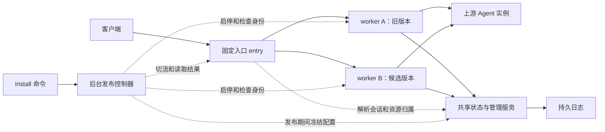

# Agent 网关同机灰度升级实现过程

记录日期：2026-10-06。

本次将 `install` 接入同机双 worker 自动发布：旧版本继续服务，新版本在另一端口启动，通过真实代理请求验证后切换后续流量，失败则回退。会话、任务及资源到原 Agent Endpoint 的映射由独立状态服务保存，避免随旧 worker 退出丢失。

核心代码和本机验证已完成；Linux systemd 实机、真实 Agent 升级/回退联调及生产压力验收仍待完成。本文按实现依赖关系记录改造过程，描述当前代码中的行为。原始方案中的拟议接口和验收目标不全部代表已交付能力。

相关文档：[通用设计](HTTP_GATEWAY_ROLLOUT_DESIGN.md)、[原实施计划](AGENT_GATEWAY_ROLLOUT_IMPLEMENTATION_PLAN.md)、[操作说明](ROLLOUT_OPERATIONS.md)、[验证记录](../VALIDATION.md)。

发版与升级的执行顺序见本文第 11 节；可直接使用的构建、上传、安装、灰度升级和恢复命令见 [完整操作步骤](ROLLOUT_OPERATIONS.md#构建发版)。

首次安装的文件布局、各进程职责，以及全组件维护过程见 [安装、运行文件与升级全流程](DEPLOYMENT_LIFECYCLE.md)。

## 1. 从原安装方式到自动发布

原部署由一个网关进程承接业务和管理请求，安装升级需要停止旧服务并替换二进制。会话绑定、资源目录和并发计数主要保存在进程内，直接启动两个实例会出现三个问题：

- 新实例不知道旧会话此前分配给哪个 Agent。
- 两个进程独立管理资源、幂等键和并发额度，可能产生重复分配或容量翻倍。
- 仅检查新进程健康，无法证明 HTTP/SSE/A2A 请求已经成功代理。

因此本次同时改造运行架构、业务状态、结果采集和安装流程。目标是让一次 `install` 完成候选启动、少量流量验证、全量切换、观察、排空和收尾，并将失败原因保存在可恢复的发布报告中。

无子命令的原单进程运行模式继续保留，主要用于开发；以下共享状态和自动灰度保证适用于新的多角色部署模式。

## 2. 落地后的运行架构

同一份二进制新增 `entry`、`state-server`、`rollout-controller`、`worker` 四种角色，灰度期间运行两个 worker。



| 组件 | 当前职责 | 默认监听 |
| --- | --- | --- |
| 固定入口 | 选择 worker、流式转发、记录活动请求与最终结果 | 外部 `:8080`；控制 Unix Socket |
| 共享状态服务 | 配置唯一写入、会话/资源归属、幂等、全局额度 | 公共管理 `:9090`（所有网卡）；状态 Unix Socket |
| 发布控制器 | 持久状态机、发布策略、恢复、调用 systemd driver | 受保护的控制 Unix Socket |
| worker A/B | 现有 Agent 协议处理、访问上游、报告代理结果 | 数据 `127.0.0.1:18080/18081`；管理 `19090/19091` |

普通业务升级保持入口、状态服务和控制器运行，只更新空闲 worker 槽位。worker A/B 是网关实例，上游 Agent Endpoint 仍沿用原来的业务实例模型。

## 3. 实现步骤与代码位置

### 3.1 定义通用发布协议

在 [releaseprotocol/protocol.go](../internal/releaseprotocol/protocol.go) 中统一定义：

- `Identity`：版本、槽位、进程代次、配置版本、就绪状态、在途执行数。
- `Target`：版本产物、worker 地址和管理地址。
- `Traffic`：稳定版、候选版、候选比例和路由 revision。
- `Policy`：灰度比例、时间窗口、成功样本与失败阈值。
- `Result`、`Statistics`：按请求、版本、协议类型统计成功、失败、排除和未知结果。

`incarnation` 区分同一槽位的不同进程，避免把重启后的进程或结果误认为原候选。路由 revision 用于条件更新，避免旧控制请求覆盖新策略。

`releaseprotocol`、`entry`、`rollout` 不导入 Agent 网关业务包，为另一个 HTTP 网关保留复用边界。

### 3.2 先实现持久日志，再迁出进程内状态

[state/journal.go](../internal/state/journal.go) 实现单写者持久日志，供业务元数据、入口和控制器分别使用。使用 Go 标准库，未引入 Redis 或数据库服务。

日志通过文件锁保证单写者；记录包含格式版本、序号、变更和 SHA-256 校验。提交在 `fsync` 成功后确认，每 1024 次实际提交压缩为原子替换的快照日志。恢复时可截断不完整尾记录，完整记录校验失败则拒绝加载。提交失败后，当前日志实例停止接受后续提交，避免在未知落盘状态上继续工作。

Agent 领域状态由 [runtime/shared.go](../internal/gateway/runtime/shared.go) 接入，共享通信位于 [runtime/shared](../internal/gateway/runtime/shared)，资源与会话恢复分别位于 [resource/durable.go](../internal/gateway/runtime/resource/durable.go) 和 [sessions.go](../internal/gateway/runtime/sessions.go)。worker 通过带认证的 Unix Socket 调用配置、会话分配、资源预留、查询、观察和释放等领域操作，不直接争用配置目录写锁。

共享内容包括会话绑定、Hermes/A2A 资源及别名、幂等预留、全局并发额度和列表快照。持久内容与瞬时内容分开：会话/资源/幂等元数据落盘；活动连接计数不作为恢复后的活连接重建，短期列表快照也不跨状态服务重启保存。

### 3.3 将原代理处理器接入共享状态

调度、资源目录与启动接入分别位于 [scheduler.go](../internal/gateway/runtime/scheduler.go)、[resource/directory.go](../internal/gateway/runtime/resource/directory.go)、[gateway.go](../internal/gateway/runtime/gateway.go)。Hermes/A2A 处理器通过运行时操作，使 worker 的调度、资源访问和执行释放转到状态服务。

资源预留及公开 ID 映射必须在对外暴露前提交；持久化错误向处理器返回，不能先宣布创建成功再补写归属。资源与相关幂等记录放在同一个日志事务中，结果未知的创建操作保留原归属，避免重新调度导致重复执行。

并发限额集中计算，两版同时运行也不会使网关、调用方或 Endpoint 的额度翻倍。原单进程路径继续使用本地实现。

### 3.4 增加真实代理结果采集

[rollout/worker.go](../internal/gateway/runtime/rollout/worker.go) 包装 worker 的 HTTP 处理，[transport.go](../internal/gateway/runtime/rollout/transport.go) 和 [result.go](../internal/gateway/runtime/rollout/result.go) 记录是否实际发出代理请求、协议类型、流结束状态和错误。worker 通过内部 trailer 返回最终结果，入口结合自身传输结果生成发布证据，并在客户端响应中移除内部字段。

[rollout/resolve.go](../internal/gateway/runtime/rollout/resolve.go) 按已认证调用方、路由、接口和 session/resource 解析灰度归属，复用 Hermes/A2A 已知资源关系。客户端提供的内部发布头在入口清除，不能指定候选或伪造内部身份。

### 3.5 增加固定入口和原子切流

[entry/entry.go](../internal/entry/entry.go) 实现固定反向代理、会话灰度分配、路由条件更新、结果统计和恢复。

灰度期间按新分配的逻辑会话分流并保存版本亲和。100% 切换影响后续请求，包括原会话的后续请求；已开始的请求继续使用原 worker。HTTP keep-alive 上的下一次请求也会读取更新后的策略。

入口分别记录活动请求和已完成结果。重启时发现没有最终结果的旧活动记录，会转成失败证据，不能用不完整数据支持转正。

### 3.6 增加后台自动发布状态机

[rollout/controller.go](../internal/rollout/controller.go) 通过 `Driver` 管理 worker，通过 `Entry` 读取和更新流量。报告持久保存当前阶段、版本、策略、统计、失败原因、恢复阶段和未完成切流意图。

切流顺序为：持久保存意图 → 带预期 revision 更新入口 → 保存确认结果。若入口已应用而回执丢失，控制器读取实际 revision 和策略核对后继续，避免盲目重复切换。

一次只接受一个发布。CLI 只提交任务并等待结果，状态机由后台服务推进，终端断开不会取消发布。

### 3.7 接入安装器和 systemd

[service/rollout.go](../internal/service/rollout.go) 实现产物暂存、安装迁移和 `SystemdDriver`；[cmd/gateway/roles.go](../cmd/gateway/roles.go) 组装各角色；[units](../internal/service/units) 增加基础服务及 worker 模板。

安装器计算二进制 SHA-256，写入不可变版本目录，向控制器提交发布。实际生成 `aiagent-gateway-worker-a.service` 和 `aiagent-gateway-worker-b.service`，绑定具体产物路径。普通升级保留凭据和基础组件产物，不覆盖正在服务的二进制。

新增 `rollout status [--json]`、`rollout resume`、`rollout rollback`。完成返回 0，失败、回退或需要恢复均返回非零值。`start/stop/restart` 管理整套服务，仍属于可能中断连接的运维操作。

## 4. 会话 ID 为什么不会随旧 worker 消失

本次关键保证是：在绑定有效期间，`会话 ID → 原 Agent Endpoint` 独立于 worker 生命周期保存。

generic 会话使用如下索引，避免不同调用方或接口的同名会话混用：

```text
(调用方 ID, 路由 ID, 接口, 会话 ID)
    → Agent Endpoint ID, 最近使用时间, 空闲 TTL, worker 归属提示
```

一次会话的处理过程如下：

1. 旧 worker 收到 `session-123`，请求状态服务分配或查询绑定。
2. 状态服务首次选中 Agent B，保存绑定并确认落盘，再返回可执行的分配结果。
3. 后续请求查到同一绑定，继续使用 Agent B。
4. 全量切换后，新 worker 查询同一个状态服务，仍得到 Agent B。
5. 旧 worker 退出时，`retire` 只释放该进程的执行租约，不删除会话绑定或资源目录。

```text
升级前：session-123 → 旧 worker → Agent B
升级后：session-123 → 新 worker → Agent B
                    ↑
       两版使用同一份共享且持久化的映射
```

Hermes session/run/response 和 A2A context/task 通过资源目录保存公开 ID、上游 ID、原 Endpoint、父子关系、别名和幂等信息，因此查询、取消和续接也能跨 worker 定位原实例。回退不会恢复旧状态快照，灰度期间新建的合法资源映射继续保留。

需要遵守以下边界：

- generic 绑定仍受空闲 TTL 约束，资源也遵循各自生命周期和回收规则；持久化不代表永不过期。
- 绑定有效但原 Agent 不可用时返回错误，不自动改投另一 Agent。
- 状态服务重启可从日志恢复元数据，无法恢复 TCP/SSE 连接，也不代替 Agent 保存聊天历史和工具状态。
- 映射指向配置中的 Endpoint；若该地址背后还有负载均衡，后端实例稳定性需要由对应部署保证。
- 首次从原单进程版本迁移，旧内存 session/task 映射不能导出继承；之后的灰度升级才具备上述共享持久化能力。

## 5. 代理成功如何决定转正

发布按 `http`、`sse`、`a2a`、`a2a_sse` 分别验证，不能用普通 HTTP 的成功样本替代流式或 A2A 验证。

| 结果情况 | 发布处理 |
| --- | --- |
| 实际访问上游，响应传输完成且协议未报告错误 | 计入对应类型的成功样本 |
| 连接错误、HTTP 5xx/429、协议 error、SSE 提前结束 | 计为有效失败，按阈值触发回退 |
| 健康探测、Agent Card 等本地响应 | 排除，不计真实代理成功 |
| 普通客户端错误或有证据的主动取消 | 排除；已有明确上游失败仍保留失败判断 |
| 意外状态、最终结果未知或证据丢失 | 不能支持转正，按状态和时间窗口回退或进入恢复 |
| 候选请求仍在执行 | 不算成功样本；已完成样本足量时可推进阶段 |

流式请求必须有可识别的完成语义；只有 HTTP 200 或首个 SSE 事件不足以判定成功。异步任务创建成功表示本次代理交互成功，不等于 Agent 后台任务最终成功。

当前验证来自实际业务请求，没有流量镜像，也不自动调用模型补足样本。失败 POST 不自动向旧版重放，避免工具执行或资源创建重复发生。

## 6. 正常切换、回退和旧请求排空

正常升级路径：

```text
PREPARING → STARTING → VERIFYING → PROMOTING
          → OBSERVING → DRAINING → COMMITTING → COMPLETED

验证失败：ROLLING_BACK → ROLLED_BACK
无法安全推进：RECOVERY_REQUIRED → resume 后回到记录的恢复阶段
```

| 阶段 | 当前实现 |
| --- | --- |
| PREPARING | 检查稳定版本，冻结路由、Endpoint 等配置写入 |
| STARTING | 启动空闲槽位，检查进程身份、协议、就绪及两版配置版本，开放候选流量 |
| VERIFYING | 检查每类真实代理成功样本、失败阈值及验证时长 |
| PROMOTING | 入口更新为后续请求 100% 进入候选 |
| OBSERVING | 全量观察，要求本阶段的新成功样本，继续处理失败信号 |
| DRAINING | 检查旧 worker 活动请求和执行占用，继续观察候选失败 |
| COMMITTING | 停止已排空旧版，提交新稳定版入口策略，解除配置冻结 |

默认策略定义在 `DefaultPolicy()`，可通过部署文件调整：

| 参数 | 默认值 |
| --- | --- |
| 新会话灰度比例 | 5% |
| 候选就绪超时 | 30 秒 |
| 灰度最短时间 / 超时 | 60 秒 / 300 秒 |
| 每个必需类型成功样本 | 至少 10 个 |
| 有效失败容忍数 | 0 |
| 全量观察 | 300 秒；每个必需类型至少 10 个新成功样本 |
| 排空等待上限 | 600 秒 |

默认按启用路由推导必需类型，并将验证中出现的其他受支持成功类型加入门槛。样本不足不会自动跳过验证。首次安装没有旧版本，候选就绪后直接开放服务，不适用双版本灰度验证。

### 旧请求未完成时

切流不移动或中断已在执行的 HTTP/SSE 请求。控制器同时要求入口的旧版本 `Active == 0` 和 worker 的 `Inflight == 0`。后者包含处理器请求数和共享执行租约，包括转交给本地后台处理的执行；driver 在停止前再次检查在途数和进程身份。

600 秒从进入 `DRAINING` 起计算，是发布等待上限，不是强制断开请求的时间。超时后进入 `RECOVERY_REQUIRED`，原因是 `old_worker_drain_timeout`：保留两个进程，新请求继续走新版，保持配置冻结并阻止下一次发布。旧请求随后结束也不会自动恢复状态机，需要执行 `rollout resume` 重新检查并继续。

回退时先让后续流量返回旧版，再等待候选存量请求和执行结束；超时同样保留现场。请求本身仍受原有上游超时、流空闲超时和客户端取消约束。

仅在 Agent 内运行、没有网关本地执行占用的异步任务，可以通过持久映射交给新 worker 继续查询或取消，不需要等待整个任务结束才能退出旧 worker。

## 7. 安装、恢复与数据路径

| 路径 | 用途 |
| --- | --- |
| `/opt/aiagent-gateway/releases/<sha256>/gateway` | 业务版本产物 |
| `/opt/aiagent-gateway/infrastructure/<sha256>/gateway` | 固定入口、状态服务和控制器产物 |
| `/etc/aiagent-gateway/deployment.json` | 部署信息及发布策略 |
| `/etc/aiagent-gateway/config.yaml` | 启动配置、公共监听端口和管理 Token |
| `/var/lib/aiagent-gateway/config.json` | 状态服务维护的存储格式、schema 和配置版本 |
| `/var/lib/aiagent-gateway/routes.json` | 状态服务独占写入的路由、实例和凭据 |
| `/var/lib/aiagent-gateway/route-logs.json` | 状态服务维护的管理幂等回执和审计记录 |
| `/var/lib/aiagent-gateway/shared/state.log` | 会话、资源、别名和幂等持久日志 |
| `/var/lib/aiagent-gateway/entry/state.log` | 入口策略、灰度亲和和请求结果日志 |
| `/var/lib/aiagent-gateway-rollout/state.log` | 后台发布报告和切流意图 |

旧安装检测到后，必须在维护窗口执行 `install --migrate`。它保留凭据、路由及 Endpoint ID，但不能继承旧内存映射。初始化或迁移失败时仍需按日志恢复，没有实现完整的旧部署自动快照回滚。

发布期间配置写入返回 `409 ROLLOUT_IN_PROGRESS`，业务请求、资源操作和发布控制继续工作。完成或安全回退后解除冻结；待恢复状态继续冻结，避免验证基线发生变化。

控制器和入口均可恢复持久记录。状态服务重启会改变运行代次，旧 worker 的状态客户端检测后拒绝继续操作并退出，防止继续使用过期状态。连接中断不能通过元数据恢复撤销。

卸载停止服务并移除 unit 和 CLI，保留凭据、状态、发布记录及版本产物用于重装。完整命令和操作流程见 [操作说明](ROLLOUT_OPERATIONS.md)。

## 8. 本次验证过程与证据

以下为本次代码实现期间已完成的验证，来源见 [VALIDATION.md](../VALIDATION.md)。整理本文没有新增 Linux 实机或真实模型验收。

| 验证层次 | 检查内容与结果 | 代码位置 |
| --- | --- | --- |
| 日志 | 独占锁、不完整尾恢复、完整记录损坏拒绝、压缩恢复通过 | [journal_test.go](../internal/state/journal_test.go) |
| 固定入口 | 条件更新、会话分流、重启证据、存储不可用时拒绝请求通过 | [entry_test.go](../internal/entry/entry_test.go) |
| 发布控制器 | 转正、代理失败/样本不足回退、全量观察故障、排空超时及 resume、切流回执丢失恢复通过 | [controller_test.go](../internal/rollout/controller_test.go) |
| 共享业务状态 | 跨 worker 会话绑定、全局额度、并发资源预留、幂等及 unknown 保护、资源恢复、Hermes/A2A 续接和列表共享通过 | [包内状态测试](../internal/gateway/runtime/shared_test.go)、[跨 worker 集成测试](../tests/integration/shared_test.go) |
| 代理与长流 | HTTP 协议错误、SSE 非正常结束、切流期间长流保留、失败 POST 不重放、内部字段不暴露通过 | [shared_test.go](../tests/integration/shared_test.go) |
| 安装器 | 不停止服务中的旧版、凭据保留、迁移显式要求、产物哈希与 unit 路径、卸载保留恢复数据通过 | [rollout_test.go](../internal/service/rollout_test.go) |
| 全量静态与回归检查 | `go test ./...`、`go test -race ./...`、`go vet ./...` 通过 | 全仓库 |
| 交叉构建 | Linux amd64/arm64，`CGO_ENABLED=0` 构建通过 | `cmd/gateway` |

另外使用 [deploy/rollout-local/check.py](../deploy/rollout-local/check.py) 启动 state、entry 和两个独立 worker OS 进程，通过临时端口连接模拟 HTTP 上游，验证了：100 个新会话中 5 个进入候选、100% 切流后原会话仍访问原 Agent、失败 POST 只发送一次，以及流量回退后的续接。

该脚本验证实际进程和 TCP 切流；自动发布状态机由 Go 测试中的模拟 driver/entry 验证。二者结合仍不等于生产 systemd 安装升级全链路验收。

本机复现命令，在仓库根目录执行：

```sh
go test ./...
go test -race ./...
go vet ./...
go build -o /tmp/aiagent-rollout-check ./cmd/gateway
python3 deploy/rollout-local/check.py /tmp/aiagent-rollout-check
```

## 9. 当前限制和后续验收

| 项目 | 当前状态 / 后续工作 |
| --- | --- |
| Linux/systemd | 需验证全新安装、维护迁移、实际 unit 权限、端口冲突、故障注入及开机恢复 |
| 真实 Agent 灰度 | 需验证两版升级/回退期间的 session/run/response/context/task 续接、取消、流式请求和原实例归属 |
| 容量与稳定性 | 需测量入口和共享状态同步落盘成本、并发上限、长流及长时间运行表现 |
| 基础组件升级 | 普通 install 不升级基础组件；状态协议不兼容变更需要独立迁移流程 |
| 会话并发 | 已实现原 Agent 归属共享；未实现同会话请求串行化或新旧 worker 执行互斥 |
| 无限流 | 无完成信号的流不能提供完整成功样本；未实现专门的长期流验证策略 |
| 列表游标 | 跨 worker 共享，状态服务重启后不恢复短期列表快照 |
| 自动回退期限 | 保护覆盖本次发布验证、观察及排空阶段；完成后的普通运行故障不自动回退上一版 |

这些限制中，会话执行互斥与会话到 Agent 的映射持久化是不同能力；前者未实现，不影响后者在绑定有效期内跨 worker 保留。

## 10. 如何复用到另一个 HTTP 网关

可复用的核心为 `releaseprotocol`、`entry`、`rollout`，以及通用日志 `state`。当前这些包位于 Go 的 `internal` 目录，跨仓库使用时需要迁出为公共模块，或连同依赖复制；尚未发布独立 SDK，也未完成第二网关接入验证。

建议按以下顺序接入：

1. 明确业务状态：如果存在 session→后端实例绑定、幂等或进程内资源目录，先使其跨版本共享并验证恢复；无状态网关可省略 Agent 资源目录。
2. 实现 worker 身份和就绪接口，报告版本、进程代次、协议、配置版本及执行占用。
3. 实现请求归属解析和代理结果采集；普通 HTTP 可以只启用所需类型，流式协议必须定义完成语义。
4. 适配 `Driver` 的启动、检查、停止和配置冻结操作，以及产品专属路径、端口和服务名。
5. 接入固定入口、后台状态机和 install，保留同样的候选验证、回退、排空和恢复规则。
6. 复用通用测试，再增加该网关的会话续接、非幂等请求、故障和实机发布验收。

`gateway/shared.go`、`durable.go` 中的 Agent 资源模型属于本产品；`service/rollout.go` 也包含 Agent 配置推导和产品路径，接入时需适配。复用目标是保持发布机制通用，让业务网关负责说明请求是否成功以及业务状态如何延续。

## 11. 发版和升级执行步骤

| 顺序 | 执行动作 | 完成依据 |
| --- | --- | --- |
| 1. 构建发版 | 从已提交代码运行测试、竞态及静态检查，编译 Linux amd64/arm64，生成构建信息、SHA-256 和压缩包 | 产物可追溯到源码 commit，目标平台验收通过 |
| 2. 上传检查 | 上传新包，在服务器新目录解压并校验哈希，选择正确架构，检查服务、候选端口、状态兼容性和流量窗口 | 校验通过，无未结束发布，基础组件和旧版可用 |
| 3. 安装或迁移 | 新机器执行新产物的 install；旧单进程部署在维护窗口执行 install --migrate | 初始发布完成，路由及实际代理可用；迁移不继承旧内存会话 |
| 4. 保存基线 | 保存当前 rollout 报告、旧 stable.release/artifact 和本次新产物哈希，必要时调整下一次发布策略 | 能明确核对升级目标及后续降级产物 |
| 5. 灰度升级 | 从新产物目录执行新二进制的 install，保持业务请求进入固定入口 | 后台经过验证、切流、观察和排空；CLI 断开仍可查询 |
| 6. 发布验收 | 保存结束报告，核对新稳定版哈希、子服务和实际业务；使用原会话续接原 Agent | COMPLETED，旧 worker 已排空停止，会话归属保持 |
| 7. 异常恢复 | 已回退则修复后重新发布；待恢复先处理原因再 resume；活动发布可主动 rollback | 状态、实际流量和运行实例一致 |

日常升级最小命令序列如下，在已校验的新产物目录执行；首次安装/维护迁移按 [操作说明](ROLLOUT_OPERATIONS.md#首次安装或维护迁移) 的分支执行。

```sh
sudo aiagent-gateway rollout status --json > rollout-before.json
sudo ./aiagent-gateway-linux-amd64 install
sudo aiagent-gateway rollout status --json > rollout-after.json
sudo systemctl list-units --all 'aiagent-gateway*'
```

ARM64 服务器使用对应的 arm64 文件。普通升级保留 `/usr/local/bin/aiagent-gateway` 作为基础管理 CLI，因此升级入口必须是新二进制；直接执行 PATH 中 CLI 的 install 会提交 CLI 自身版本。

发布完成后的降级，使用保留的旧 worker 产物重新执行 install，作为一次新的灰度发布验证。`rollout rollback` 用于仍有候选和旧稳定目标的活动任务，不能在完成后直接选择历史版本。完整命令、默认观察窗口、排空超时、结果判读及归档要求见 [日常升级](ROLLOUT_OPERATIONS.md#日常灰度升级) 和 [异常处理](ROLLOUT_OPERATIONS.md#结果确认和异常处理)。
