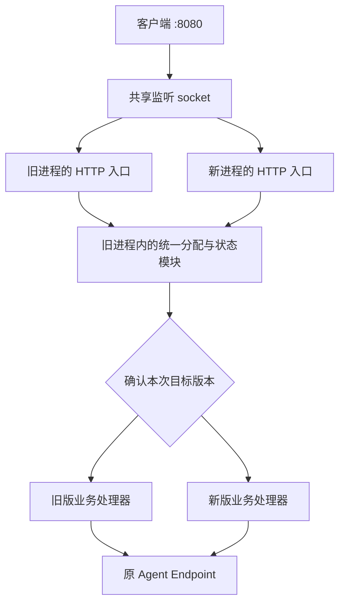

# 单常驻进程、双进程灰度升级方案

日期：2026-10-14。状态：待评审方案，尚未实现。本文只描述拟议改造；当前安装行为仍以 [部署全流程](DEPLOYMENT_LIFECYCLE.md) 为准。

2026-10-18 补充：[主流设计对照与推荐落地顺序](PROCESS_REDUCTION_RECOMMENDATION.md)采用 2 → 3 → 2，保留状态单写者不变，再验证本文的一体化目标。2026-10-19 已实现 host-worker 并作为新安装默认模式；本文描述的 1 → 2 → 1 仍未实现。

本文目标：平时只运行一个网关进程，升级时临时运行新旧两个进程，保留真实流量验证、自动放量和失败回退。发布成功或完成回退后恢复一个进程。

## 1. 推荐方案

将入口、业务处理、状态管理、发布控制合并到同一个网关进程。升级时由当前网关启动新版子进程，传递监听 socket；两个版本共享对外端口，应用层按逻辑会话决定请求由哪个版本处理。验证通过后交接状态写入权、发布控制权和 systemd 主进程身份，旧版排空退出。

第一版采用 **监听 FD 继承 + 应用层灰度分配 + 单写者状态交接**。不依赖额外常驻代理、状态服务、发布控制器或数据库，也不要求安装 BPF 程序。

| 项目 | 当前部署 | 目标部署 |
| --- | --- | --- |
| 稳定运行 | entry、state、controller、worker，共 4 个进程 | 1 个完整网关进程 |
| 灰度期间 | 基础组件加新旧 worker，共 5 个进程 | 新旧网关，共 2 个进程 |
| 公共端口 | entry :8080、state :9090 | 同一个网关持有 :8080、:9090 |
| 版本间通信 | 固定内部 TCP 端口及 Unix Socket | 每次发布的私有 Unix Socket |
| 灰度策略 | 5% 新逻辑会话，随后 100% 后续请求 | 保留相同策略 |
| 数据写入者 | 独立 state-server | 灰度期为旧网关，交接后为新网关 |
| 管理接口和发布组件升级 | 普通 install 不更新基础组件 | 随完整网关一起升级；协议须兼容 |
| systemd | 服务组及多个角色 unit | 一个 service，灰度时同一 cgroup 内两个进程 |

这里的进程数量统计承载服务的网关进程；用户执行的短命 install/status CLI 不属于常驻服务。排空或交接异常时可以保留两个进程并报告待恢复，不能为了满足数量强杀仍在处理请求的进程。任何情况下不启动第三个服务实例。

## 2. 同端口接入与灰度分流

### 2.1 两种机制的取舍

Linux 的 `SO_REUSEPORT` 可以让两个独立 listener 绑定同一个地址，由内核分配新连接。结合 reuseport BPF 可以自定义连接分配，但连接比例不能直接表达本项目的逻辑会话比例；同一连接可能承载多个会话，同一会话也可能使用多个连接。该机制可以用于连接级灰度。[Linux socket 文档](https://man7.org/linux/man-pages/man7/socket.7.html)

本项目推荐另一种同端口方式：旧进程把已监听 socket 的 FD 传给新版子进程，两者引用同一个内核监听 socket。Go 可使用 `exec.Cmd.ExtraFiles` 传递 FD，子进程用 `net.FileListener` 构造自己的 listener。关闭一方的 listener 不要求另一方重新 bind。[Go 进程 FD 继承](https://pkg.go.dev/os/exec#Cmd)、[Go FileListener](https://pkg.go.dev/net#FileListener)

两版都能接受公共端口的连接，但 **接受连接的进程和最终处理业务的版本允许不同**。这样保留当前灰度规则，也避免把 HTTP keep-alive 的连接分配比例当成请求或会话比例。

第一版分阶段启用新版入口：5% 验证阶段由旧版接入公共连接，再将命中的请求交给新版业务处理；候选持有监听 FD，但暂不调用 Accept。进入 100% 观察阶段后才允许新版也接入公共连接，随后排空旧入口。这样 5% 阶段不会因为内核分配连接而让约一半新连接提前暴露给新版 HTTP 入口。

全量观察需分别确认“新版业务执行”与“新版公共入口接入”的真实样本。若客户端持续复用旧连接、新入口没有样本，则不能仅凭旧入口转发的成功结果提交升级。这个方案不提供 5% 新版入口代码的连接级灰度；需要该能力时再增加受控连接分配，例如 reuseport BPF。

### 2.2 请求路径



图中统一分配与状态模块属于旧进程，不是第三个服务。

1. 候选先完成私有通道握手、协议及状态版本校验，再接受旧入口转发的灰度请求；公共 listener 按上述阶段启用。
2. 任一入口先清理外部伪造的内部头，再通过唯一的分配器完成认证、资源解析和灰度归属判定。
3. 目标是本进程时直接调用本地 handler；目标是另一个版本时，通过私有 UDS 转发一次。版本内部执行入口绕过灰度分配器，防止 A→B→A 循环。
4. 内部请求带 request_id、rollout_id、routing_revision、目标 incarnation 和发布期凭证。目标校验身份后才访问 Agent；客户端不能指定目标版本。
5. 入口完成下游传输后汇总接入版本和实际执行版本的结果，分别保留 ingress_incarnation 与 execution_incarnation。相同 request_id 只计一次；本地调用和 UDS 转发使用同一套成功判据。
6. 稳定运行时分配器、状态和 handler 全部本地调用，不绕一圈本机 HTTP。

每个请求只向 Agent 执行一次；不会为了验证复制 POST、模型调用或工具操作。转发已发送后失败也不换版本重放。

5% 针对新分配的逻辑会话；已有会话在验证阶段保持网关版本亲和。100% 后，已有会话的后续请求也由新版执行，Agent Endpoint 归属保持不变。进行中的 HTTP/SSE 请求留在原处理链直到结束。

统一分配器串行确认首次归属，不能在两版各自维护独立计数器或仅按连接/IP 哈希。公共 :9090 同样可以由两版接入，但业务管理请求转到当前状态写入者；发布控制另走受限本机通道。

## 3. 单进程内部结构

```text
GatewayProcess
  ├─ PublicServers       HTTP 数据面、管理面、连接排空
  ├─ TrafficRouter       版本选择、会话亲和、结果汇总
  ├─ BusinessRuntime     HTTP / SSE / Hermes / A2A 处理
  ├─ StateBackend        配置、资源、会话、幂等、配额、租约
  ├─ ReleaseController   发布状态机、持久进度、失败恢复
  └─ ProcessManager      候选启动、FD 传递、退出监测、主进程交接
```

这些是同一 PID 内的模块和 goroutine，不是子进程列表。

平时 StateBackend 使用本地实现。灰度时，旧版本地调用和新版 UDS 调用进入同一套状态操作，使用相同的租约、幂等和容量规则。不能让本地路径绕过全局额度或持久化，也不能让两版分别打开数据目录写锁。

监听接纳、业务执行接纳、状态操作接纳、存储健康必须分开表示。旧版停止接受新连接后，仍须为新版处理状态请求；不能调用现有 `BeginShutdown()` 就把它同时标成状态不可用。

候选始终是完整新版可执行文件，转正后具备独立启动下一次灰度的能力，不依赖已退出的父进程。

## 4. 状态共享与交接

这是主要改造量。当前目录独占锁、资源日志和共享操作可复用，但当前远程客户端遇到 state epoch 改变会永久失败，租约保存 Go 回调，也没有在线交接接口，不能直接把几个角色放进一个 main 就完成升级。

### 4.1 灰度期只有一个写入者

旧网关继续拥有配置和状态日志的独占锁，负责所有状态提交。新版通过 UDS 读写，不直接写同一份文件。发布期间保留管理配置冻结，业务资源操作继续进行。

| 状态 | 交接要求 |
| --- | --- |
| 路由、Endpoint ID、消费者、上游 Token、管理幂等 | 同一配置 revision；不回写旧配置快照 |
| generic 会话绑定 | 保留 caller/route/interface/session → Endpoint，首次分配在上游执行前落盘 |
| Hermes/A2A 公开 ID、别名、父子关系、幂等预留 | 保留映射、生命周期和未确认执行状态，不重新创建资源 |
| 全局、每调用方、每 Endpoint 并发 | 保留当前占用，交接时不能清零或翻倍 |
| 执行租约与资源引用 | 迁移 token 和占用明细，迟到 release 只能释放一次 |
| 分页快照 | 迁移未过期快照与游标，保持上限和原过期时间 |
| 灰度绑定、活动请求、结果去重 | 保留 request_id、归属、未知结果和完成结果，不能补造成功证据 |
| 后台核查 | 同时只有一个拥有调度权的版本；核查开始/结果提交受代次约束 |
| 发布报告、未完成意图、冷启动选择 | 持久化同一次交接决定，重启不能猜测应启动哪个版本 |

租约先改为可序列化记录，例如 `lease_id / holder_incarnation / owner / route / endpoint / resource_refs / quota_debits / kind`。release 根据记录更新引用与计数，不能依赖只存在旧进程内存里的闭包。业务请求结束、后台执行结束、状态 RPC 结束分别计数。

### 4.2 交接顺序

推荐在全量观察通过、旧版业务及公共连接排空后交接状态。新版可以仍有 HTTP/SSE 请求进行中；因此不能要求新版所有长连接同时归零。

1. **准备**：旧版持久化 HANDOFF_PREPARED，记录源/目标 incarnation、配置 revision、快照格式、交接 ID。新版预加载只读快照，旧版继续工作；有序增量同步缩短最后屏障时间。
2. **建立屏障**：停止产生新的状态操作和后台核查，等待已进入状态临界区的操作提交完成。新状态调用有界等待，已有业务网络传输继续；不能持全局锁等待任意 SSE 结束。
3. **封存**：旧版刷盘最终增量、活动租约、请求证据及必要临时快照，标记逻辑 revision 和校验摘要。新版确认能完整导入，并满足容量及协议约束。
4. **让出锁**：旧版进入只读交接状态，关闭所有状态写句柄并按约定顺序释放锁。只允许记录中的目标竞争下一代写入权；数据锁 FD 不能像 listener 一样继承。
5. **接管并提交**：新版取得独占锁，复核交接 ID/revision/摘要，恢复租约与去重表，持久化新 epoch 及提交决定。此决定同时作为冷启动应选择新版的依据。
6. **切换调用**：新版 StateBackend 切为本地；旧版尚未完成的内部调用由桥接通道转到新版。调用方只有验证本次交接凭据后才更新 epoch。恢复状态操作和后台核查。
7. **交接进程管理**：新版接管控制 socket 和发布推进，完成 systemd MainPID 切换；旧版退出，新版确认旧 PID 消失后标记 COMPLETED。

屏障期间只等待状态调用，不缓存无限请求正文。等待队列必须同时限制条数、字节和时间，沿用原请求 deadline；新请求尚未访问 Agent 时可返回明确的暂时不可用。已经产生上游副作用的请求保持未知状态，不因等待超时重放业务。屏障超预算且未提交新 owner 时取消本次交接并恢复原 owner，发布保持待恢复。

屏障时长先通过实测确定；目标是短暂停顿，不能仅凭方案承诺固定毫秒数或绝对无中断。持续大快照、磁盘故障或无限长旧连接可能阻止完成。

当前日志压缩会重置物理 sequence。交接使用独立、单调的逻辑 revision 和交接 ID，不能直接把现有 Journal.sequence 当作跨压缩的复制位置。

### 4.3 重试、代次与崩溃一致性

同一状态操作在交接前提交、回执丢失、交接后重试时，必须使用原 operation_id 和指纹找到原结果。交接迁移有界回执缓存及未确认操作记录；缓存淘汰后也不能盲目重新执行，须通过资源幂等状态核对或返回结果未知。

旧版一旦让出写入权，就不能因为新版暂时失联直接恢复写入。恢复必须核对持久提交决定、当前锁持有者和源/目标 incarnation；连接超时或 PID 数字相同都不能作为主从身份依据。

交接提交前，旧版是确认的稳定版本，可以回退流量。交接提交后，新版成为冷启动版本；控制回执丢失不撤销已经落盘的决定。此后的崩溃按新版运行故障恢复，不能恢复旧快照覆盖新版数据。后续降级使用兼容现有状态的旧产物重新发布。

## 5. 发布流程与回退

```text
STABLE
  → PREPARING → STARTING → VERIFYING (5%)
  → PROMOTING (100% 后续请求) → OBSERVING
  → DRAINING_OLD → HANDING_OFF → COMMITTING
  → COMPLETED（只剩新版）

交接提交前验证失败：
  → ROLLING_BACK → DRAINING_CANDIDATE → ROLLED_BACK（只剩旧版）

无法确认状态、超时未排空或交接结果不明：
  → RECOVERY_REQUIRED → resume 后按已持久化阶段继续
```

沿用当前策略默认值：5% 新会话，至少验证 60 秒、每个必需 profile 至少 10 个成功样本，验证最长 300 秒；全量观察 300 秒并取得新的成功样本；有效失败阈值 0；排空最长 600 秒。HTTP、SSE、A2A、A2A SSE 分别取证，无流量或未知结果不能自动转正。

结果必须区分 `success / failure / excluded / unknown`，校验业务是否真正访问上游、响应是否完整、协议是否到达终态及归属是否成功提交。健康检查和 Agent Card 不计入代理成功样本。

旧版在 DRAINING_OLD 阶段关闭自己的公共 listener 副本，停止新连接并处理 keep-alive 排空；候选保留同一监听 socket。旧进程中已有 SSE 仍可能代理至新版，这类转发连接也必须排空。不能只看旧业务 handler 的 inflight 就退出旧 PID。排空开始前保留可恢复接纳的 listener FD，失败回退仍能重新开始接入。

若以后启用 HTTP/2，必须补充 GOAWAY 和 stream 排空验证；不能把 HTTP/1.1 测试结果推广成 HTTP/2 保证。

| 故障 | 处理及边界 |
| --- | --- |
| 候选启动、协议或 readiness 不通过 | 不接候选流量，清理候选，旧版继续 |
| 候选出现有效失败、样本不足 | 分配器切回旧版，候选公共入口停止接纳，已发送请求不重放，排空后退出 |
| 候选进程崩溃 | 旧版检测退出并切回；释放经确认已死亡持有者的执行引用，保留资源未知状态 |
| 旧版业务/转发长流不结束 | 保留两个进程，报告排空超时，不强杀、不报告成功 |
| 状态交接提交前失败 | 核对源/目标状态与锁；能明确撤回时恢复旧 owner，否则待恢复 |
| 状态交接已提交、回执丢失 | 按持久决定恢复新版 owner，不重新竞争或重置状态 |
| systemd MainPID 交接未确认 | 保留现场并重试核对，不退出旧 PID、不报告完成 |
| 旧主进程灰度期间崩溃 | 第一版由 systemd 清理同组残留并重启确认版本；在途连接可能中断 |
| 两版或机器同时重启 | 按持久提交决定冷启动；未提交交接启动旧版，已提交启动新版；不伪造丢失样本 |
| CLI 断开 | 发布由网关内控制器继续；重连查询原任务，不重复提交 |

整合进程减少了隔离：灰度期间旧进程同时承载状态和控制，旧进程崩溃会影响候选。目标是计划升级期间平滑交接，不承诺单机故障时连接不断。

## 6. systemd 与安装

### 6.1 一个 service 管理两个临时版本

继续使用 `aiagent-gateway.service`，运行账户仍为非 root 专用用户。拟采用 `Type=notify`、`NotifyAccess=main`、`KillMode=control-group`。旧 MainPID 启动候选子进程，两者留在同一个 cgroup；正常升级不执行整服务的 `systemctl restart`。

旧主进程通过通知提交新 MainPID；随后新版核对 systemd 实际 MainPID，并以新主进程身份完成通知及屏障，再通过交接通道确认，旧版才退出。不能只以发送通知成功作为切换成功，也不能在 NotifyAccess=main 下假设旧 PID 被替换后还能发有效通知。systemd 提供 `MAINPID=` 和 `BARRIER=1`，但本项目仍需在目标 systemd 版本实测身份切换、失败重启和组内清理。[systemd v247 通知协议](https://github.com/systemd/systemd/blob/v247/man/sd_notify.xml)

保持 control-group 停止语义，人工 stop/restart 应处理整个服务的两个进程；不能以 `KillMode=process` 留下游离候选来实现表面上的平滑升级。[systemd v247 进程终止配置](https://github.com/systemd/systemd/blob/v247/man/systemd.kill.xml)

本方案没有额外常驻父进程：旧父进程完成交接后退出，候选成为 MainPID，下一次继续启动自己的候选。启动失败的子进程需要回收，listener 副本和其他 FD 必须关闭。

### 6.2 冷启动版本与权限

unit 的 ExecStart 使用稳定的启动入口读取已提交版本记录，校验产物后通过 exec 替换自身为该版本；启动入口不常驻，也不形成第三个服务进程。运行中两版始终绑定不可变 SHA-256 产物路径。

冷启动必须理解交接提交决定，不能仅靠“最后一次运行的二进制”或未确认的软链接选择版本。状态写入权、冷启动版本与 MainPID 不能跨三个无关联文件各自盲目更新；同一 handoff_id 驱动恢复核对。

拟议路径：

| 路径 | 用途及写入者 |
| --- | --- |
| `/usr/local/bin/aiagent-gateway` | 管理 CLI/冷启动入口，root 安装 |
| `/opt/aiagent-gateway/releases/<sha256>/gateway` | root 暂存的不可变产物，运行用户只读 |
| `/etc/aiagent-gateway/config.yaml` | 启动配置和管理 Token，root 管理 |
| `/etc/aiagent-gateway/deployment.json` | 新版部署模式与发布策略，root 管理 |
| `/var/lib/aiagent-gateway/` 下的 `config.json`、`routes.json`、`route-logs.json`、恢复事务及 `shared/` | 现有配置与业务日志，当前 owner 独占写 |
| `/var/lib/aiagent-gateway/release/` | 发布报告、交接记录及启动选择，当前 owner 写 |
| `/run/aiagent-gateway/` | 控制、版本间通信和临时握手 socket |

root CLI 校验并暂存新产物后提交发布，之后后台流程不需要 root 常驻控制器。执行产物只能来自 root 所有、运行用户不可修改的版本目录，并核对哈希及真实路径。

安装提交通过本机 Unix peer credentials 限制为 root；管理 Token 只管理业务，不能通过公共 HTTP API 请求执行任意本机文件。数据/管理 listener、必要配置 FD 和专用握手通道按白名单传递，不继承数据锁、journal 文件或无关连接。子进程显式传入现有 YAML 路径或配置 FD，不能回落到工作目录中的默认文件。

发布日志需要从当前 root 专属目录迁入服务账户可写目录，这是首次维护迁移内容。systemd 凭据及 NOTIFY_SOCKET 等服务管理协议不改变应用设置来自 YAML 的约定。

### 6.3 CLI 行为

保留用户已有命令形式，以下为实现后的目标行为：

```sh
sudo ./新版二进制 install
sudo aiagent-gateway rollout status --json
sudo aiagent-gateway rollout rollback
sudo aiagent-gateway rollout resume
sudo aiagent-gateway status
```

首次安装启动一个完整实例，无旧版可灰度。后续 install 暂存新版并提交任务，等待后台结果。status 至少展示两版 PID/incarnation、实际主进程、状态 owner/epoch、执行流量比例、各 profile 样本、活动连接/执行/状态调用数和交接阶段。

同一时间只能有一个发布；存在未退出旧实例或未解决交接时拒绝第三版。COMPLETED 要同时满足新版独立可用、MainPID 正确、旧 PID 已退出。提交前 rollback 恢复旧版承接后续流量；提交后降级通过兼容产物的新发布完成。

## 7. 对现有代码的改造

| 模块 | 主要改动 |
| --- | --- |
| `cmd/gateway/main.go`、`roles.go` | 新的一体化启动组装、候选握手、listener 继承、分阶段停机；旧角色仅保留兼容入口 |
| `internal/service` | 默认安装单 service、候选子进程驱动、不可变产物和冷启动选择、MainPID 交接、维护迁移 |
| `internal/entry` | 支持本地 handler / UDS 两种目标；抽取唯一分配器及结果存储，避免两入口独立分配 |
| `internal/rollout` | 保留真实样本门槛，增加状态交接、提交决定和进程身份交接；COMMITTING 不再直接停止状态 owner |
| `internal/releaseprotocol` | 发布/状态兼容范围、handoff_id、epoch/revision、序列化租约、进程身份与接管协议 |
| `internal/gateway/runtime` | 统一 Local/Remote StateBackend、默认持久化、接纳状态拆分、可恢复租约和后台调度交接 |
| `runtime/rollout/worker.go` | 本地执行也可采集结果，消除当前必须有 Remote 的约束，保证公共调用不能绕过认证 |
| `runtime/shared` | 回执去重迁移、显式 epoch 接管、游标快照迁移、迟到操作防护 |
| `runtime/resource`、`sessions.go`、`internal/state` | 资源和会话交接、逻辑增量 revision、一致快照、单写者锁移交 |
| `tests/integration`、`deploy/rollout-local` | 从四角色验证扩展为真实两个 PID、同端口、交接完成后连续升级 |

现有直接本地调用与远程调用不能简单共用一个可变指针切换。状态操作应在开始时绑定 owner epoch，退出时带原 operation_id/lease_id 提交；交接屏障负责桥接，避免半个操作落在两个 owner。

新版业务在验证期仍使用旧 owner 的状态语义。因此真实流量灰度可以验证业务处理和新入口，但新版状态写入实现要到交接后才实际启用。须另做快照导入校验、持久化故障注入和接管后的运行核查，不能把业务样本通过解释为所有模块已获得完整线上覆盖。

## 8. 从当前部署迁移

首次从 4/5 进程架构进入新架构安排维护窗口，不声称能够无损热迁移现有运行进程。

1. 结束当前发布，保存版本、配置及状态备份，暂停新业务并排空连接和本地执行。
2. 停止原服务组，核对 entry/state/controller/worker 全部退出。
3. 保留管理 Token、消费者、route/Endpoint ID、路由三文件（config.json、routes.json、route-logs.json）、存在时的 .config.pending.json 恢复事务和 shared 业务日志；校验能导入完整资源及会话归属。
4. 归档旧 entry/发布控制日志和部署清单，生成带明确新模式版本号的清单与发布基线；不把旧流量 revision 直接当成新进程状态。
5. 安装单 service，启动一个完整实例，验证存量公开 ID、幂等和 Agent 归属，再恢复流量。
6. 用第二份兼容产物演练成功升级与失败回退，确认进程数量为 1→2→1，随后再做一次升级验证可连续交接。

迁移不能恢复原有 TCP/SSE 连接或已丢失的纯内存映射。尚未对外开放新版本写入时可恢复整套备份；已经接收新写入后，恢复必须使用最新兼容状态，不用旧快照覆盖合法业务数据。

## 9. 实施阶段与验收

| 阶段 | 交付 | 必须通过的验收 |
| --- | --- | --- |
| P0：进程原型 | 两份可执行文件共享 listener；单 service 主进程切换；冷启动选择 | Linux 上确认 FD 继承、旧 listener 关闭、新 MainPID、stop 清理两版、CLI 退出不影响服务 |
| P1：单进程模块整合 | 稳定模式一体化、本地状态调用和默认持久化 | 只有一个服务 PID；HTTP/SSE/Hermes/A2A、认证、路由管理、重启恢复回归通过 |
| P2：状态交接 | token 租约、一致快照/增量、代次和回执迁移、单写者提交决定 | 屏障边界故障注入；无双写、无重复扣减/释放、无资源和幂等丢失；活跃新版流不断 |
| P3：灰度闭环 | 双入口、统一分配、真实结果统计、放量/回退/排空 | 5% 新会话分配、keep-alive 跨版本后续请求、失败 POST 不重放、样本不足拒绝、回退后单 PID |
| P4：安装迁移 | 新 unit、产物和权限、CLI、旧部署维护迁移 | Linux 首装、升级、失败恢复、重启、开机启动、卸载/重装及连续多次升级 |
| P5：实际业务验收 | 真实 Agent 联调与容量测试、文档更新 | Hermes/A2A 存量资源续接；长流/后台执行交接；实测交接暂停和内存/FD 开销 |

P0 优先消除 systemd 生命周期风险；P2 是自动转正的硬前置。P0–P5 完成前不把默认 install 切到未验证的新方案。

回归覆盖至少包括：

- 两入口并发首次请求同一会话，只生成一个版本归属和一个 Agent 归属；相同幂等键不重复调用上游。
- keep-alive 上连续请求，以及新连接上的旧资源访问，均遵守最新策略和调用方隔离。
- SSE 首帧成功后中断、HTTP 200 内 RPC error、结果丢失，均不能误判发布成功。
- 新版业务已有成功样本，但新版公共入口没有真实样本时，不提交升级；5% 阶段候选不能擅自开始公共 Accept。
- 旧版接入但转发新版的长流也计入排空；超时保留现场，新发布不启动第三个服务进程。
- 状态交接时新版仍有活动 HTTP/SSE 和后台工作；配额、引用和后续释放保持一致。
- 状态操作已落盘但回执丢失后跨 epoch 重试，不重复写入；写入者切换各断点均可恢复。
- 候选崩溃、旧主进程崩溃、两版重启、磁盘写入失败、MainPID 通知延迟、提交后回执丢失。
- 已提交新版重启后选择正确产物；连续 A→B→C 和一次失败回退后再升级，最终无遗留进程、僵尸或 FD。
- 本地调用与 UDS 调用的安全校验、容量限制和结果统计一致；伪造内部头或远程管理 Token 不能发起二进制执行。

代码阶段执行现有 `go test ./...`、`go test -race ./...`、`go vet ./...`，并增加真实 Linux/systemd 进程测试。macOS 上单元测试和 Go 交叉编译不能代替 MainPID、cgroup 和故障恢复验收。

需要用 P0/P2 原型确定的参数为：状态屏障等待预算、快照及增量容量、交接期间队列上限，以及所支持 systemd 版本的确切行为。上述参数未实测前不承诺升级耗时、零请求失败或生产容量。
